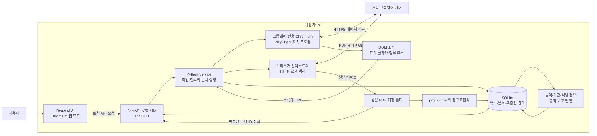
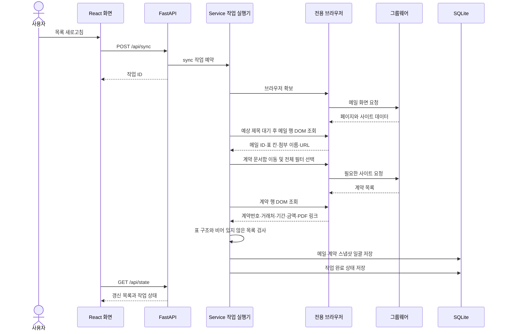
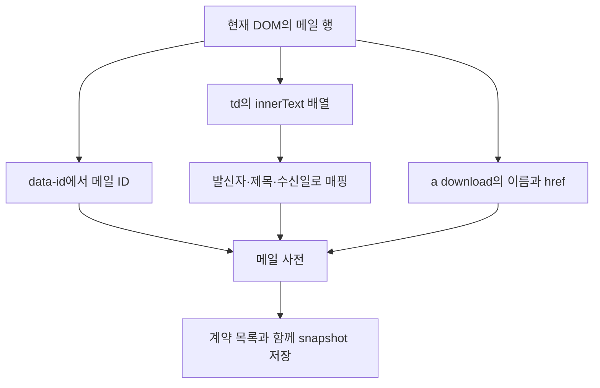
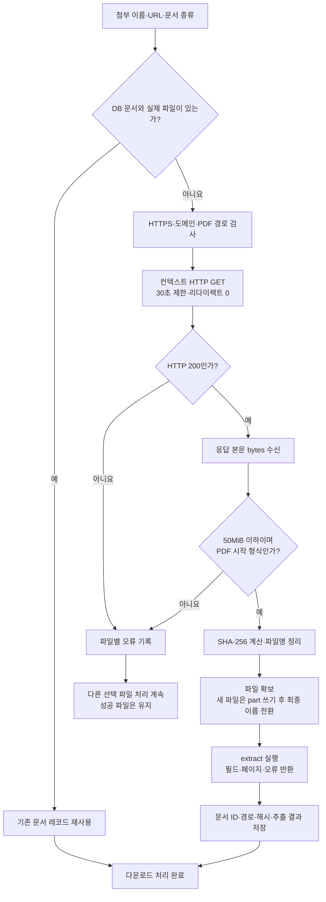
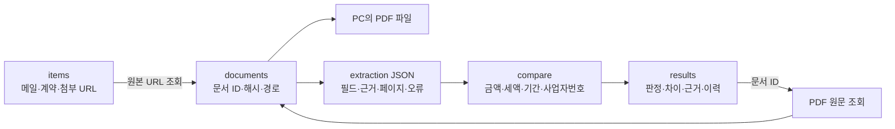
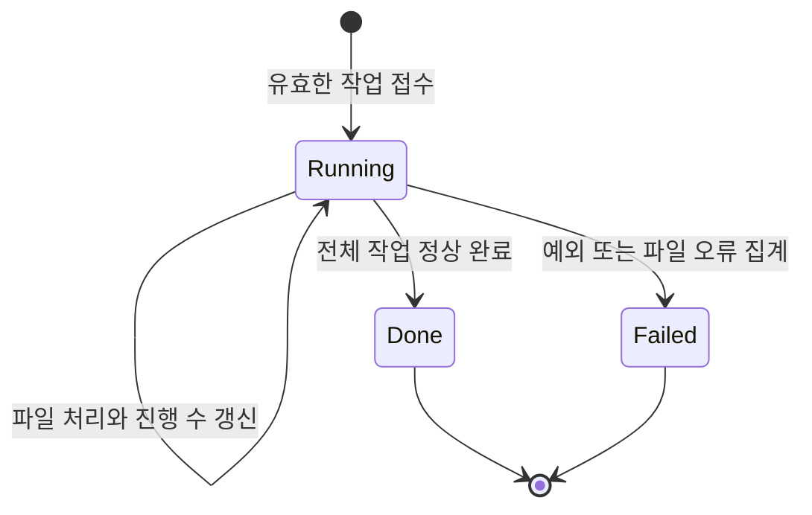
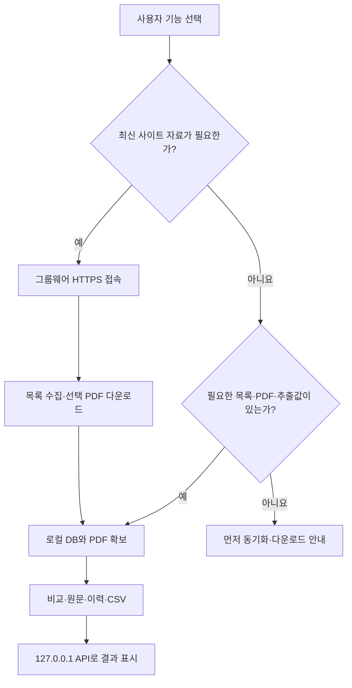

# AI 연결 없이 웹 텍스트를 수집하고 PDF를 다운로드하는 동작 원리

- 작성일: 2026-10-21
- 대상 프로그램: 새봄 문서비교
- 프로젝트: `D:\ChaAI\07_auto`
- 작성 기준: 현재 로컬 소스의 실행 코드와 함수 기능명세
- 문서 범위: 사이트 접근, DOM 텍스트·첨부 링크 수집, 로그인 세션 재사용, HTTP 다운로드, 파일 검증·저장, PDF 텍스트 추출, 로컬 비교

> 이 문서의 Mermaid 블록은 구조도와 처리 흐름의 원본입니다. Mermaid를 지원하는 Markdown 뷰어에서 다이어그램으로 볼 수 있습니다. 이 문서는 현재 구현을 설명하며 개선 아이디어는 별도로 구분합니다.

## 1. 핵심 처리 방식

프로그램은 브라우저 자동화와 HTTP 통신, PDF 텍스트 라이브러리를 조합합니다. AI 모델에 페이지나 문서를 보내 판단을 요청하는 과정은 없습니다.

처리는 다음 세 단계로 나뉩니다.

| 단계 | 입력 | 기술 | 출력 |
|---|---|---|---|
| 웹 목록 수집 | 브라우저에 열린 그룹웨어 화면 | Playwright, DOM 선택자, JavaScript | 메일·계약 목록과 첨부 URL |
| 파일 다운로드 | 선택 문서의 첨부 URL | Playwright APIRequestContext의 HTTP GET | PDF 원본 바이트와 저장 파일 |
| PDF 판독 | PC에 저장된 PDF | pdfplumber, Python 정규표현식 | 금액·사업자번호·날짜·원문 근거 |

웹페이지의 글자는 HTML 요소에서 가져오고, 파일은 URL로 요청해 받으며, PDF 내부의 값은 별도 추출 규칙으로 읽습니다. 세 작업은 서로 다른 기능입니다.

## 2. 전체 시스템 구조



화면용 브라우저와 그룹웨어 자동화용 브라우저는 별도 컨텍스트입니다. 화면용은 PC 내부 서버를 표시하고, 자동화용은 외부 그룹웨어에 접속합니다.

## 3. 기술과 역할

| 기술                          | 이 프로그램에서의 역할                   |
| --------------------------- | ------------------------------ |
| Python                      | 작업 실행, 응답 바이트 처리, 파일 저장, 추출·비교 |
| Playwright                  | 브라우저 실행·화면 이동·요소 대기·DOM 조회     |
| Chromium                    | 사이트 JavaScript 실행과 DOM 구성      |
| CSS 선택자                     | 특정 메일 행·계약 행·첨부 링크를 식별         |
| JavaScript `evaluate_all()` | 브라우저 안에서 요소를 배열·객체로 변환         |
| HTTP GET                    | 첨부 URL의 PDF 데이터 요청             |
| 브라우저 프로필·쿠키                 | 사이트 세션을 유지하고 파일 요청에 연결         |
| SHA-256                     | 받은 파일 내용의 식별값 생성과 이동 전후 검증     |
| pathlib·파일 입출력              | 저장 경로 생성, 임시 파일 쓰기, 최종 파일 전환   |
| pdfplumber                  | PDF 페이지에서 텍스트 추출               |
| Python `re`                 | 현재 문서 양식에 맞는 값 검색              |
| SQLite                      | 목록·문서 경로·해시·추출값·비교 이력 저장       |
| PDF.js                      | 저장된 원문을 화면에 표시. 텍스트 비교 엔진과는 별개 |

프로그램은 메일 서버에 IMAP으로 접속하거나 Gmail API로 메일을 읽는 구조가 아닙니다. 현재 새봄 그룹웨어의 웹 화면과 그 화면에 등록된 첨부 링크를 사용합니다.

## 4. 관련 파일과 핵심 함수

| 파일·함수 | 입력 | 출력·책임 |
|---|---|---|
| `saebom/api.py`의 `sync()` | 사용자 목록 갱신 요청 | 목록 동기화 작업 ID |
| `saebom/api.py`의 `download()` | 선택 메일·계약 연결 목록 | 다운로드 작업 ID |
| `Service.browser()` | 기존 브라우저 상태·프로필 위치 | 사용 가능한 Playwright 페이지 |
| `Service.sync()` | 작업 ID | 사이트 목록을 추출하여 DB에 저장 |
| `Service.catalog()` | 저장된 목록·문서 | 파일 상태와 추천 계약을 포함한 화면 데이터 |
| `Service.validate_pairs()` | 메일 ID·계약 ID·계산서 URL | 검증된 메일·계약 사전 또는 오류 |
| `allowed_url()` | 다운로드 URL | 허용된 URL 또는 오류 |
| `Service.download()` | 작업 ID·선택 연결 | URL 중복 제거 후 파일별 저장·오류 집계 |
| `Service.download_one()` | 첨부 이름·URL·문서 종류 | 다운로드·추출·등록된 문서 레코드 |
| `extract()` | 로컬 PDF 경로·문서 종류 | 필드·페이지 텍스트·오류 사전 |
| `Store.snapshot()` | 메일 목록·계약 목록 | 최신 목록과 동기화 시각 저장 |
| `Store.save_document()` | URL·이름·해시·추출값·경로 | 문서 ID를 보존한 레코드 저장 |
| `Service.run_compare()` | 저장 문서 연결·보정값 | 로컬 비교 결과 이력 저장 |

함수 구현은 [service.py](saebom/service.py), [compare.py](saebom/compare.py), [store.py](saebom/store.py), [api.py](saebom/api.py)를 참조합니다. 코드 안에도 목적·입출력·처리·오류·부수효과 명세를 넣었습니다.

## 5. 목록 갱신 요청부터 저장까지

사용자가 **목록 새로고침**을 누르면 로컬 API가 작업을 접수합니다. 실제 사이트 접근은 단일 작업 실행기에서 처리하고, 화면은 작업 상태를 주기적으로 조회합니다.



메일과 계약 목록을 모두 수집한 뒤 하나의 DB 트랜잭션으로 갱신합니다. 목록이 비어 있거나 계약 표의 열 수가 맞지 않으면 오류로 처리해 기존 목록을 유지합니다.

## 6. 웹 텍스트를 읽는 구체적인 알고리즘

### 6.1 사이트 화면 열기와 준비 대기

```python
page.goto(SITE + "#/mail", wait_until="domcontentloaded")
page.locator('#app h2').filter(
    has_text="받은 메일함"
).wait_for(timeout=30000)
```

`domcontentloaded` 단계 이후 예상 제목을 기다립니다. 브라우저는 사이트의 JavaScript를 실행할 수 있으므로 JavaScript로 만들어진 화면 요소도 조회 대상이 됩니다.

현재 대기 조건은 제목·필터 등 특정 요소의 존재입니다. 모든 종류의 지연 로딩·페이지 나누기·가상 스크롤 완료를 자동 보장하는 범용 수집기는 아닙니다.

### 6.2 CSS 선택자로 행 찾기

```python
page.locator('tr[data-testid="mail-row"]')
```

| 표현 | 의미 |
|---|---|
| `tr` | HTML 표의 행 |
| `[data-testid="mail-row"]` | 해당 속성과 값을 가진 요소 |
| `td` | 행 안의 표 칸 |
| `a[download]` | 다운로드 속성이 있는 링크 |

아래 HTML은 동작 설명용 예시입니다.

```html
<tr data-testid="mail-row" data-id="M-10">
  <td>바른회선 담당자</td>
  <td>9월 세금계산서</td>
  <td>2026-10-08</td>
  <td>
    <a href="/files/invoice.pdf" download="세금계산서.pdf">첨부파일</a>
  </td>
</tr>
```

이 경우 ID·발신자·제목·날짜·첨부 이름·주소는 이미 HTML 요소와 속성에 들어 있습니다. 화면 캡처에서 글자를 인식할 필요가 없습니다.

### 6.3 브라우저 안에서 JavaScript 실행

실제 수집 코드의 핵심 형태는 다음과 같습니다.

```javascript
rows => rows.map(r => ({
  id: r.dataset.id,
  cells: [...r.querySelectorAll('td')].map(c => c.innerText),
  attachments: [...r.querySelectorAll('a[download]')].map(a => ({
    name: a.getAttribute('download'),
    url: a.href
  }))
}))
```

- `dataset.id`: `data-id` 속성에서 메일 ID 조회.
- `querySelectorAll('td')`: 행의 표 칸 수집.
- `innerText`: 표 칸의 텍스트 조회.
- `getAttribute('download')`: 첨부파일 이름 조회.
- `href`: 브라우저가 해석한 링크 주소 조회.
- `map()`: 요소 배열을 필요한 데이터 배열로 변환.

Playwright의 `evaluate_all()`이 선택된 요소들을 이 JavaScript 함수에 전달합니다. 함수 결과는 배열·문자열·객체로 구성되어 Python에서 사용할 수 있는 데이터로 반환됩니다.

### 6.4 Python 업무 데이터로 매핑

```python
mail_items.append({
    "id": m["id"],
    "sender": cells[0],
    "subject": cells[1],
    "received": cells[2],
    "attachments": m["attachments"]
})
```

계약 목록은 계약번호·종류·거래처·계약명·기간·금액 표시·PDF 링크로 매핑합니다. 현재 계약 표는 열 7개를 전제로 검사합니다.



목록에 보이는 금액 문자열은 계약 선택을 돕는 정보입니다. 비교 엔진이 사용하는 계약 금액은 다운로드한 PDF에서 별도로 추출합니다.

## 7. 로그인 세션을 다운로드에 연결하는 방법

### 7.1 지속 브라우저 프로필

```python
self.context = self.pw.chromium.launch_persistent_context(
    str(self.store.root / "browser-profile"),
    headless=False,
    accept_downloads=True,
    viewport={"width": 1280, "height": 860}
)
```

프로그램은 사이트용 브라우저 프로필을 별도 폴더에 유지합니다. 사이트 로그인이 필요하면 사용자가 이 브라우저에서 진행합니다. 프로필을 재사용하므로 사이트가 유효하게 인정하는 쿠키 등 브라우저 상태를 다음 접근에서도 사용할 수 있습니다.

### 7.2 동일 컨텍스트의 요청 객체

PDF 요청은 다음 객체를 사용합니다.

```python
self.context.request.get(url)
```

Playwright의 브라우저 컨텍스트에 연결된 APIRequestContext는 그 컨텍스트와 쿠키 저장소를 공유합니다. 쿠키 기반 인증 사이트에서는 파일 URL을 요청할 때도 해당 세션 쿠키가 사용될 수 있습니다.

그룹웨어 로그인과 프로그램 시작 비밀번호는 다른 기능입니다. 프로그램 시작 비밀번호는 로컬 UI·API의 잠금을 풀고, 그룹웨어 로그인은 외부 사이트의 접근 권한을 결정합니다.

현재 코드는 localStorage의 토큰을 직접 읽어 Authorization 헤더로 변환하지 않습니다. 그러한 인증 방식의 사이트에는 별도 처리가 필요합니다.

## 8. 선택 문서 검증과 URL 제한

사용자가 선택한 한 건의 연결 관계는 다음 형식입니다.

```json
{
  "mail_id": "M-10",
  "contract_id": "C-2026-019",
  "invoice_url": "https://sbgw.vercel.app/files/example.pdf"
}
```

위 URL은 설명용 예시입니다. 실제 요청에는 사이트 DOM에서 읽은 첨부 URL을 사용합니다.

`validate_pairs()`는 다음 조건을 확인합니다.

1. 선택 수가 1~500건인지 검사.
2. 메일·계약이 현재 저장 목록에 존재하는지 확인.
3. 연결 계약에 PDF 첨부가 있는지 확인.
4. 선택 계산서 URL이 해당 메일의 실제 PDF 첨부인지 확인.
5. 같은 메일을 한 작업에 중복 선택하지 않았는지 확인.

이후 새 다운로드에서는 `allowed_url()`이 다음을 검사합니다.

```python
u = urlsplit(url)
if (u.scheme != "https"
        or u.netloc != "sbgw.vercel.app"
        or not u.path.lower().endswith(".pdf")):
    raise ValueError(...)
```

지정 HTTPS 도메인과 PDF 경로만 허용합니다. 사이트에 첨부되지 않은 PDF 주소를 프로그램이 임의로 추측해서 요청하는 방식이 아닙니다.

## 9. HTTP GET 다운로드와 응답 검증

### 9.1 파일을 받는 실제 코드

```python
response = self.context.request.get(
    url,
    timeout=30000,
    max_redirects=0
)
if response.status != 200:
    raise ValueError(...)
body = response.body()
```

이는 첨부 URL에 HTTP GET을 보내 응답 본문을 바이트로 받는 동작입니다. 파일 내용의 언어적 의미를 이해할 필요가 없습니다.

| 설정·값 | 현재 의미 |
|---|---|
| `timeout=30000` | 요청 제한시간 30초 |
| `max_redirects=0` | 다른 주소로의 리다이렉트를 따라가지 않음 |
| `response.status` | HTTP 응답 상태. 현재는 200만 정상 처리 |
| `response.body()` | 응답 본문을 bytes로 가져옴 |

### 9.2 PDF 형식·크기 검사

```python
if (len(body) > 50 * 1024 * 1024
        or not body.lstrip().startswith(b"%PDF-")):
    raise ValueError(...)
```

확장자가 PDF여도 서버가 로그인 HTML·오류 페이지를 돌려줄 수 있으므로 응답 내용의 시작 부분을 검사합니다. 현재는 Content-Type만으로 판단하지 않습니다.

- 크기 제한은 50MiB이며 코드의 오류 안내에는 50MB로 표현되어 있습니다.
- `%PDF-`는 파일 시작 형식 검사이며 내부 전체의 무결성 검사는 아닙니다.
- 50MiB 검사는 응답 본문을 받은 뒤 수행합니다. 스트리밍 수신 중 제한 크기에서 즉시 중단하는 구조는 아닙니다.

### 9.3 다운로드 분기와 오류 흐름



다운로드된 파일의 텍스트 판독이 실패해도 `extract()`가 오류 사전을 반환하면 그 정보가 문서 레코드에 저장될 수 있습니다. ‘파일을 받았음’과 ‘자동 비교에 필요한 값을 모두 판독했음’은 같은 상태가 아닙니다. 비교 단계에서 판독 오류와 누락 정보를 다시 판단합니다.

## 10. 파일 저장·해시·재사용

### 10.1 내용 기반 파일 식별

```python
digest = hashlib.sha256(body).hexdigest()
```

전체 SHA-256은 DB에 저장하고 앞 12자리를 파일명에 붙입니다.

```text
사용자가 선택한 폴더/
├─ 세금계산서/
│  └─ 96effa72c2b6_세금계산서_별빛보안_2026-09.pdf
└─ 계약서/
   └─ 해시앞12자리_계약서파일명.pdf
```

SHA-256은 파일 내용을 식별하고 복사 전후 동일성을 검사하는 데 사용합니다. 문서 내용의 뜻을 분석하는 알고리즘은 아닙니다.

### 10.2 파일명과 임시 저장

파일명에서 Windows 금지 문자와 제어문자를 바꾸고 길이·끝 문자도 정리합니다. 새 파일은 다음 순서로 저장합니다.

```python
tmp = path.with_suffix(".part")
tmp.write_bytes(body)
tmp.replace(path)
```

임시 쓰기 중 파일과 최종 파일을 구분합니다. 별도 저장 위치 변경 기능에서는 전체 원본·복사본 해시를 확인한 후 DB 경로를 함께 갱신합니다.

### 10.3 재사용과 실패 후 재시도

기존 URL에 대응하는 문서 레코드가 있고 실제 파일이 있으면 다운로드와 재추출을 생략합니다. 여러 메일이 같은 계약서를 참조하면 파일 목록을 URL 키로 합쳐 중복 요청을 줄입니다.

일부 파일 실패 시 성공 파일은 남겨 두고 파일별 오류를 모읍니다. 재시도하면 존재하는 정상 파일을 재사용할 수 있습니다. 실패 파일을 작업 위치부터 자동 이어받는 바이트 단위 재개 다운로드는 구현되어 있지 않습니다.

현재 캐시는 파일 존재 기준이며 ETag·Last-Modified로 같은 URL의 원격 변경을 탐지하지 않습니다.

## 11. PDF 내부 텍스트와 값 추출

PDF 저장 뒤 `extract(path, kind)`를 호출합니다.

```python
with pdfplumber.open(path) as pdf:
    pages = [
        {"page": n + 1, "text": p.extract_text() or ""}
        for n, p in enumerate(pdf.pages)
    ]
text = "\n".join(p["text"] for p in pages)
```

현재 코드는 페이지 텍스트를 결합하여 정규표현식으로 검색합니다. OCR, 화면 캡처 판독, 범용 표 구조 인식은 사용하지 않습니다.

| 추출 항목 | 대표 규칙 |
|---|---|
| 사업자등록번호 | `\d{3}-\d{2}-\d{5}` |
| 계산서 업체명 | 상호와 성명 사이 문자열 |
| 공급가액·세액 | 작성일자·공급가액·세액 헤더 다음 줄의 날짜·금액 |
| 청구 월 | `(\d{4})년\s*(\d{1,2})월분` |
| 계약 금액 | 월 금 또는 총 금, 숫자, 부가가치세 포함·별도 표현 |
| 계약기간 | 년·월·일부터 년·월·일까지 표현 |

금액은 쉼표를 제거해 정수로 바꿉니다. 각 필드에는 값과 함께 원문·페이지·추출 방법을 저장합니다.

```json
{
  "value": 1200000,
  "quote": "값을 읽은 실제 원문 구간",
  "page": 1,
  "method": "PDF 텍스트·양식 규칙"
}
```

100페이지 초과 문서는 판독을 중단하고, 공백 제거 텍스트가 30자 미만이면 텍스트 판독 불가로 처리합니다. 손상·암호화 등 오류도 결과 사전으로 돌려줍니다. 대부분의 항목 규칙은 첫 매칭을 사용하므로 여러 후보의 의미를 종합하는 신뢰도 평가와는 다릅니다.

## 12. 데이터 저장과 로컬 비교

문서 레코드는 다음 정보를 보관합니다.

| 정보 | 용도 |
|---|---|
| `id` | 원문 조회와 이력 연결에 사용하는 문서 식별자 |
| `source` | 원본 첨부 URL. 기존 문서 재사용의 조회 키 |
| `name` | 원본 파일 이름 |
| `hash` | 전체 SHA-256 |
| `extraction` | 추출 필드·근거·페이지·오류 JSON |
| `disk_path` | 현재 실제 PDF 파일 경로 |



위 연결은 코드의 조회 관계를 나타내며 모든 관계를 DB 외래키로 강제한다는 의미는 아닙니다.

비교 실행은 매번 사이트에 다시 가서 값을 읽지 않습니다. 저장된 추출값을 사용하고 금액·기간 등의 명시적 규칙을 적용합니다. 추출 규칙을 수정해도 이미 저장된 추출값이 저절로 새 규칙으로 바뀌지 않으므로 기존 문서에 대한 재추출 절차가 필요합니다.

## 13. 작업 상태와 화면 갱신

주요 작업은 `ThreadPoolExecutor(max_workers=1)`에서 실행합니다. 동시에 다른 주요 작업을 제출하면 거부하여 사이트 브라우저·파일 작업이 충돌하지 않게 합니다.

작업은 `running`, `done`, `failed`와 완료 수·전체 수·메시지·파일별 오류를 갖습니다. React는 진행 작업이 있으면 약 1초마다, 없으면 약 8초마다 로컬 상태를 조회합니다.



파일 여러 건 중 일부만 실패한 경우 작업 전체 상태는 실패가 될 수 있어도, 이미 정상 저장한 파일을 되돌려 삭제하지 않습니다.

## 14. 인터넷 구간과 로컬 구간

| 기능 | 외부 인터넷 필요 여부 |
|---|---|
| 그룹웨어 페이지 열기·로그인 | 필요 |
| 최신 메일·계약 목록 수집 | 필요 |
| 아직 없는 PDF 다운로드 | 필요 |
| 저장된 PDF 텍스트 추출 | 불필요 |
| 저장된 추출값 비교 | 불필요 |
| 저장된 원문·이력 표시 | 불필요 |
| CSV 생성 | 불필요 |
| React와 FastAPI 통신 | 같은 PC의 루프백 통신 |



다운로드·추출·비교 코드에는 문서를 AI 서비스에 업로드하는 호출이 없습니다. 외부 사이트 자체가 수행하는 네트워크 요청까지 모두 없다는 의미는 아니며, 그룹웨어 페이지를 여는 구간에는 일반적인 사이트 통신이 발생합니다.

## 15. 접근 보호와 실제 보장 범위

- 앱 API는 로컬 실행 세션과 잠금 해제 상태를 검사합니다.
- 브라우저에서 받은 임의 문자열을 파일 경로로 그대로 사용하지 않고 URL·파일명을 검증합니다.
- 문서 원문은 임의 경로 대신 문서 ID로 조회합니다.
- 다운로드 URL을 지정 HTTPS 도메인으로 제한하고 리다이렉트를 허용하지 않습니다.
- 파일 종류 시작 형식과 크기를 확인하고 파일 해시를 기록합니다.

PDF 시작 형식 검사만으로 악성·손상 PDF 전체를 검증하는 구조는 아닙니다. 파일·DB를 앱 자체에서 암호화하는 기능이나 같은 PC 사용자 권한을 가진 다른 프로그램까지 차단하는 기능도 현재 범위에는 없습니다.

## 16. 현재 구현의 제약과 개선 가능한 부분

다음은 현재 기능과 구분되는 확장 검토 항목입니다.

| 현재 구현 | 영향 | 개선 방향 예시 — 아직 구현되지 않음 |
|---|---|---|
| 사이트 DOM 선택자·표 열 위치 고정 | 사이트 개편 시 수집 실패·매핑 오류 가능 | 사이트별 어댑터와 열 이름 기반 매핑 |
| 현재 DOM 행 수집 | 페이지 나누기·가상 스크롤 자료 누락 가능 | 페이지 순회·스크롤 완료 조건 추가 |
| 특정 요소 존재 대기 | 후속 지연 목록 로딩까지 보장하지 않음 | 목록 준비 상태·응답 완료 조건 명시 |
| 쿠키 공유 요청 사용 | 토큰 헤더 인증 사이트는 추가 구현 필요 | 해당 사이트 인증 방식에 맞는 요청 구성 |
| 응답 본문 수신 후 크기 검사 | 큰 응답이 일단 메모리에 올라옴 | 스트리밍·수신 중 상한 검사 |
| 파일 존재 기준 캐시 | 같은 URL의 원격 문서 변경을 자동 탐지하지 않음 | ETag·수정일·강제 갱신 정책 |
| 양식별 정규표현식 | 문서 표현·줄바꿈·순서 변경에 민감 | 양식별 추출기·다중 후보 검증 |
| 다운로드 시 추출값 저장 | 규칙 변경 후 기존 값 자동 재추출 없음 | 재추출 명령·추출 규칙 버전 기록 |
| 실패 파일 재시도 | 바이트 단위 이어받기 미지원 | Range 요청 기반 재개 정책 |

이 확장들은 AI 없이도 구현 가능한 일반적인 수집·파일 처리 기능입니다. 현재 문서가 해당 기능의 구현 완료를 뜻하지는 않습니다.

## 17. 검증과 유지보수 방법

### 17.1 관련 검증 파일

- [tests/test_app.py](tests/test_app.py): 실제 PDF 비교, 필드·근거, 캐시 경로 복구, 접근 보호, 오프라인 처리, 저장 위치 이동 등.
- [scripts/verify_ui.py](scripts/verify_ui.py): 실제 브라우저의 로그인·기업 선택·비교·확대·스크롤·저장 위치 이동.
- [tests/fixtures/README.md](tests/fixtures/README.md): 가상 기업 검증 문서의 출처와 사용 범위.
- [검증결과.md](검증결과.md): 기능 수정 과정의 검증 기록.

2026-10-19의 코드 내부 주석·기능명세 추가 후 pytest 17개 통과, TypeScript 검사 통과를 확인했습니다. 이 문서 작성 과정에서는 프로그램 실행이나 다운로드를 다시 수행하지 않고 소스만 확인했습니다.

### 17.2 수집 실패 시 확인 순서

1. 사이트용 전용 브라우저에서 로그인과 실제 목록 표시를 확인합니다.
2. 메일·계약 DOM 선택자와 표 열 순서가 현재 화면과 일치하는지 확인합니다.
3. 첨부 이름과 URL이 DOM에서 올바르게 수집되는지 확인합니다.
4. HTTP 상태가 200인지, 리다이렉트나 로그인 HTML이 반환되는지 확인합니다.
5. 저장 경로의 권한·파일 존재 여부·문서 레코드를 확인합니다.
6. 파일 다운로드 성공과 텍스트 추출 성공을 구분해 `extraction.error`를 확인합니다.
7. 추출된 페이지 텍스트와 실제 정규표현식의 줄바꿈·표현을 비교합니다.

검증 시 인증 쿠키·실행 토큰을 공개 로그나 저장소에 기록하지 않습니다. 브라우저 통합 검사는 DB와 원본 PDF를 테스트 경로로 복사해 사용자 자료와 분리하도록 작성되어 있습니다.

## 18. 참고 코드와 공식 문서

### 프로젝트 소스

- [saebom/service.py](saebom/service.py): `allowed_url`, `Service.browser`, `sync`, `validate_pairs`, `download_one`, `download`, `run_compare`.
- [saebom/compare.py](saebom/compare.py): `extract`, `norm`, `compare`.
- [saebom/store.py](saebom/store.py): `snapshot`, `document`, `save_document`, `path`.
- [saebom/api.py](saebom/api.py): 접근 보호와 수집·다운로드·원문 조회 엔드포인트.
- [frontend/src/main.tsx](frontend/src/main.tsx): 작업 요청·진행 조회와 PDF 표시.
- [프로그램_기술설계서.md](프로그램_기술설계서.md): 앱 전체 실행·화면·비교·저장 구조.

### 라이브러리 공식 설명

- [Playwright Locator와 evaluate_all](https://playwright.dev/python/docs/api/class-locator#locator-evaluate-all): 선택한 페이지 요소에 대해 JavaScript를 실행하는 기능.
- [Playwright APIRequestContext](https://playwright.dev/python/docs/api/class-apirequestcontext): 브라우저 컨텍스트와 연결된 HTTP 요청 및 쿠키 공유.
- [pdfplumber 공식 저장소](https://github.com/jsvine/pdfplumber): PDF 텍스트·문자·페이지 접근 도구. 이 프로그램은 그중 페이지 텍스트 추출을 사용합니다.
