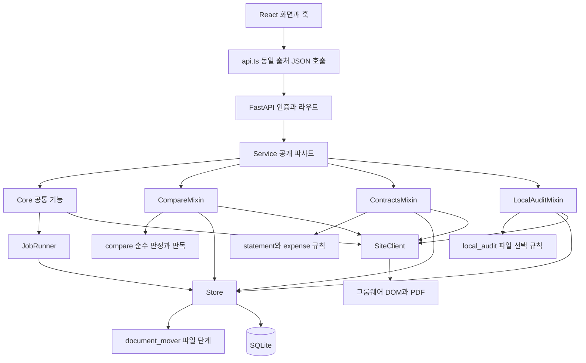
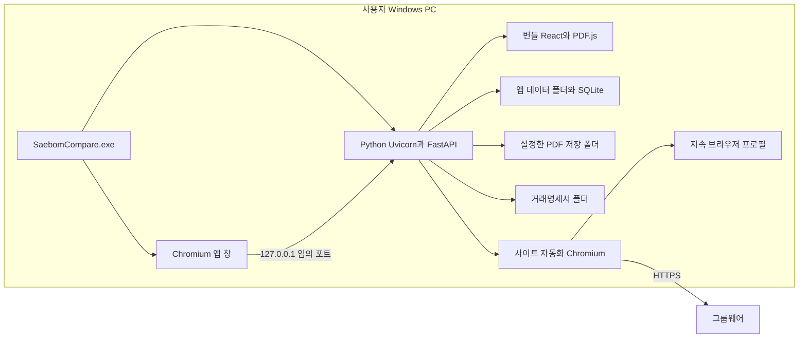

# 새봄 문서비교 아키텍처 설계서

- 기준일: 2026-10-26
- 기준: 리팩토링 1~3단계 최종 소스 직접 확인
- 범위: 논리·물리·배포·스레드·보안 구조와 설계 결정
- 관련: [DB 설계서](03_DB_설계서.md), [인터페이스 정의서](05_인터페이스_정의서.md), [보안 설계서](10_보안_설계서.md)

## 1. 시스템 경계

Windows PC에서 실행하는 Python 서버와 React 정적 화면이다. 그룹웨어의 목록·PDF를 Playwright로 수집하고 pdfplumber로 판독하며, 순수 규칙으로 대조한다. AI API·OCR을 호출하지 않는다. 지출결의서 상신만 그룹웨어에 기안을 만드는 쓰기 작업이다. 거래명세서는 로컬 Excel 파일로 만든다.

| 경계 | 구성 | 코드 근거 |
| --- | --- | --- |
| 로컬 사용자 화면 | Chromium 앱 창, React, PDF.js | `launcher.py:106`, `frontend/src/App.tsx:40` |
| HTTP 경계 | FastAPI, 인증 미들웨어, 기능별 routes | `saebom/api.py:86` |
| 업무 조정 | Service와 기능 믹스인 | `saebom/service.py:31` |
| 작업 실행 | 단일 작업 스레드, 상태 영속화 | `saebom/jobs.py:35` |
| 외부 그룹웨어 | 지속 프로필 Chromium, DOM, PDF 요청 | `saebom/site.py:89` |
| 로컬 저장 | SQLite WAL, PDF, Excel, 브라우저 프로필 | `saebom/store.py:51`, `saebom/statement.py` |

## 2. 논리 구조

라우트는 HTTP 형식과 오류 변환을 맡는다. 비교 보정 검증은 `overrides.py`, CSV 직렬화는 `export.py`로 분리했다. 순수 모듈은 입력 사전으로 계산하고 DB·사이트 상태 변경은 서비스가 조율한다. `ServiceHost`는 믹스인이 기대하는 self 속성의 정적 계약이며 런타임 의존성 주입 프레임워크는 아니다. 근거: `saebom/routes/compare.py:1`, `saebom/services/common.py:41`.

## 3. 물리·배포 구조

| 배포 자산 | 역할·배치 | 근거 |
| --- | --- | --- |
| `dist/SaebomCompare/` | PyInstaller onedir, EXE와 `_internal` 동반 배포 | `scripts/build.py:54` |
| `frontend/dist` | 빌드 정적 화면, `/`에 mount | `saebom/api.py:201` |
| `saebom/assets` | 거래명세서 템플릿을 번들에 포함 | `scripts/build.py:54` |
| Chromium | Playwright 실행 경로의 브라우저 폴더를 번들에 포함 | `scripts/build.py:46` |
| 앱 데이터 루트 | 명시 root → `SAEBOM_DATA_DIR` → LOCALAPPDATA/SaebomCompare | `saebom/store.py:52` |
| `browser-profile` | 사이트 로그인·기안 localStorage 보존 | `saebom/services/core.py:27` |
| `app-profile` | 앱 창 전용 프로필. 사이트 프로필과 별도 | `launcher.py:122` |

빌드는 npm 잠금 설치 → TypeScript·Vite → PDF 자산 복사 → PyInstaller → 라이선스·설명서 → ZIP 순서다. npm은 PATH에서 운영체제에 맞는 이름을 탐색한다. 소스 실행과 EXE 실행은 같은 서버 코드를 사용하되 번들 경로는 `_MEIPASS`로 구분한다. 이번 재개 작업에서 EXE를 재빌드한 것은 아니다. 근거: `scripts/build.py:21`, `scripts/build.py:37`, `saebom/site.py:99`.

## 4. 프로세스·스레드 뷰

| 실행 단위 | 담당 | 수명·제약 | 근거 |
| --- | --- | --- | --- |
| 메인 Python 프로세스 | Mutex, 서버, 종료 조정 | 데이터 루트별 단일 실행 | `launcher.py:37`, `launcher.py:76` |
| 앱 창 데몬 스레드 | Chromium 앱 창·활성화 이벤트 감시 | 창 종료 시 서버 종료 요청 | `launcher.py:106` |
| Uvicorn 이벤트 루프 | 비동기 미들웨어·서버 요청 | lifespan 종료에서 Service·Store 정리 | `saebom/api.py:102` |
| FastAPI 스레드풀 | 동기 라우트 | Tk 폴더창도 여기서 실행될 수 있음 | `saebom/api.py:60` |
| site-worker 1개 | 수집·다운로드·대조·상신 | 실행 작업 하나, 브라우저 정리도 같은 실행기에 예약 | `saebom/jobs.py:37`, `saebom/jobs.py:155` |

`JobRunner.lock`은 접수와 작업 상태를 보호한다. `Store.lock`은 SQLite 연결을 보호하며 `check_same_thread=False`를 사용한다. `exclusive`는 설정 이동·거래명세서 생성 중 새 작업 접수를 막는 표시를 설정하고 블록 실행 동안 실행기 잠금을 계속 잡지 않는다. Store의 파일 이동은 별도 Store 잠금 범위를 가지므로 DB 조회 지연은 별개다. 근거: `saebom/jobs.py:135`, `saebom/store.py:55`, `saebom/store.py:330`.

작업 제한시간이나 강제 중단은 없다. 단계 사이 종료 플래그를 확인하지만 지출결의서 상신 이후에는 중단하지 않는다. `close()`는 실행기 종료를 기다리므로 멈춘 외부 호출이 종료를 지연할 수 있다. 근거: `saebom/services/core.py:146`, `saebom/services/contracts_service.py:171`, `saebom/jobs.py:155`.

## 5. 보안 뷰

| 방어 계층 | 구현 | 근거 |
| --- | --- | --- |
| 네트워크 노출 제한 | 서버를 127.0.0.1 임의 포트에 바인딩 | `launcher.py:79` |
| Host·Origin | Host는 127.0.0.1, Origin은 현재 로컬 출처만 허용 | `saebom/api.py:119` |
| 실행 세션 | 최초 URL 토큰을 HttpOnly·SameSite strict 쿠키로 교환 | `saebom/api.py:128` |
| 비밀번호 잠금 | 실행별 잠금 해제 쿠키, 5회 실패 후 30초 잠금 | `saebom/api.py:178`, `saebom/config.py:31` |
| 다운로드 경계 | 고정 사이트 HTTPS PDF URL, 크기·서명 검사 | `saebom/site.py:32`, `saebom/site.py:46` |
| 브라우저 정책 | CSP, no-store, nosniff, no-referrer | `saebom/api.py:139` |

URL·DOM 검증과 로컬 잠금은 사용자 PC 자체의 악성 프로세스를 격리하지 않는다. `instance.json`에는 실행 토큰이 있고 브라우저 프로필에는 로그인 상태가 남으므로 앱 데이터도 보호 대상이다. 비밀값을 개발문서·위키에 기록하지 않는다.

## 6. 설계 결정과 품질 속성

| 결정 | 선택과 이유 | 품질·한계 | 근거 |
| --- | --- | --- | --- |
| ADR-01 로컬 배포 | Python·Chromium을 폴더형 EXE에 포함 | 사용자 설치 절차 단순화, 번들 크기 증가 | `scripts/build.py:54` |
| ADR-02 작업 직렬화 | 주요 작업 단일 실행 | Playwright 수명·진행 상태 단순화, 동시 처리 없음 | `saebom/jobs.py:78` |
| ADR-03 Store 파사드 유지 | 이동 파일 단계만 분리 | 기존 호출 계약 보존 | `saebom/store.py:330`, `saebom/document_mover.py:26` |
| ADR-04 결과 요약 열 | `results.summary` 저장, 옛 행 지연 보충 | 목록 성능 개선, 첫 옛 행 조회는 data 읽음 | `saebom/store.py:415` |
| ADR-05 상신 불확실성 보존 | 상태 없음 + `site_draft` | 이전 성공 오인 방지, 사이트 확인 후 재상신 필요 | `saebom/services/contracts_service.py:171` |
| ADR-06 판정 정책 유지 | 총액 계약 period 확인 필요 | 사용자 검토 필요, 자동 일치로 바꾸지 않음 | `saebom/compare.py`, 승인 계획의 판정 불변 원칙 |
| ADR-07 설정 덮어쓰기 | 자사번호·제목 접두어 환경변수, 기본값 유지 | 사이트 URL은 고정 보안 경계로 유지 | `saebom/config.py:20` |

결과 JSON 안의 문서 사본 중복, 절대 `disk_path` 이관, 전역 로그인 실패 누적 정책, Tk 비메인 스레드 호출은 남은 개선 과제다. 상세 시험·제외 범위는 [리팩토링 결과보고서](14_리팩토링_결과보고서.md)를 따른다.
