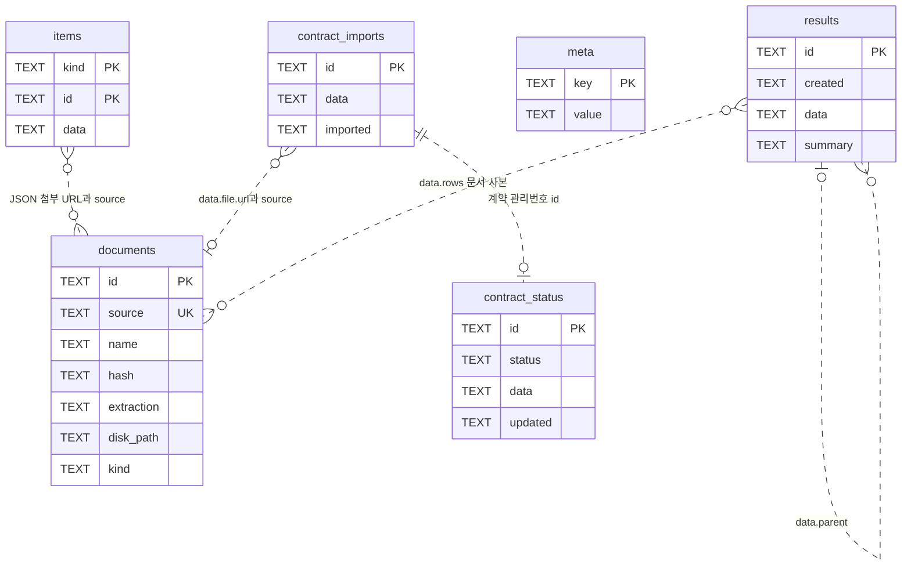

# 03. DB 설계서

- 기준일: 2026-10-26
- 기준: 리팩토링 후 `saebom/store.py`와 저장 호출부를 직접 확인한 구현 명세
- 관련: [API 명세서](04_API_명세서.md), [시퀀스 다이어그램](07_시퀀스_다이어그램.md)

## 1. 저장소와 설계 원칙

DB는 SQLite `saebom.sqlite3` 한 개이며 `journal_mode=WAL`, `check_same_thread=False`로 연다. 앱 데이터 루트는 명시적 `Store(root)` → `SAEBOM_DATA_DIR` → `LOCALAPPDATA/SaebomCompare` 순서다. `LOCALAPPDATA`가 없으면 사용자 홈 아래를 쓴다. `Store`의 재진입 잠금 `threading.RLock`으로 공유 연결 접근을 보호한다. 근거: `saebom/store.py:51`.

6개 테이블, 23개 열을 사용한다. 모든 열의 선언형은 `TEXT`이고 JSON도 TEXT 안에 저장한다. 선언된 외래 키·CHECK·NOT NULL·열 기본값은 없다. SQLite 일반 테이블의 TEXT PRIMARY KEY는 명시적인 NOT NULL과 같지 않다. 앱은 ID·상태·JSON을 작성하는 메서드로 유효성을 관리하며 DB 차원의 참조 무결성은 보장하지 않는다. 근거: `saebom/store.py:61`, `saebom/store.py:177`.

## 2. ERD

아래 실선/점선 관계는 **논리 참조**다. 실제 FOREIGN KEY가 아니다. `documents.source`는 URL, `contract_imports.id`와 `contract_status.id`는 사이트 관리번호다. 결과의 문서 참조·부모 ID·메일 ID는 JSON 안에 들어 있다.

결과 이력은 당시 문서 사본까지 저장한다. 원문 파일 열기는 사본의 ID로 현재 `documents` 행을 다시 조회하므로 저장 위치 변경 후에도 과거 결과에서 원문을 열 수 있다. 근거: `saebom/store.py:292`, `saebom/services/compare_service.py:167`.

## 3. 테이블 정의

### 3.1 items — 마지막 사이트 목록 스냅샷

| 열 | 형·제약 | 값과 용도 |
|---|---|---|
| kind | TEXT, 복합 PK 1 | `mails` 또는 `contracts` |
| id | TEXT, 복합 PK 2 | 메일 ID 또는 계약 관리번호 |
| data | TEXT | 메일/계약 행 JSON |

`snapshot(mails, contracts)`는 한 트랜잭션에서 `items` 전체 삭제 → 두 목록 삽입 → `meta.synced` 갱신한다. 중간 실패는 롤백하며 원본 PDF·결과·가져온 계약 목록을 지우지 않는다. `items(kind)`에는 ORDER BY가 없고, 화면용 정렬은 서비스가 수행한다. 근거: `saebom/store.py:85`, `saebom/store.py:99`, `saebom/services/compare_service.py:46`.

메일 JSON은 `id, subject, sender, received, attachments:[{name,url}]`를 포함한다. 계약 JSON은 `id, kind, partner, title, period, amount_text, file:{name,url}|null`이다. 원본 사이트 행에서 읽은 표시 문자열을 보관하며 금액은 별도 PDF 추출값을 사용한다. 근거: `saebom/site.py:157`, `saebom/site.py:171`, `saebom/site.py:238`.

### 3.2 documents — PDF와 추출 결과

| 열 | 형·제약 | 값과 용도 |
|---|---|---|
| id | TEXT, PK | 신규 문서는 UUID hex; 동일 source 재저장 시 유지 |
| source | TEXT, UNIQUE | 원본 URL; 일괄 조회·재사용 키 |
| name | TEXT | 원본 첨부 이름 |
| hash | TEXT | PDF 바이트 SHA-256 hex |
| extraction | TEXT | `{pages,fields,error}` JSON |
| disk_path | TEXT | 원본 PDF 파일 경로; 옛 행은 NULL 가능 |
| kind | TEXT | `invoice` 또는 `contract`; 옛 행은 NULL 가능 |

`save_document`는 열 이름을 명시한 INSERT OR REPLACE다. `kind=None`이면 기존 값을 유지하며 값 자체를 검사하지 않는다. `set_document_kind`는 NULL/빈 문자열인 행만 채운다. `source`가 같고 파일이 있으면 다운로드·재추출을 생략하고 종류만 보완한다. 원격 URL의 내용 변경은 자동 감지하지 않는다. 근거: `saebom/store.py:262`, `saebom/store.py:279`, `saebom/services/core.py:183`.

추출 필드는 `{value,quote,page,method}` 구조다. `value`는 필드에 따라 문자열·정수·목록이고, `quote/page`는 원문 근거다. `pages`는 페이지별 텍스트이며, 추출 오류는 `error`에 보관한다. 공급가액·세액·합계, 사업자번호·상호·청구월, 계약 금액·VAT 조건·기준·기간·분할 비율·지급 조건 등이 들어간다. 보정된 결과 사본의 필드는 `previous`를 추가할 수 있다. 근거: `saebom/compare.py:55`, `saebom/compare.py:97`, `saebom/compare.py:127`, `saebom/services/compare_service.py:167`.

HTTP 목록·상세 응답에서는 `extraction.pages`를 빈 배열로 바꾼 사본을 제공한다. DB 원문을 삭제하는 것은 아니다. 근거: `saebom/views.py:15`, `saebom/views.py:31`.

### 3.3 results — 변경하지 않는 비교 이력

| 열 | 형·제약 | 값과 용도 |
|---|---|---|
| id | TEXT, PK | 결과 UUID hex |
| created | TEXT | 시스템 로컬 시간대 오프셋을 포함한 ISO 8601, 초 단위 |
| data | TEXT | 결과 전체 JSON |
| summary | TEXT | 목록용 요약 JSON; 옛 행은 최초 조회 전 NULL |

신규 결과는 `data`·`summary`를 한 INSERT로 저장한다. 조회 순서는 `created DESC,rowid DESC`이며 같은 초의 결과도 저장 역순으로 정렬한다. 수동 보정은 이전 결과를 덮어쓰지 않고 `parent`를 가진 새 결과를 저장한다. 근거: `saebom/store.py:38`, `saebom/store.py:356`, `saebom/store.py:390`, `saebom/routes/compare.py:92`.

| JSON 위치 | 구조 |
|---|---|
| data | `{id,created,parent,rows,pairs,overrides}` |
| pairs[] | `{mail_id,contract_id,invoice_url}` |
| overrides | `{문서ID:{필드명:보정값}}` |
| rows[] | `{mail_id,contract_id,subject,partner,invoice,contract,effective_invoice,status,checks,error}` |
| checks[] | `{key,label,actual,expected,status,difference,note,invoice_source,contract_source}` |
| summary | `{id,created,parent,count,mismatch,partners,mail_ids}` |

`summary.count`는 행 수, `mismatch`는 `status == '불일치'`인 행 수, `partners`는 앞 3개 행의 거래처(중복 제거 없음), `mail_ids`는 전체 행 순서의 메일 ID다. `parent`가 없으면 null이다. 근거: `saebom/store.py:371`, `saebom/compare.py:200`.

### 3.4 meta — 문자열 설정과 JSON 상태

| 열 | 형·제약 | 값과 용도 |
|---|---|---|
| key | TEXT, PK | 설정/상태 이름 |
| value | TEXT | 아래 키별 저장 형식 |

| 키 | 실제 value 형식 | 읽기·쓰기 계약 |
|---|---|---|
| synced | JSON이 아닌 ISO 시각 문자열 | `snapshot` / `synced` 전용 |
| document_root | JSON이 아닌 경로 문자열 | `_commit_root` / `document_root` 전용 |
| jobs | JSON 객체 `{작업ID:Job}` | `meta_get/meta_set`, JobRunner가 최대 20건 유지 |
| local_invoice_folder | JSON 문자열 `"D:\\자료\\계산서"` | 폴더 검사 후 `meta_set` |
| local_audit | JSON 객체, 마지막 1회 대조 결과 | 전체 대조 완료 후 교체 |

`meta_get`는 JSON 역직렬화를 하므로 `synced`·`document_root`에 사용하면 안 된다. 키 미존재는 None이다. 비밀번호·실행 토큰은 이 테이블에 저장하지 않는다. 근거: `saebom/store.py:111`, `saebom/store.py:123`, `saebom/store.py:135`, `saebom/store.py:306`, `saebom/jobs.py:35`.

`Job = {id,kind,status,message,done,total,errors,created,result_id?}`. 상태는 `running/done/failed`이며 복원 시 `running`을 메모리에서 `failed`로 바꾼다. 복원 변경은 다음 영속화 때 DB에 반영한다. 근거: `saebom/jobs.py:35`, `saebom/jobs.py:78`.

`local_audit = {folder,ran_at,contracts_total,counts,warnings,rows}`. `counts`에는 일치·불일치·확인 필요·계약서 없음·처리 실패 건수가 들어간다. 행은 `{file,type,size,partner,partner_source,invoice,contract,contract_doc,candidates,expected,status,checks,note}`다. `invoice`는 `{fields,error}`, `expected`는 금액 사전 또는 null이다. 이력 누적 테이블은 없다. 근거: `saebom/services/local_audit_service.py:108`, `saebom/local_audit.py:239`, `saebom/local_audit.py:289`.

### 3.5 contract_imports — 가져온 계약 목록

| 열 | 형·제약 | 값과 용도 |
|---|---|---|
| id | TEXT, PK | 사이트 계약 관리번호 |
| data | TEXT | 사이트 계약 행 JSON(items의 계약과 같은 형태) |
| imported | TEXT | 가져온 시각(now) |

PDF 저장·판독에 성공한 계약만 기록한다. 같은 ID 재가져오기는 행과 시각을 갱신한다. `snapshot`이 교체하는 `items`와 분리돼 동기화 후에도 유지된다. 반환 시 `imported`를 JSON에 합치고 관리번호 큰 순으로 정렬한다. 근거: `saebom/store.py:158`, `saebom/store.py:191`, `saebom/services/contracts_service.py:25`.

### 3.6 contract_status — 마지막 지출결의서 상신 결과

| 열 | 형·제약 | 값과 용도 |
|---|---|---|
| id | TEXT, PK | 계약 관리번호 |
| status | TEXT | `없음` 또는 `품의완료`(Store 메서드에서 검사) |
| data | TEXT | approval JSON 또는 SQL NULL |
| updated | TEXT | 마지막 갱신 시각 |

`data`는 `{title,month,supply,vat,total,submitted_at,review,warnings,doc_id?,doc_no?,doc_url?,document_total?,site_draft?,error?}`다. `review[]`는 `{label,actual,expected,ok}`. 사이트 작성본 검토 8항목이 모두 일치해야 `품의완료`다. 상태 행이 없으면 서비스는 `{status:'없음',approval:null}`을 반환한다. 근거: `saebom/store.py:167`, `saebom/store.py:177`, `saebom/services/contracts_service.py:61`, `saebom/expense.py:111`.

상신 실행 시작 시 이전 결과를 `없음`으로 초기화한다. 검토 불일치는 `없음`과 `site_draft:true`를 저장한다. 상신 클릭 이후 오류 `SubmitUncertain`도 `없음`·`site_draft:true`·`error`를 저장한다. 일반 오류는 `없음`·`error`를 저장하며, 실제 작성본이 존재하는지 단정할 수 없다. 이전 `품의완료` 기록은 시작 시 초기화하되 `data.prior_approval`로 보존하며 `품의완료` 저장 때 제거한다. 작성본 수신 뒤 오류는 `site_draft:true`와 `doc_id`·`doc_no`·`doc_url`·`error`를 저장한다. `site_draft`는 상태 enum이 아닌 상세 경고 플래그다. 자동 재상신하지 않고 사이트 확인을 안내한다. 근거: `saebom/services/contracts_service.py:171`, `saebom/site.py:195`.

## 4. 마이그레이션과 요약 채우기

버전 번호 테이블이나 별도 migration 도구는 없다. 시작 시 `CREATE TABLE IF NOT EXISTS` 후 `PRAGMA table_info`로 없는 열만 추가한다.

| 변경 | 적용 방법 | 기존 행 처리 |
|---|---|---|
| documents.disk_path | 없으면 `ALTER TABLE ... ADD COLUMN ... TEXT` | NULL; `root/documents/{hash}.pdf`로 해석 |
| documents.kind | 같은 방식 | NULL 유지; PDF 재사용 시 종류 보완, 이동 시 추측 |
| results.summary | 없으면 TEXT 열 추가 | NULL 유지; 첫 목록 조회에서 채움 |
| contract_imports / contract_status | 없으면 테이블 생성 | 기존 자료를 추정해 채우지 않음 |

근거: `saebom/store.py:61`, `saebom/store.py:68`, `saebom/store.py:292`.

`result_summaries()`는 잠금 안에서 `(id,summary)`만 조회한다. NULL 요약이 있으면 **같은 Store.lock과 한 트랜잭션 안에서** 해당 행의 data를 SELECT → JSON 파싱 → `_summarize` → UPDATE한다. 실패하면 채우기 트랜잭션을 롤백한다. 이미 summary가 있는 행의 JSON 파싱은 잠금 밖에서 한다. 따라서 정상 목록 조회는 큰 data를 읽지 않지만 최초 보완은 큰 JSON 파싱 동안 다른 Store 접근을 기다리게 한다. 빈 문자열·손상 summary는 NULL로 간주하지 않으며 파싱 오류가 전파된다. 근거: `saebom/store.py:415`.

열을 되돌리는 down migration은 없다. 복구는 앱 종료 후 백업 DB와 파일을 함께 되돌리는 운영 절차다. 구버전 프로그램의 열 수 의존 INSERT와의 호환은 별도 확인이 필요하다.

## 5. 잠금·트랜잭션·파일 이동

| 구간 | 보호와 실패 처리 |
|---|---|
| 일반 쓰기 | `with self.lock,self.db`; 실패 시 해당 DB 트랜잭션 롤백 |
| 일반 읽기 | fetch 동안 Store.lock; 많은 JSON 복원은 잠금 밖(일괄 문서 조회는 안쪽) |
| 작업 상태 | JobRunner.lock → Store.meta_set의 Store.lock; 실행기에서 직접 DB 접근 안 함 |
| 저장 위치 변경 | JobRunner.exclusive의 busy 표시로 새 작업 즉시 거절; 실제 파일 이동 전체는 Store.lock 보유 |
| PDF 이동 확정 | 복사·해시 검증 후 모든 disk_path와 document_root를 단일 DB 트랜잭션으로 갱신 |

`exclusive` 본문은 JobRunner.lock을 계속 쥐지 않는다. 그러나 이동 중 Store.lock 때문에 `/api/state` 같은 DB 조회는 지연될 수 있다. 새 작업 접수는 기다리지 않고 400이다. 근거: `saebom/jobs.py:135`, `saebom/store.py:318`, `saebom/store.py:330`, `saebom/routes/system.py:38`.

이동은 경로·쓰기 검사 → 등록 문서 복사와 해시 검증 → DB 일괄 확정 → 이전 복사본 정리 순서다. 확정 전 실패 시 이번 이동이 만든 대상 파일을 지운다. 확정 뒤 이전 파일 정리 실패는 새 설정을 롤백하지 않는다. 기존 DB와 결과 안 절대경로 전체를 재작성하는 것이 아니며, 문서 원문 조회는 ID로 최신 경로를 해석한다. 근거: `saebom/document_mover.py:26`, `saebom/document_mover.py:64`, `saebom/document_mover.py:96`, `saebom/store.py:330`.

## 6. 파일 저장 규칙과 보존 범위

| 자료 | 위치·규칙 |
|---|---|
| DB | 앱 데이터 루트/saebom.sqlite3(WAL 관련 파일 동반 가능) |
| 기본 원본 PDF | 앱 데이터 루트/원본PDF/세금계산서 또는 계약서 |
| 다운로드 파일명 | `{SHA256 앞 12자리}_{safe_name(원래 이름)}`; `.part` 작성 후 교체 |
| 옛 PDF 호환 | 앱 데이터 루트/documents/{전체 SHA256}.pdf |
| 거래명세서 | 현재 document_root/거래명세서/; 새 xlsx 이름으로 저장, 기존 파일 덮어쓰기 방지 |
| 사이트 브라우저 | 앱 데이터 루트/browser-profile |
| 로컬 계산서 폴더 | 사용자가 지정; 원본은 읽기만 수행 |

근거: `saebom/files.py:12`, `saebom/services/core.py:24`, `saebom/services/core.py:183`, `saebom/store.py:292`, `saebom/statement.py:288`.

저장 위치 변경은 DB에 등록된 PDF만 대상으로 한다. 거래명세서 xlsx·브라우저 프로필·DB 자체와 사용자 로컬 계산서 폴더까지 옮기는 기능은 아니다. `results`는 페이지 전문을 포함한 문서 사본을 중복 보관하고 페이지네이션 없이 조회한다. `disk_path` 절대경로의 다른 PC 이관은 개선 과제다.

판정 코드 `period`의 총액 계약 분할 이행 조건은 항상 `확인 필요`로 남기는 의도된 정책이다. DB 오류·마이그레이션 누락으로 오해하지 않는다. 근거: `saebom/compare.py:240`.
