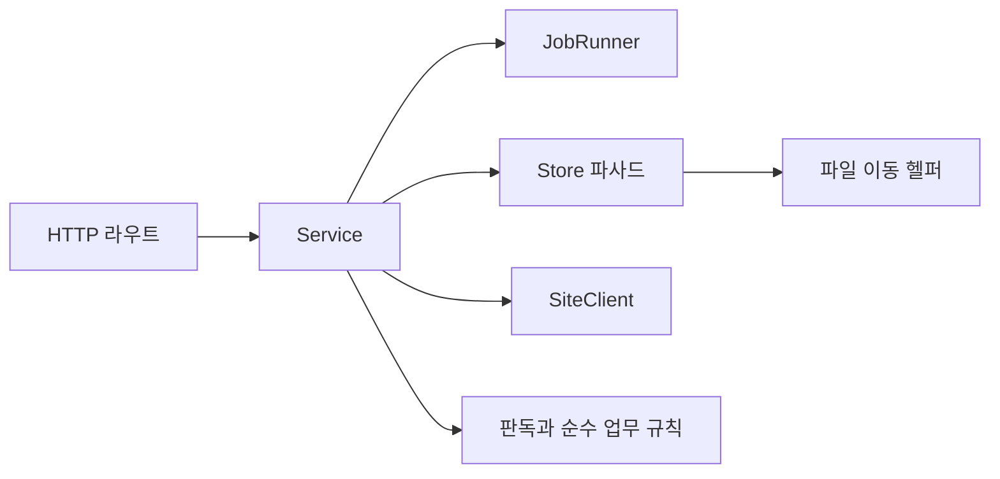

# 새봄 문서비교 인터페이스 정의서

- 기준일: 2026-10-26
- 기준: 최종 서버·프런트 소스 직접 확인
- 관련: HTTP 27개 경로의 상세 요청·응답은 [API 명세서](04_API_명세서.md), 저장 형식은 [DB 설계서](03_DB_설계서.md)
- 표기: 반환형은 현재 실행 코드가 사용하는 사전 구조이며 모든 응답에 별도 Pydantic 응답 모델이 있는 것은 아니다.

## 1. 내부 모듈 호출 경계



### 1.1 Service 파사드

| 호출 계약 | 입력 → 출력 | 규칙·실패·부수효과 | 근거 |
| --- | --- | --- | --- |
| `submit(kind, fn, *args)` | 이름·작업함수 → `{id}` | fn은 `fn(job_id,*args)`. 실행·종료·배타 구간 중 ValueError. 비동기 작업 예약 | `saebom/services/core.py:89` |
| `update(job, **kw)` | ID·진행 필드 → None | 메모리·meta.jobs 저장, 없는 ID KeyError | `saebom/services/core.py:78` |
| `jobs_snapshot()` | 없음 → job[] | 최신순 사본 | `saebom/services/core.py:100` |
| `exclusive(label,message)` | 표시 이름 → context manager | 동기 배타 작업. 진입 충돌 ValueError, finally 해제 | `saebom/services/core.py:111` |
| `sync(job)` | job ID → None | 메일·계약 수집 뒤 목록 교체, 형식 오류면 기존 목록 유지 | `saebom/services/compare_service.py:21` |
| `catalog()` | 없음 → mails·contracts·synced | URL 일괄 조회, pages 빈 배열, 후보·available 보강 | `saebom/services/compare_service.py:46` |
| `validate_pairs(pairs)` | 연결[] → 메일·계약 사전 튜플 | 목록 소속·PDF 첨부·최대 건수 검증 | `saebom/services/compare_service.py:109` |
| `download_one(file,kind)` | `{url,name}`, invoice/contract → document | 파일 존재 시 재사용, 빈 kind만 채움. 없으면 PDF 다운로드·판독·저장 | `saebom/services/core.py:183` |
| `download(job,pairs)` | 작업·연결[] → None | PDF별 실패를 진행 오류로 기록 | `saebom/services/compare_service.py:135` |
| `run_compare(job,pairs,overrides,parent)` | 작업·연결·선택 보정·부모 → None | 기존 판정 함수 호출, 새 결과 저장, job.result_id 기록 | `saebom/services/compare_service.py:167` |
| `get_result(id)` / `list_results()` | ID 또는 없음 → 상세 또는 요약[] | 없는 상세 None, 옛 요약 지연 저장 | `saebom/services/core.py:215`, `saebom/services/core.py:226` |
| `document_file(id)` | 문서 ID → `(Path,name)` 또는 None | 문서·실제 파일 둘 다 있어야 반환 | `saebom/services/core.py:237` |
| `import_contracts(job,kind,limit,only_new)` | 필터·건수·미수집 조건 → 완료 문구 | 가져오기 기록은 PDF 저장 성공 후. 전체 목록 비면 로그인 확인 오류 | `saebom/services/contracts_service.py:25` |
| `contract_catalog()` | 없음 → 가져온 계약 목록 | 문서·상태를 합치고 pages 비움 | `saebom/services/contracts_service.py:61` |
| `statement_draft(id)` / `create_statement(id,values)` | 관리번호·선택 입력 → 초안/생성 결과 | 수입 계약만 생성, 로컬 xlsx 쓰기 | `saebom/services/contracts_service.py:110`, `saebom/services/contracts_service.py:124` |
| `expense_draft(id)` / `submit_expense(id,values)` | 관리번호·선택 입력 → 초안/작업 ID | 지출 여부·월·금액 검증, 업체명은 계약에서 부여 | `saebom/services/contracts_service.py:138`, `saebom/services/contracts_service.py:152` |
| `local_audit_state()` / `set_local_folder(folder)` | 없음/폴더 → 상태/설정 결과 | 로컬 폴더 검사, meta에 설정 저장 | `saebom/services/local_audit_service.py:60`, `saebom/services/local_audit_service.py:89` |
| `run_local_audit(job)` | 작업 ID → 완료 문구 | 로컬 판독 캐시, 웹 계약 확보, 마지막 결과 meta 저장 | `saebom/services/local_audit_service.py:108` |
| `close()` | 없음 → None | 새 작업 접수 차단, 동일 worker에서 브라우저 정리 후 대기 | `saebom/services/core.py:254` |

### 1.2 Store와 JobRunner

| 제공자 | 계약 | 규칙·영향 | 근거 |
| --- | --- | --- | --- |
| Store | `snapshot(mails,contracts)`, `items(kind)` | 최신 목록 교체·조회. contract_imports는 유지 | `saebom/store.py:85` |
| Store | `meta_get(key)`, `meta_set(key,value)` | JSON 값 또는 None. JSON 직렬화·DB 오류 전파 | `saebom/store.py:123`, `saebom/store.py:135` |
| Store | `document(source=...,id=...)` | 둘 중 조회 키 사용, 없으면 None | `saebom/store.py:217` |
| Store | `documents_by_sources(sources)` | URL→document 사전, SQL 900건 단위 분할 | `saebom/store.py:229` |
| Store | `save_document(source,name,digest,extraction,disk_path,kind)` | 원본 URL 기준 저장·갱신, 반환 document | `saebom/store.py:262` |
| Store | `path(doc)`, `document_root()` | 현재 DB 경로 우선, 없으면 해시 기반 구형 경로 | `saebom/store.py:292`, `saebom/store.py:306` |
| Store | `set_document_root(folder)` | 준비→복사·해시→DB 확정→옛 파일 정리. 실패 시 새 파일 정리 | `saebom/store.py:330` |
| Store | `save_result(result)`, `result(id)`, `result_summaries()` | 결과 JSON·요약 분리, 없는 상세 None | `saebom/store.py:356`, `saebom/store.py:402`, `saebom/store.py:415` |
| Store | `save_contract_import(item)`, `contract_imports()` | 관리번호 기준 가져오기 이력 보존 | `saebom/store.py:158`, `saebom/store.py:191` |
| Store | `save_contract_status(id,status,data)`, `contract_statuses()` | 계약별 상태·상신 검토 JSON 갱신·일괄조회 | `saebom/store.py:177`, `saebom/store.py:167` |
| JobRunner | `submit(kind,fn,*args)` | 최대 20개 작업 보존. 동시에 running 1개, 요청은 기다리지 않고 거절 | `saebom/jobs.py:78` |
| JobRunner | `update`, `snapshot`, `exclusive`, `close` | RLock, meta API 사용. 최종 저장 실패 시 메모리 상태라도 완료/실패 전환 | `saebom/jobs.py:66`, `saebom/jobs.py:122`, `saebom/jobs.py:135`, `saebom/jobs.py:155` |

### 1.3 순수 규칙·변환 모듈

| 모듈 | 계약 | 처리 규칙·외부 효과 | 근거 |
| --- | --- | --- | --- |
| compare | `extract(path,kind)` / `compare(invoice,contract)` | 파일 판독과 규칙 판정. 총액 period는 확인 필요 유지 | `saebom/compare.py` |
| contract_utils | `contract_sort_key(id)` | 관리번호 숫자 정렬 키. Store·서비스 공용 | `saebom/contract_utils.py:22` |
| rules | `is_month(value)`, `is_amount(value,upper)`, `spreadsheet_safe(value)` | 유효 월·금액 범위·수식 접두어 방어. bool·부동소수 처리 등은 함수 구현 기준 | `saebom/rules.py:24`, `saebom/rules.py:41`, `saebom/rules.py:52` |
| overrides | `validate_overrides(result,overrides)`, `merge_overrides(...)` | 문서 소속·허용 필드·범위 확인 후 기존 보정과 병합 | `saebom/overrides.py:25`, `saebom/overrides.py:47` |
| views | `strip_doc_pages(doc)`, `strip_result_pages(result)` | 입력을 수정하지 않는 응답용 사본, pages=[] | `saebom/views.py:15`, `saebom/views.py:31` |
| export | `result_csv(result)` | Excel 호환 CSV 직렬화, 수식 방어. 디스크 저장 없음 | `saebom/export.py:23` |
| statement | `draft`, `validate`, `build` | 초안·입력 확인·템플릿 기반 xlsx 생성. build는 파일 쓰기 | `saebom/statement.py` |
| expense | `draft`, `validate`, `parse_document`, `review` | 금액 검산·작성본 검토. 사이트 접속은 하지 않음 | `saebom/expense.py` |
| document_mover | `prepare_root`, `kind_folder`, `copy_document`, `remove_old_copies` | DB 미접근, 파일시스템 검사·복사·정리 | `saebom/document_mover.py:26`, `saebom/document_mover.py:64` |

## 2. 프런트↔서버 계약

| 구간 | 송수신 규약 | 근거 |
| --- | --- | --- |
| `api<T>(path,body?,method)` | `/api/` 접두어. body 없으면 GET, 있으면 JSON·기본 POST. T는 TypeScript 기대형이며 런타임 검증기가 아님 | `frontend/src/api.ts:62` |
| HTTP 실패 | detail 문자열을 Error로 변환, 구조화 422 detail은 일반 입력 안내 | `frontend/src/api.ts:79` |
| 인증 만료 | auth 외 401 시 `saebom:unauthorized` 1회 이벤트, AccessGate 복귀. 로그인 성공 때 플래그 초기화 | `frontend/src/api.ts:72` |
| 서버 종료 | fetch 실패를 한글 연결 안내로 변환 | `frontend/src/api.ts:70` |
| 작업 접수 | `{id}`를 받고 `/api/state` jobs를 조회, 완료 후 해당 화면 재조회 | `saebom/jobs.py:78`, `frontend/src/hooks/useAppState.ts` |
| 파일 응답 | PDF·CSV·xlsx는 JSON helper 대신 URL·다운로드 응답 사용 | `saebom/routes/compare.py`, `saebom/routes/contracts.py` |

요청 모델은 구조·길이·enum을 422로, 업무 규칙은 보통 ValueError의 400으로 구분한다. Work.pairs는 1~500개, ImportContracts.kind는 전체/수입/지출, ExpenseRequest의 세 금액은 StrictInt다. 근거: `saebom/api_models.py:17`, `saebom/api_models.py:36`, `saebom/api_models.py:76`.

## 3. 외부 연동 계약

| 경계 | 입력·출력 | 실패·부수효과 | 근거 |
| --- | --- | --- | --- |
| Playwright 생성 | profile_dir → persistent context·Page | headed Chromium, 기본 timeout 15초, 프로필 저장 | `saebom/site.py:89` |
| 메일 DOM | `data-testid=mail-row`, data-id, td, a[download] → 메일 항목 | 셀 3개 미만 ValueError, DOM 변경·시간초과 전파 | `saebom/site.py:157`, `saebom/site.py:238` |
| 계약 DOM | contract-filter·contract-row → 계약 항목 | 정확히 7열, 구분 선택·페이지 이동 | `saebom/site.py:171` |
| PDF 요청 | HTTPS 고정 호스트 `.pdf` URL → bytes | HTTP 200·50MiB·`%PDF-` 검사, max_redirects=0으로 리다이렉트 금지 | `saebom/site.py:32`, `saebom/site.py:62` |
| 기안 입력 | 관리번호·검증값 → 작성본 DOM 사전 | f-form/f-title/f-contract/f-month/f-supply/f-vat/f-total/f-note, attachments, submit | `saebom/site.py:195` |
| 상신 결과 | doc-title/doc-amount/doc-content → 문서번호·URL·원문 | 클릭 후 판독 실패 SubmitUncertain, 사이트 폼 오류 ValueError. 자동 재상신 없음 | `saebom/site.py:218` |
| 폴더 선택 | title·initialdir → 문자열/None | Tk 숨김창·최상단, finally 파괴. 동기 라우트 스레드풀 호출의 알려진 한계 | `saebom/api.py:67` |
| Windows Mutex | 데이터 루트 경로 → 핸들·중복 여부 | 데이터 루트 해시별 단일 실행, 기존 instance 활성화 | `launcher.py:37`, `launcher.py:53` |
| 빌드 프로세스 | npm·Python 명령 → 정적 화면·EXE·ZIP | check=True 실패 전파. 실사용 EXE를 종료한 후 별도 승인 범위에서 실행 | `scripts/build.py:37` |

그룹웨어 API를 직접 호출하는 대신 화면 DOM을 자동화한다. 선택자와 열 수가 바뀌면 연동 계층을 수정해야 한다. 이 문서 작성에서는 실제 사이트 상신·접속을 새로 검증하지 않았다.

## 4. 데이터 교환 형식

아래는 모든 선택 키를 강제하는 JSON Schema가 아니라 코드에서 사용하는 논리 스키마다. 전체 열과 JSON 키는 DB 설계서·API 명세서를 따른다.

| 객체 | 필수 중심 키 | 선택·중첩 계약 |
| --- | --- | --- |
| FileRef | `name:string, url:string` | 계약 file은 null 가능 |
| Pair | `mail_id, contract_id, invoice_url` 문자열 | Work의 pairs 배열 |
| Document | `id, source, name, hash, extraction` | disk_path·kind nullable, available 응답 보강 |
| Extraction | `fields, pages, error` | fields의 값은 `{value,...}`. 응답 pages는 []로 축소 |
| Result | `id, created, rows` | parent·overrides 등 결과 문맥, rows에 문서 사본 포함 |
| Job | `id,kind,status,message,done,total,errors,created` | result_id는 비교 완료 시. status=running/done/failed |
| Approval | `title,month,supply,vat,total,submitted_at,review,warnings` | doc_id/doc_no/doc_url/document_total, error, site_draft |

```json
{
  "status": "없음",
  "approval": {
    "month": "2026-09",
    "review": [],
    "warnings": [],
    "site_draft": true,
    "error": "상신 후 확인 필요"
  }
}
```

예시는 계약 조회 응답의 상태·approval 일부다. `site_draft=true`는 사이트에 기안이 존재하거나 존재할 수 있음을 뜻하며 로컬 품의완료와 같지 않다. Store 내부 contract_status.data가 조회 시 approval로 노출된다. 검토 불일치는 job가 done이어도 계약 상태는 없음이다. 근거: `saebom/services/contracts_service.py:61`, `saebom/services/contracts_service.py:171`.

## 5. 오류·예외 계층

| 예외·상태 | HTTP·작업 표현 | 처리 책임 | 근거 |
| --- | --- | --- | --- |
| BusinessError extends ValueError | 400 `{detail}` | 사용자 수정 가능 오류, 일반 예외 로그 생략 | `saebom/errors.py:15`, `saebom/api.py:154` |
| 일반 ValueError | 400 `{detail}` + 예외 로그 | 기존 호환 유지, 내부 오류 추적 가능 | `saebom/api.py:154` |
| ContractNotFound extends LookupError | 계약 라우트 404 | 이 예외만 변환. KeyError·IndexError를 404로 숨기지 않음 | `saebom/errors.py:27`, `saebom/routes/contracts.py` |
| SubmitUncertain extends BusinessError | 작업 failed, 상태 없음·site_draft | 서비스가 영속화 후 다시 던져 JobRunner가 기록 | `saebom/errors.py:38`, `saebom/services/contracts_service.py:171` |
| 모델 검증 | 422 | FastAPI/Pydantic | `saebom/api_models.py` |
| 실행·비밀번호 미인증 | 401 | protect/login | `saebom/api.py:119`, `saebom/api.py:178` |
| Host·Origin 거부 | 403 | protect | `saebom/api.py:119` |
| 로그인 잠금 | 429 | login | `saebom/api.py:178` |
| 그 밖의 동기 예외 | 기본 500 | 프레임워크, 업무 오류로 오분류하지 않음 | `saebom/api.py:154` |
| 비동기 작업 예외 | job.failed·message | JobRunner, HTTP 접수 응답과 분리 | `saebom/jobs.py:96` |

오류 식별용 별도 숫자 코드 enum은 없다. HTTP status와 detail 문자열, job.status·message로 구분한다. 상신·파일쓰기·상태 저장은 서로 다른 경계이므로 로컬 실패가 외부 부수효과의 롤백을 뜻하지 않는다.
