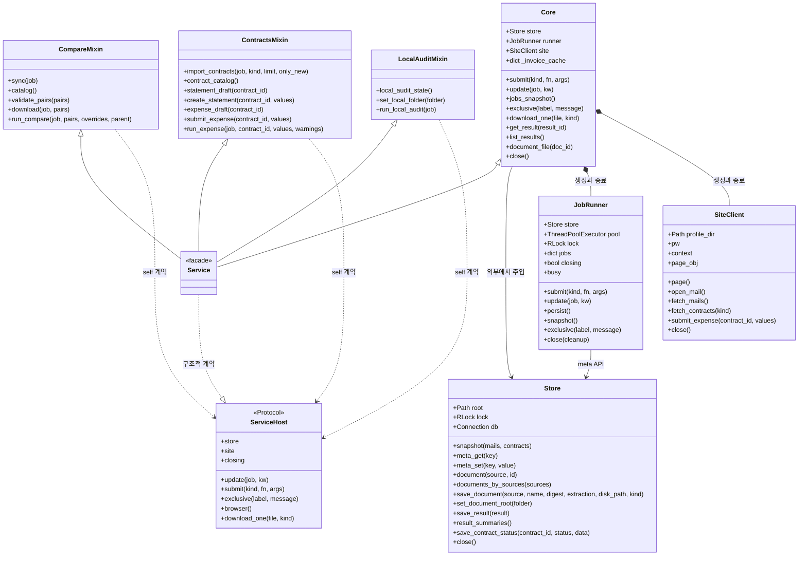
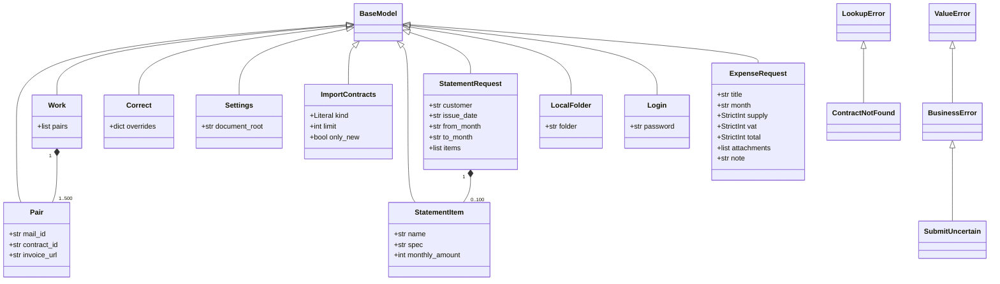
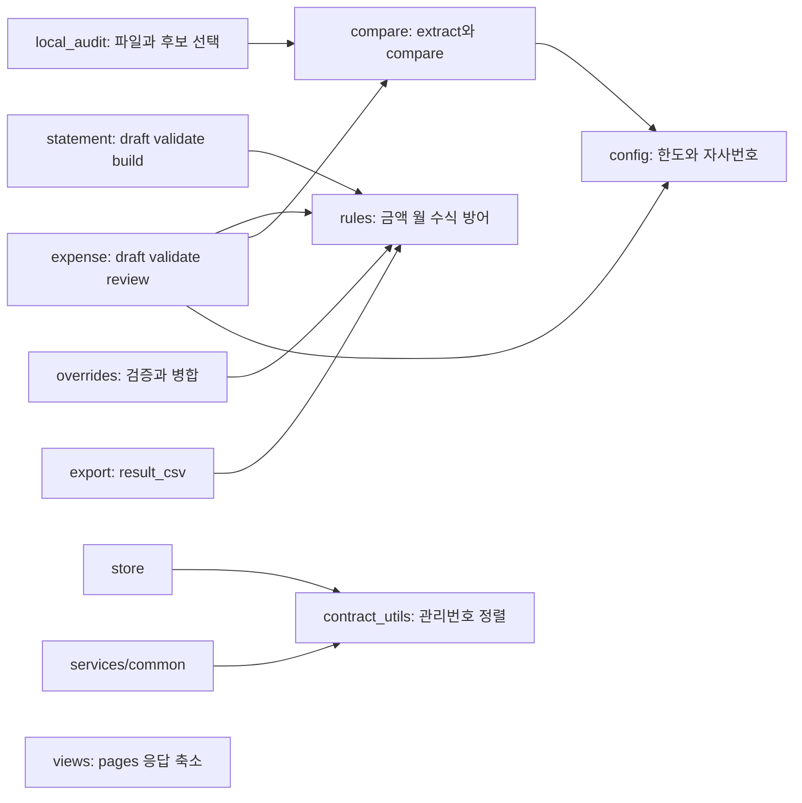
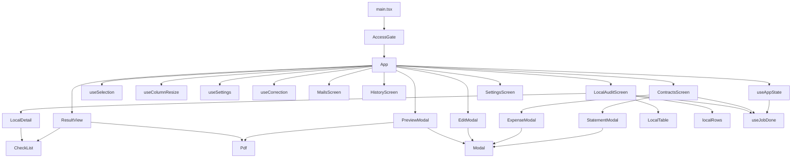
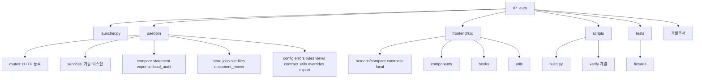

# 새봄 문서비교 클래스·패키지 다이어그램

- 기준일: 2026-10-26
- 기준: 리팩토링 완료 소스의 실제 클래스·import·호출 관계
- 관련: [아키텍처 설계서](02_아키텍처_설계서.md), [인터페이스 정의서](05_인터페이스_정의서.md)
- 표기: Python에 선언된 클래스는 UML classDiagram, 함수 모듈·React 함수 컴포넌트는 별도 관계도로 표현한다. Mermaid 도식의 메서드는 대표 계약만 기재한다.

## 1. 서비스·저장·외부 연동 클래스

| 요소 | 구현·관계 설명 | 근거 |
| --- | --- | --- |
| Service 다중 상속 | Core·CompareMixin·ContractsMixin·LocalAuditMixin 순서 | `saebom/service.py:31` |
| Core 소유 관계 | Store를 전달받고 JobRunner·SiteClient·캐시 잠금을 생성 | `saebom/services/core.py:24` |
| ServiceHost | Protocol 구조적 계약. Service가 명시적으로 상속하는 클래스는 아님 | `saebom/services/common.py:41` |
| Store | SQLite·RLock·root를 소유. DB 종료는 lifespan에서 별도 수행 | `saebom/store.py:51`, `saebom/api.py:102` |
| JobRunner | 스레드 1개, 작업 상태·busy·closing 보관 | `saebom/jobs.py:35` |
| SiteClient | pw/context/page_obj를 지연 생성하고 같은 작업 스레드에서 정리 | `saebom/site.py:78`, `saebom/services/core.py:254` |

Service는 저장소 파사드와 실행기를 조합한다. 믹스인은 독립 인스턴스 사용을 지원하지 않으며 ServiceHost에 적힌 속성이 self에 있어야 한다. 기존 `saebom.service.extract` 등의 재노출은 테스트 대역 주입·호환용이므로 실제 미사용 코드와 구분한다. 근거: `saebom/service.py:1`.

## 2. 요청 모델과 예외 계층

모델 구조·수량은 `saebom/api_models.py:9`부터 정의한다. StatementRequest의 100개는 요청 크기 상한이며 실제 거래명세서 품목 제한 12개는 업무 검증에서 적용한다. 금액·월 업무 검증은 규칙 모듈에서 추가 수행한다. ExpenseRequest에는 partner가 없고 서비스가 계약의 업체명을 강제로 부여한다. 예외 계층은 `saebom/errors.py:15`, `saebom/errors.py:27`, `saebom/errors.py:38`을 따른다.

## 3. 순수 함수 모듈의 의존 관계

compare.norm은 판정 정책의 일부여서 공통 문자열 정규화 함수로 합치지 않았다. `rules.py`는 의미가 같은 금액·월·수식 방어만 공유한다. 파일 판독 extract와 Excel 생성 build는 각각 파일 읽기·쓰기 효과가 있으므로 엄밀한 순수 함수는 아니다. 위 도식의 분류는 업무 규칙 모듈 경계를 나타낸다. 근거: `saebom/rules.py:1`, `saebom/compare.py:55`, `saebom/statement.py:288`.

## 4. React 컴포넌트·훅 관계

| 관계 | 책임 | 근거 |
| --- | --- | --- |
| AccessGate→App | 인증 상태를 확인하고 잠금 해제 후 앱 표시 | `frontend/src/AccessGate.tsx:21` |
| App→훅 | 서버 상태·선택·열 크기·설정·수동 보정 역할 분리 | `frontend/src/App.tsx:54` |
| useJobDone | 완료 작업 중복 처리 방지 공통화 | `frontend/src/hooks/useJobDone.ts:21` |
| Modal | 포털·dialog·Esc·포커스 이동·스크롤 잠금·복귀 공용화 | `frontend/src/components/Modal.tsx:36` |
| local 하위 모듈 | 테이블·상세·행 계산을 화면 조정 코드에서 분리 | `frontend/src/screens/local/LocalAuditScreen.tsx:42` |

이 요소는 TypeScript 함수·훅이므로 백엔드처럼 클래스 상속 관계로 표현하지 않는다. props·반환 객체·상태 수명 상세는 [화면 설계서](08_화면_설계서.md)를 따른다.

## 5. 패키지·폴더 관계

패키지 공개 진입점 `saebom/service.py`와 `saebom/api.py`는 유지한다. 폴더 관계도는 책임 분류이며 Domain·Infra·Shared라는 실제 하위 폴더가 있다는 뜻은 아니다. `scripts/verify_*`는 로컬 회귀용과 실제 사이트 접속·상신용을 구분해서 실행한다.
