# 07. 시퀀스 다이어그램

- 기준일: 2026-10-26
- 기준: 리팩토링 후 실행 코드; 다이어그램은 주요 호출·실패 분기를 추린 논리 흐름
- 관련: [DB 설계서](03_DB_설계서.md), [API 명세서](04_API_명세서.md), [클래스 다이어그램](06_클래스_다이어그램.md)

## 1. 실행 주체와 공통 작업 계약

로컬 HTTP API와 사이트 자동화는 별개다. API는 FastAPI에서 요청을 받고, 주요 작업은 `JobRunner`의 단일 작업 스레드에서 실행한다. 앱 창용 `app-profile`과 그룹웨어 사이트용 `browser-profile`도 별개다. 다이어그램의 Site는 전용 Playwright 브라우저와 그룹웨어를 묶어 표현한다. API의 200 작업 ID 응답은 작업 완료를 뜻하지 않는다. 근거: `launcher.py:106`, `saebom/jobs.py:35`, `saebom/services/core.py:24`.

`Service.submit`은 작업 실행기 위임이며, 실행기는 작업 상태를 `meta.jobs`에 저장한다. 화면은 `/api/state`를 다시 읽어 완료를 확인하고 비교 결과·가져온 계약·로컬 대조 결과를 해당 API로 조회한다. 아래 비동기 다이어그램의 200 반환과 작업 시작은 실제로 경쟁할 수 있다. 근거: `saebom/jobs.py:78`, `saebom/services/core.py:89`.

## 2. 시작·중복 실행·잠금 해제

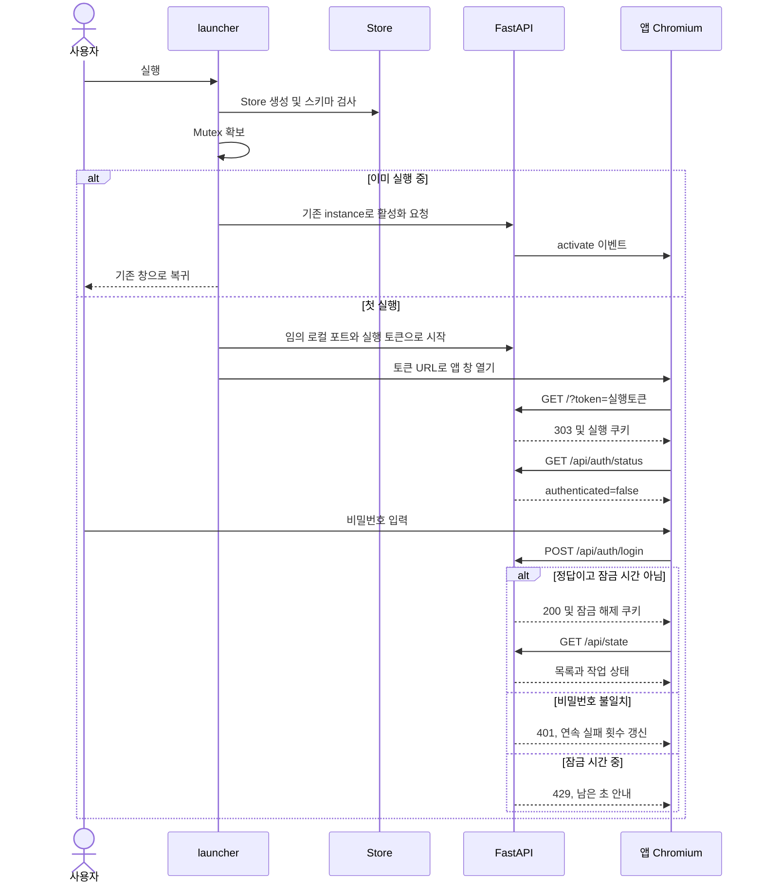

로그인 연속 실패가 5회면 이후 30초 잠금이며 잠금을 거는 5번째 요청은 401이다. 실행 토큰과 잠금 해제 토큰은 서버 재시작마다 새로 만든다. 재시작 후 API가 401을 반환하면 화면은 로그인 상태를 다시 확인한다. 실행 쿠키까지 만료된 경우에는 실행 경로에서 창을 다시 열어야 한다. 근거: `saebom/api.py:85`, `saebom/api.py:116`, `saebom/api.py:177`, `launcher.py:37`, `launcher.py:53`, `launcher.py:76`.

## 3. 사이트 목록 동기화

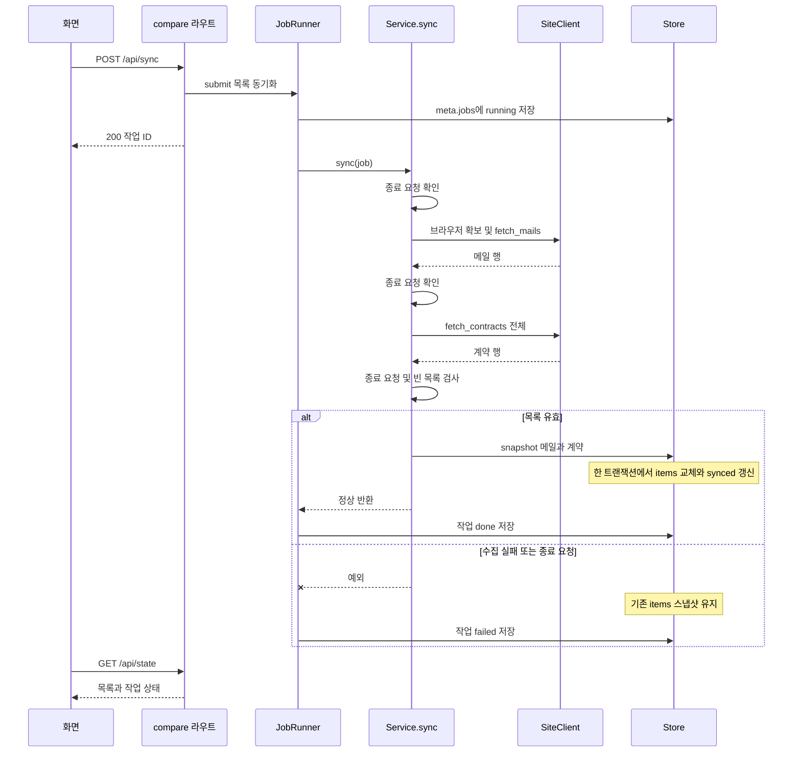

메일 셀이 3개 미만이거나 계약 셀이 7개가 아니면 양식 변경 오류다. 목록 일부만 DB에 먼저 확정하지 않는다. 단계 사이 종료 검사는 강제 중단이 아니므로 진행 중인 네트워크 호출을 즉시 끊지는 못한다. 근거: `saebom/services/compare_service.py:21`, `saebom/site.py:171`, `saebom/site.py:238`, `saebom/site.py:252`, `saebom/store.py:85`.

## 4. 선택 문서 다운로드

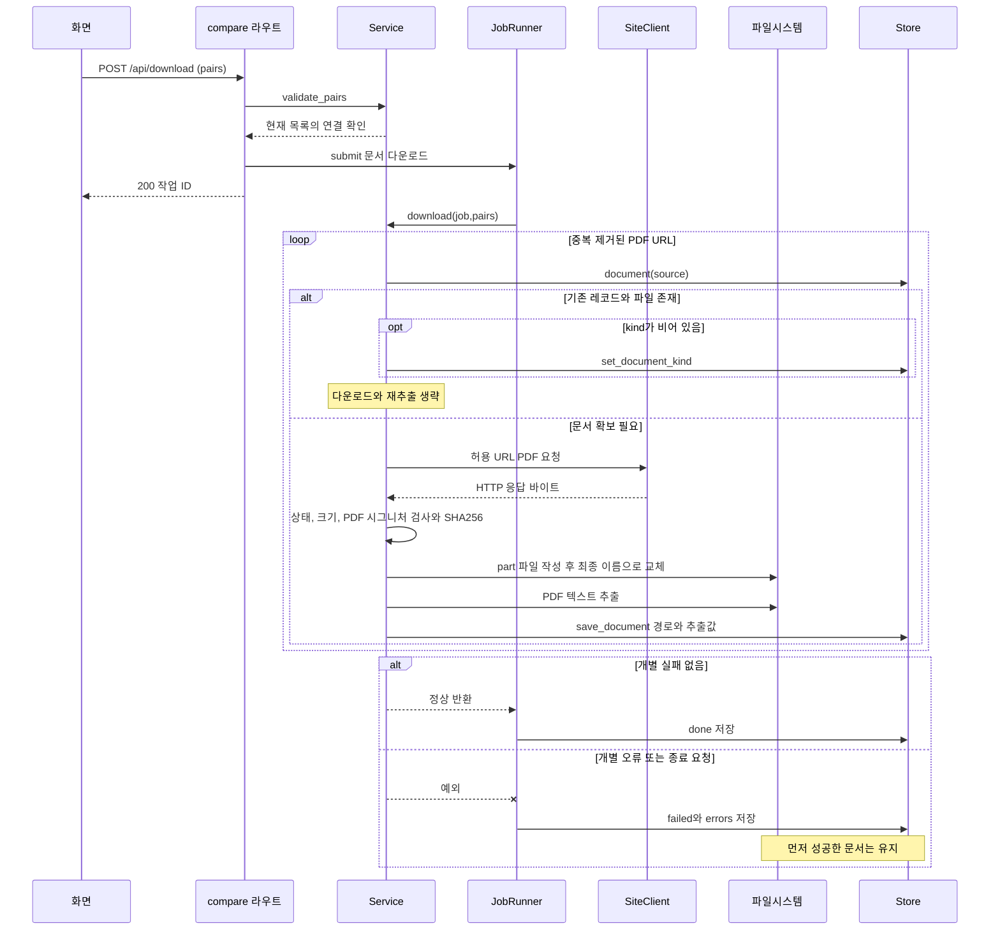

URL 허용 검사·HTTP 200·50 MiB 상한·PDF 시그니처를 검사한다. 기존 파일 재사용은 로컬 파일 존재 기준이며 원격 문서 변경 감지 기능은 없다. 이미지 PDF는 저장할 수 있으나 OCR 없이 판독 오류 또는 확인 필요가 된다. 근거: `saebom/services/compare_service.py:135`, `saebom/services/core.py:183`, `saebom/site.py:32`, `saebom/site.py:46`, `saebom/compare.py:55`.

## 5. 오프라인 비교와 수동 보정

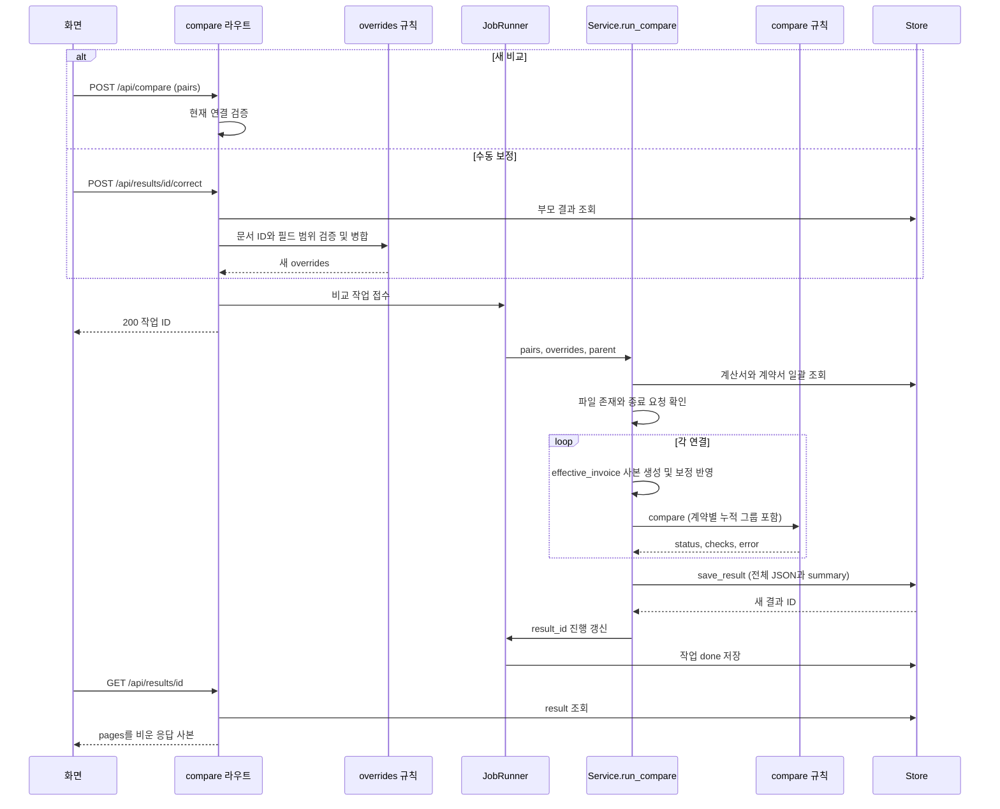

비교는 네트워크·AI를 사용하지 않는다. 파일이 없으면 작업 failed이며 다운로드를 안내한다. 보정값은 원본 문서 추출값을 덮어쓰지 않고 `method='수동 보정'`, `previous`를 가진 결과 사본을 만든다. HTTP 보정 접수가 실패하면 화면의 보정 창을 유지한다. 근거: `saebom/services/compare_service.py:167`, `saebom/routes/compare.py:92`, `saebom/overrides.py:25`.

판정 우선순위는 일반 항목에서 불일치 → 확인 필요 → 일치다. 문서 오류는 먼저 처리한다. 총액 계약의 `period`는 분할 지급 이행 여부를 문서만으로 확정하지 않으므로 **항상 확인 필요인 의도된 정책**이다. 금액이 맞더라도 이 정책은 유지된다. 근거: `saebom/compare.py:186`.

## 6. 계약서 가져오기

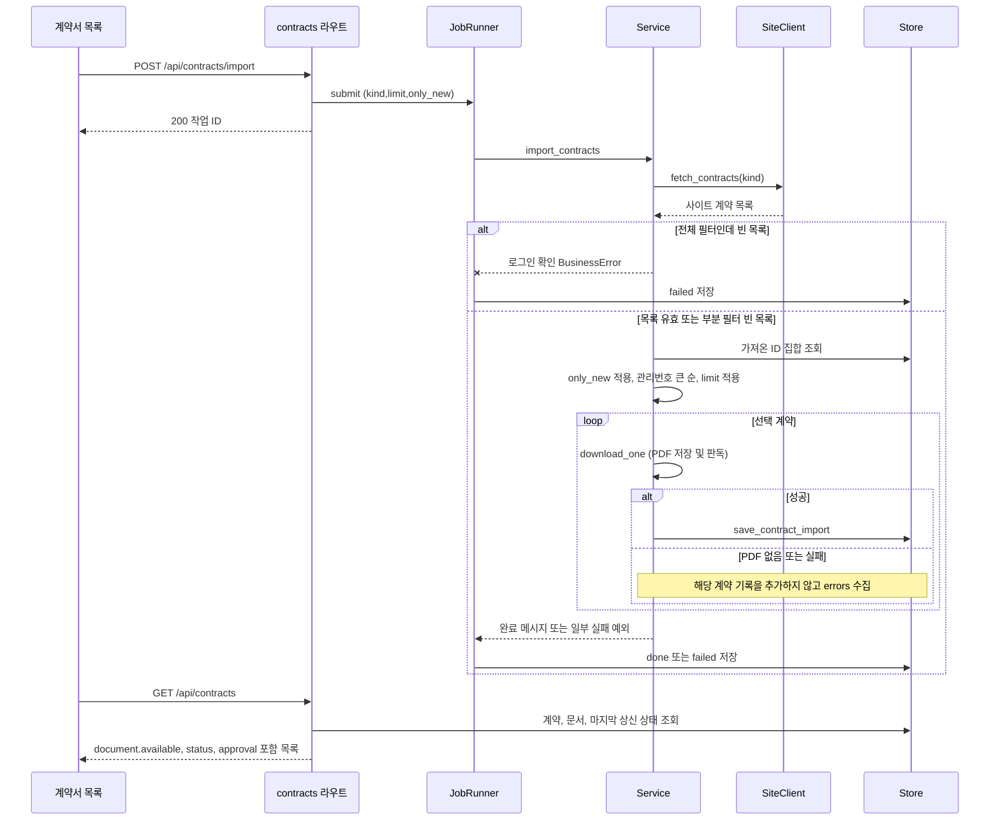

가져올 계약이 없으면 정상 done이다. 성공한 계약은 일부 실패가 있어도 유지되며, 실패한 계약은 다음 only_new 가져오기에서 다시 대상이 된다. 이 메뉴는 `items` 스냅샷을 덮어쓰지 않는다. 근거: `saebom/services/contracts_service.py:25`, `saebom/services/contracts_service.py:61`.

## 7. 거래명세서 초안·생성·내려받기

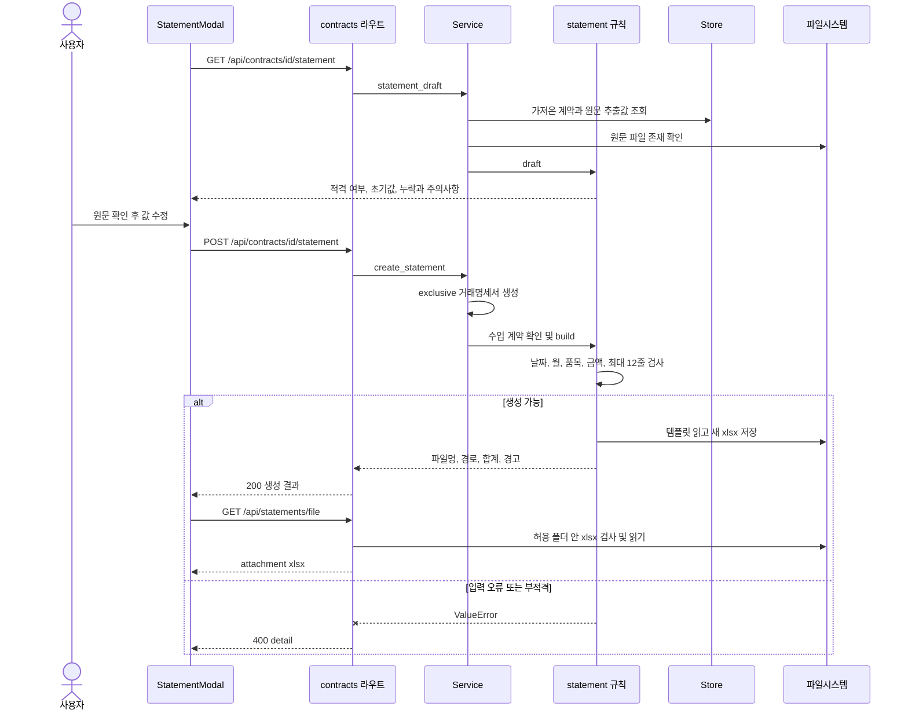

위 화살표는 서비스·API를 거쳐 화면으로 응답하는 중간 반환을 일부 생략했다. 생성은 동기 HTTP 처리이며 작업 ID를 반환하지 않는다. 원문·템플릿·기존 생성 파일을 덮어쓰지 않는다. exclusive는 생성 중 새로운 주요 작업 접수를 거절한다. 근거: `saebom/services/contracts_service.py:93`, `saebom/services/contracts_service.py:124`, `saebom/statement.py:288`, `saebom/routes/contracts.py:102`.

## 8. 지출결의서 상신·검토·불확실성

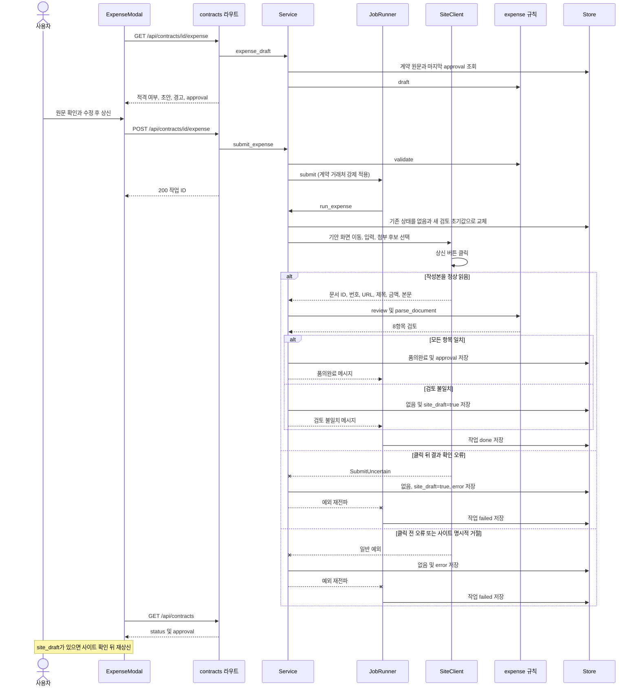

`품의완료`는 앱의 작성본 검토 완료 표기다. 실제 결재자의 승인 완료를 조회하는 상태가 아니다. 검토 항목은 작성본 금액·본문 합계·본문 공급가액·본문 세액·검산·업체명·사용기간·제목이다. 근거: `saebom/expense.py:111`, `saebom/services/contracts_service.py:171`.

버튼 클릭 뒤 결과 화면 대기·읽기 오류를 `SubmitUncertain`으로 감싼다. 단, 사이트 명시적 폼 오류는 일반 ValueError다. **click 호출 자체는 이 래핑 try 밖**에 있으므로 그 호출 중 발생한 오류는 일반 예외 경로가 될 수 있다. `site_draft`가 없다고 사이트 기안이 없음을 보장하지는 않는다. 실제 사이트 상태와 다를 수 있으므로 자동 재상신하지 않는다. 근거: `saebom/site.py:195`.

입력 검증 실패나 접수 충돌이면 `run_expense`에 진입하지 않아 기존 상태를 유지한다. 실행이 시작되면 이전 성공 상태를 초기화한다. 상신 함수 안에서는 종료 요청 플래그로 중간 중단하지 않으며, DB 저장 장애가 겹치면 사이트 결과를 로컬에 기록하지 못할 수 있다. 근거: `saebom/services/contracts_service.py:152`, `saebom/services/contracts_service.py:171`.

## 9. 로컬 세금계산서 대조

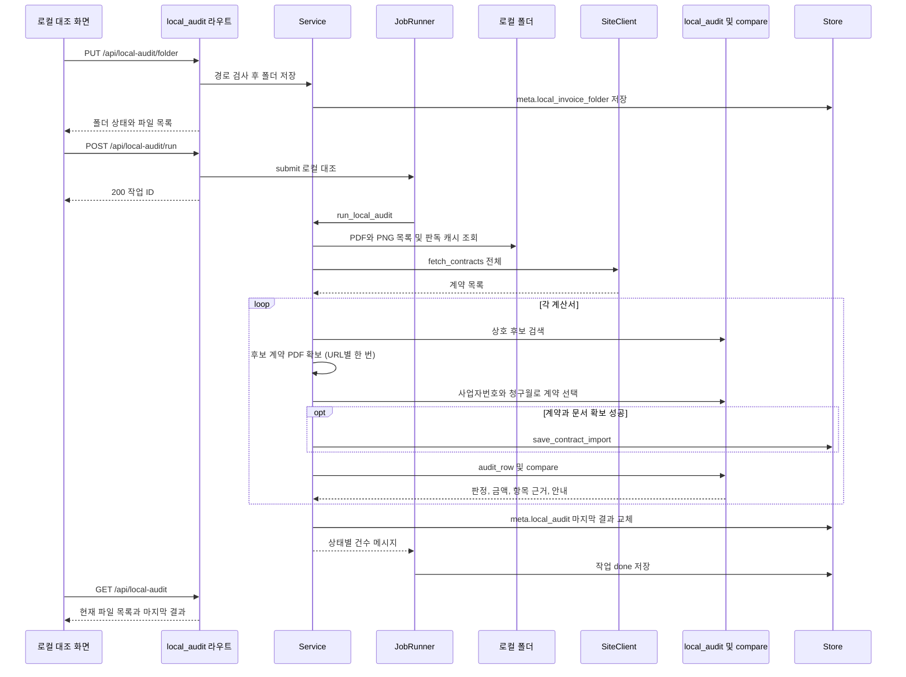

웹 계약 전체가 비어 있거나 폴더·수집·종료 오류가 나면 작업 failed이고 이전 `local_audit`를 유지한다. 행별 다운로드 실패는 처리 실패 행으로 모으고 나머지를 진행한다. PNG는 금액을 읽지 않으며 확인 필요다. 이 작업은 계약 수집·다운로드에 네트워크를 사용하지만 로컬 원본을 수정하지 않는다. 근거: `saebom/services/local_audit_service.py:108`, `saebom/local_audit.py:239`.

## 10. 저장 위치 변경

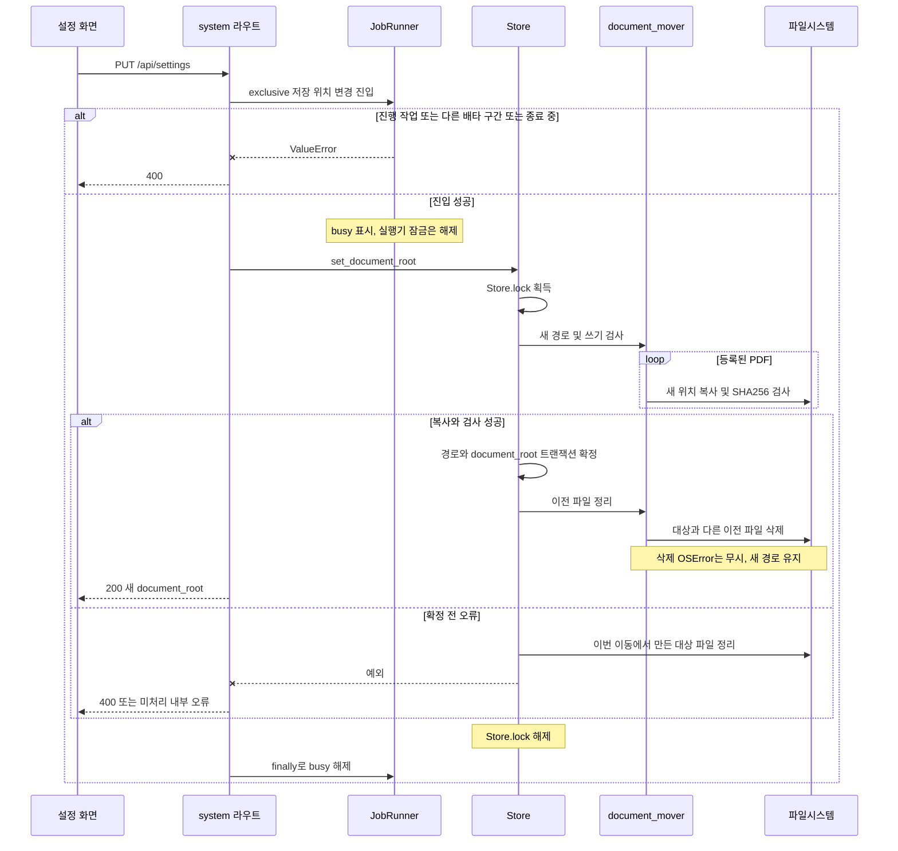

논리 순서는 검사 → 복사·검증 → DB 확정 → 이전 파일 정리다. 응답 시점과 finally 정리는 표현상 간략화했다. 이동 구간에 새 작업은 기다리지 않고 400이며, DB 조회는 Store.lock 때문에 기다릴 수 있다. DB 자체·브라우저 프로필·거래명세서 xlsx·사용자 계산서 폴더는 옮기지 않는다. 근거: `saebom/routes/system.py:38`, `saebom/jobs.py:135`, `saebom/store.py:318`, `saebom/store.py:330`, `saebom/document_mover.py:96`.

## 11. 종료

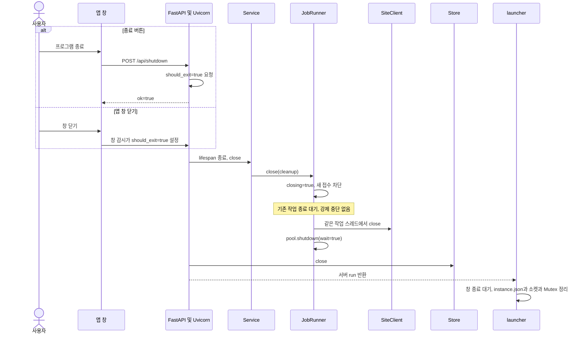

closing은 `JobRunner.close` 시 설정된다. shutdown HTTP 응답 자체가 이미 모든 자원 정리를 마쳤다는 뜻은 아니다. 비교·동기화·가져오기 작업은 플래그 확인 지점에서 중단할 수 있지만 상신 함수는 실행 중 중단하지 않는다. 작업이 끝나지 않으면 종료 대기도 길어질 수 있다. 근거: `saebom/api.py:100`, `saebom/jobs.py:155`, `saebom/services/core.py:254`, `launcher.py:152`.

## 12. 작업 상태 전이

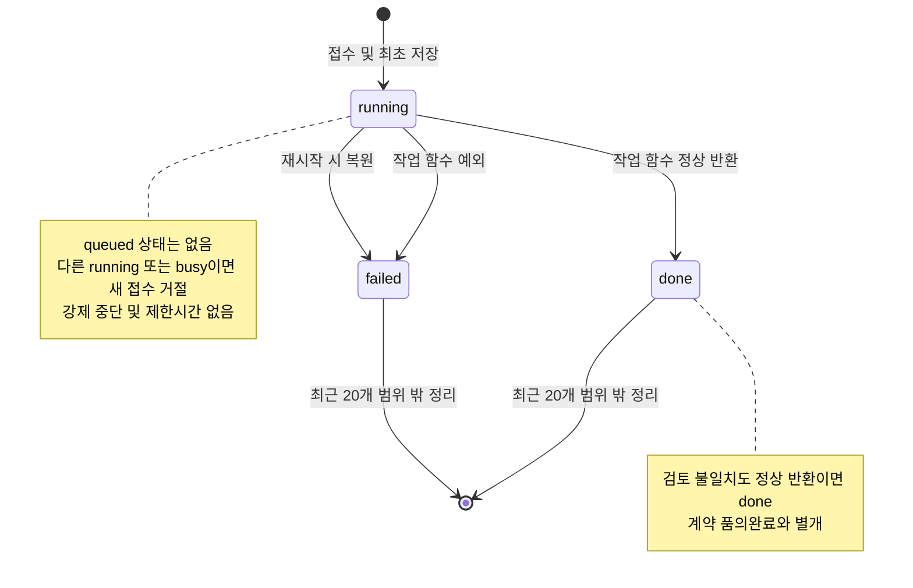

최종 상태 DB 갱신 실패 시 메모리에서 동일한 done/failed를 남긴다. DB에는 running이 남을 수 있으며 다음 실행에서 failed로 복원한다. 최근 20건 밖 작업 제거는 새 접수 때 수행한다. 근거: `saebom/jobs.py:35`, `saebom/jobs.py:78`.

## 13. 계약 상태 전이

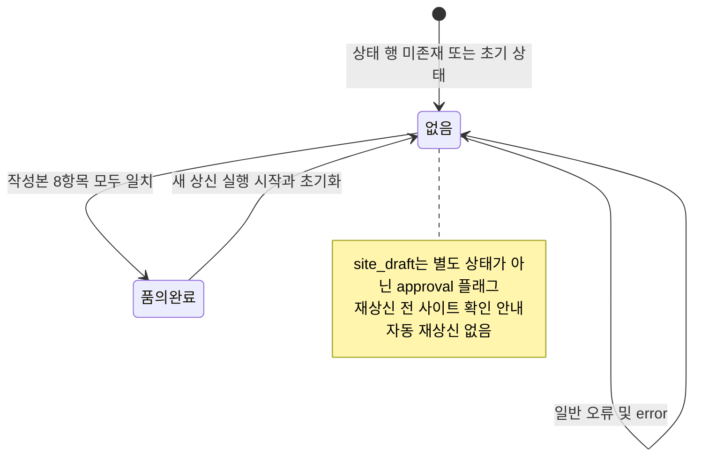

API 입력 검증·접수 실패 단계에서는 상태 전이가 없다. 상태 테이블은 계약별 마지막 결과만 보관하며 과거 상신 이력을 배열로 누적하지 않는다. 작업 이력과 계약 상태를 결합해 화면을 해석해야 한다. 근거: `saebom/store.py:177`, `saebom/services/contracts_service.py:152`, `saebom/services/contracts_service.py:171`.
