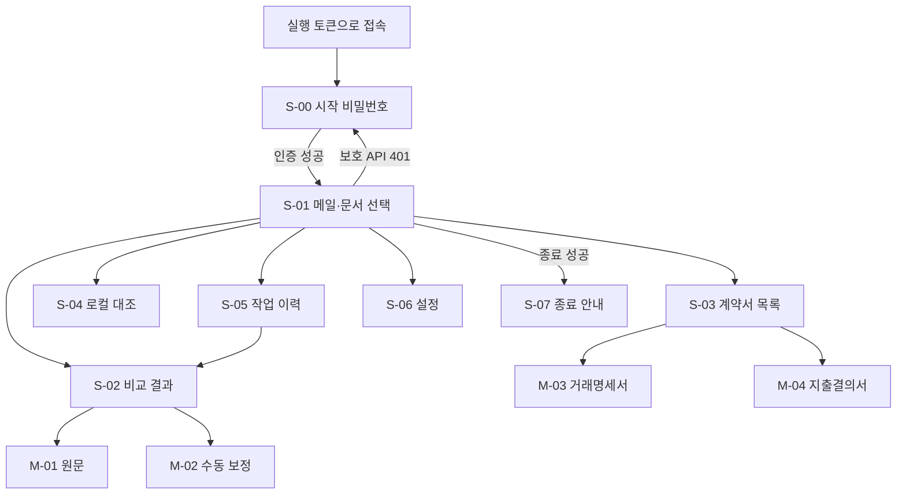
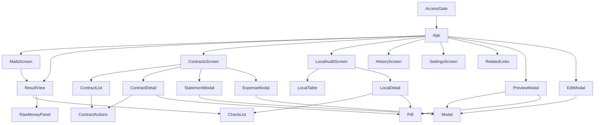

# 화면 설계서

- 기준일: 2026-10-26, `frontend/src/` 최종 소스.
- 진입점: `main.tsx` → `AccessGate` → `App`. React 상태로 화면을 전환하며 별도 URL 라우터는 없다.
- 화면 ID·기능 ID는 [요구사항·기능명세서](01_요구사항_기능명세서.md)와 연결한다.
- 추가 요구(2026-10-26): 새봄 앱의 모든 업무 메뉴를 한 화면에 놓고, 연결된 링크는 오른쪽에 정리한다. [전체화면 2단 구성 계획](../기획/전체화면_2단구성_계획.md)을 반영한다.

## 1. 화면 목록

| ID | 상태 키·화면 | 주요 영역·입력 | 실행·결과 | 기능 |
|---|---|---|---|---|
| S-00 | AccessGate | 시작 비밀번호, 잠금·실패 안내 | 인증 성공만 App 표시 | F-01 |
| S-01 | mails / 메일·문서 선택 | 검색·수신일, 기업 선택, PDF·계약 연결, 3단 비교 | 동기화·다운로드·비교·기업 결과 선택 | F-02~05 |
| S-02 | results / 비교 결과 | 결과 요약, 행 목록, 항목별 값·차이·근거, 원 추출 금액 | 원문 창·보정 창·CSV | F-05~08 |
| S-03 | contracts / 계약서 목록 | 가져오기 구분·개수·새 계약, 검색·구분 탭, 목록·상세·PDF | 수입 거래명세서 / 지출결의서 버튼·품의 상태 | F-09·10·12 |
| S-04 | local / 로컬 세금계산서 대조 | 폴더 선택, 대조 집계, 표, 선택 행의 후보·근거·PDF | 마지막 대조 조회·실행 | F-11 |
| S-05 | history / 작업 이력 | 결과 요약 목록 | 클릭한 결과의 첫 행을 S-02에 표시 | F-08 |
| S-06 | settings / 설정 | 원본 PDF 루트, 폴더 구조 안내, 서버 `state.site`, 데이터 경로 | 폴더 이동·전용 브라우저 열기 | F-13·14 |
| S-07 | stopped / 종료 안내 | 저장 데이터 유지·재실행 안내 | 폴링 중단 | F-14 |

사이드바·상단 경로·제목은 `navigation.ts:11`의 `NAV`와 `HEADINGS`를 공통으로 참조한다. App은 오류(role=alert), 완료 안내(role=status), 최근 작업의 진행률·파일별 오류를 공통 영역에 표시한다.

잠금 해제 후 7개 메뉴(개발문서 포함)는 공통 `workspace-layout`을 공유한다. 왼쪽 `workspace-main`은 제목·오류·작업·업무 콘텐츠·footer를 포함하며 내부 스크롤한다. 오른쪽 `RelatedLinks`는 별도로 내부 스크롤하며 접근성 이름은 **관련 링크**다. 앱 골격은 한 viewport 높이이고 페이지 전체를 길게 스크롤하지 않는다. 로그인·종료 안내와 포털 모달은 별도 상태다.

| 현재 화면 | 오른쪽 관련 링크 |
|---|---|
| 메일·문서 선택 | 비교 결과·계약서 목록·이력·설정 이동, 현재 행의 저장 계산서/계약서·결과 CSV |
| 비교 결과 | 문서 선택·이력·계약서 목록 이동, 현재 행 원문·결과 CSV |
| 계약서 목록 | 문서 선택·로컬 대조·설정 이동, 선택 계약의 저장 원문 |
| 로컬 대조 | 계약서 목록·비교 결과·설정 이동, 선택 행의 저장 계약 원문 |
| 작업 이력 | 비교 결과·문서 선택 이동, 현재 결과 행 원문·CSV |
| 설정 | 문서 선택·계약서 목록·로컬 대조 이동, 서버 사이트 주소의 수동 링크 |

내부 버튼 이름은 기존 메뉴와 구분되도록 `비교 결과로 이동`처럼 메뉴명 뒤에 `로 이동`을 붙인다. 문서는 ID 중복을 제거하고 파일 없음(available=false)은 원문 링크를 표시하지 않는다. 선택 문서가 없으면 안내를 표시한다. 저장 위치·다운로드·대조·상신 등의 작업은 기존 본문 버튼에서만 실행한다. 외부 사이트는 사용자가 링크를 누를 때만 새 탭으로 열며 전용 자동화 브라우저 버튼과 구분한다.

그림의 Mail은 초기 화면이자 앱 공통 메뉴 진입점을 나타낸다. 메뉴는 업무 화면 사이 어디서나 전환할 수 있다.

## 2. 컴포넌트 구조와 책임

| 상태 소유자 | 상태·책임 |
|---|---|
| `App` | screen, 검색·일자, 선택 행·기업 포커스, 오류·알림, 요청 중, 종료, 미리보기, 하위 화면의 선택 문서 |
| `useAppState` | 서버 state·결과 요약·선택 상세, 최초 로딩, 폴링·상세 재시도 |
| `useSelection` | 메일 선택과 PDF/계약 연결, 작업 대상 도출 |
| `useColumnResize` | 3열 비율, 경계 드래그·키보드 조작·초기화 |
| `useSettings` | 폴더 입력, 선택·이동 중 상태, 설정 요청과 재조회 |
| `useCorrection` | 보정 폼·편집값, 성공 시에만 닫기 |
| `ContractsScreen` | 가져오기 조건·필터·선택 계약·초안·열기 버튼 참조 |
| `LocalAuditScreen` | 로컬 대조 상태·폴더 조작·선택 행 |
| `Pdf` | 문서·페이지·배율·Canvas 렌더 상태 |
| `RelatedLinks` | 현재 업무의 관련 메뉴·문서·CSV·사이트 링크 표시. 자체 서버 조회·작업 실행 없음 |

## 3. 상태 조회·동작 규약

- `useAppState.reload`는 `/api/state`와 `/api/results`를 병렬로 읽는다. 요약 목록에 선택 ID가 없으면 최신 결과를 표시한다.
- `running` 작업이 있으면 1초, 없으면 8초 간격으로 상태·요약을 다시 읽는다. 종료 상태와 언마운트 시 타이머를 정리한다. `setInterval` 방식으로 요청 자체를 직렬화하는 장치는 없다.
- 선택 결과 상세는 결과 ID·재시도 신호가 바뀔 때 읽는다. 대상과 다른 이전 상세는 노출하지 않고 대기 표시를 한다. 늦게 도착한 이전 응답은 무시한다. 상세 실패는 다음 폴링 때 재시도한다.
- `useJobDone`은 최초 목록의 종결 작업을 기억하고 이후 새 종결 작업에만 반응한다. App은 `result_id`를 선택하고, 계약 화면은 가져오기·상신 완료 후 목록, 로컬 화면은 대조 완료 후 상태를 재조회한다.
- `App.act`는 요청 성공 여부를 반환한다. 보정 실패 시 폼을 유지한다. 요청 성공 후 reload 실패는 오류 배너로 표시하지만 요청 성공 자체를 취소하지 않는다.
- 메일 기업 카드를 누르면 해당 메일이 포함된 최신 결과 요약을 선택한다. 상세가 아직 오지 않았으면 메일 ID를 예약해 도착 후 행을 맞춘다.
- 보호 API의 401은 `saebom:unauthorized` 이벤트를 한 번 보내며 AccessGate가 App을 언마운트한다. 서버 접속 실패는 한글 안내로 표시한다. 인증 복구 시 새 App이 상태를 다시 조회한다.
- 폴더·보정·배율·선택·열 비율은 화면 상태다. 서버에 저장한 폴더 설정·결과·품의 상태와 구분한다.
- 계약·로컬 화면은 `onRelatedDocument` 콜백으로 선택한 저장 원문 또는 null을 App에 전달한다. App은 현재 화면에 맞는 문서만 RelatedLinks에 전달한다. 별도의 원문 목록 API는 추가하지 않는다.

## 4. 모달 상세

| ID | 컴포넌트 | 입력·행동 | 실패·잠금 |
|---|---|---|---|
| M-01 | PreviewModal | 양쪽 PDF, 각각 페이지·배율·화면 맞춤·내려받기 | 문서/렌더 실패 안내; 내용만 별도 스크롤 |
| M-02 | EditModal | 금액·업체·기간 등 허용 보정값. 금액·차수·비율은 쉼표·공백을 허용하는 0 이상의 정수(`utils/correction.ts`) | 저장 실패하면 창 유지; 변환할 수 없는 입력은 요청 전에 필드별 한글 오류로 표시; 요청 중 중복 제출 차단 |
| M-03 | StatementModal | 초안을 마크다운 문서(기본 정보 목록·품목 표)로 바꿔 3단 편집 화면(§4.1)에서 수정; 줄 수·합계 미리보기 | 문서 형식 오류·12줄 초과 안내와 생성 버튼 잠금; 변경 후 닫기는 확인 줄; 생성 결과 xlsx 경로·내려받기 |
| M-04 | ExpenseModal | 제목·청구월·금액·첨부명·특이사항을 마크다운 문서로 구성해 3단 편집 화면(§4.1)에서 수정, 확인 후 상신 | 진행 중 닫기 차단; 변경 후 닫기는 확인 줄; 작성본 검토 표·문서 링크·site_draft 경고 |

`components/Modal.tsx:44`의 공용 규약:

1. `document.body` 포털로 그려 부모 표·상세 선택과 이벤트 영역을 분리한다.
2. `role=dialog`, `aria-modal=true`, `aria-labelledby`, `tabIndex=-1`을 제공한다.
3. 최초 포커스는 지정 요소 또는 대화상자 자체다. Tab/Shift+Tab은 보이는 활성 요소 사이를 순환한다. 요소가 없으면 대화상자에 머문다.
4. 맨 위 모달만 Esc·Tab을 처리한다. `closable=false`는 Esc 닫기를 막는다. 배경 클릭은 닫지 않는다.
5. body 스크롤을 잠그고 닫을 때 이전 overflow를 복원한다. 열기 버튼 또는 이전 포커스 요소가 DOM에 남아 있으면 포커스를 돌려준다.
6. 요청 진행 중 임의 닫기 방지는 각 모달이 `closable`과 버튼 비활성을 함께 전달한다. 공용 틀은 서버 작업을 취소하지 않는다.

### 4.1 전송 전 문서 편집 3단 화면

`StatementModal`·`ExpenseModal`의 입력 단계는 `components/docedit/`의 `DocEditor`를 쓴다. 두 창은 입력 단계에서만 `doc-edit-modal`(최대 1500px × 93vh)로 커지고, 결과·진행 단계는 기존 크기를 쓴다.

| 단 | 구성 | 접근성 이름 |
|---|---|---|
| 좌 | 마크다운 원문 textarea(`MarkdownPane`) | region "마크다운 편집", textarea "마크다운 원문" |
| 중 | 워드형 편집(TipTap + 마크다운 확장, 표 지원; `WysiwygPane`) | region "문서 편집", textbox "문서 본문"(`tabindex=0`) |
| 우 | `#`·`##`·`###` 목차와 읽기 전용 안내 슬롯(`TocPane`) | navigation "목차" |

- **단일 원천**: 화면 상태는 마크다운 문자열 하나다. 좌 입력과 중 편집이 모두 이 값을 갱신하며(중 → 좌는 150ms 디바운스, 자기가 만든 값이면 재주입하지 않음) 목차는 이 값에서 `toc.ts`가 뽑는다. 목차를 누르면 좌는 해당 줄로, 중은 같은 순번의 제목으로 스크롤한다.
- **문서 ↔ 필드**: 창을 열 때 서버 초안을 `docMarkdown.ts`의 `statementToMarkdown`·`expenseToMarkdown`으로 고정 서식 문서로 바꾸고, 편집할 때마다 `markdownToStatement`·`markdownToExpense`로 필드를 다시 읽는다. 라벨(`- 수신: …`)로 읽으므로 줄 순서는 상관없다. 필수 라벨·표 머리글 누락, 숫자가 아닌 금액, 형식이 틀린 월·일자는 문제 목록에 한글로 표시하고 전송 버튼을 막는다. 합계 검산·12줄 제한 같은 의미 검증은 기존 모달 규칙과 서버가 그대로 맡는다.
- **서버는 변하지 않는다**: 요청 본문(`StatementRequest`·`ExpenseRequest`)과 서버 검증·검토 8항목은 그대로이며, 검토 기준은 편집 문서가 아니라 문서에서 읽은 구조화 필드다. 지출결의서의 `## 특이사항` 아래 모든 텍스트는 마크다운 원문 그대로 `note`가 되어 그룹웨어 `#f-note`에 입력된다. 사이트는 본문을 직접 조립하므로 앱이 본문 전체를 바꾸지 않는다.
- **닫기**: 입력 단계에서 문서가 처음과 다르면 Esc·X·취소가 닫지 않고 창 안 확인 줄(`DiscardBar`: 계속 편집/버리고 닫기)을 보여 준다. 브라우저 `confirm`은 쓰지 않는다. 요청 중에는 기존대로 닫기를 막는다.
- **반응형**: 760px 이하에서는 3열 대신 탭 3개(마크다운/문서/목차, `role=tablist`·방향키 이동)로 한 번에 하나만 보이며 숨은 단도 마운트를 유지한다.
- **편집기 정규화**: 중 편집 직후 TipTap이 마크다운의 공백·표 정렬을 정리해 좌 원문의 서식이 바뀔 수 있다. 제목은 1~6단계를 보존하지만 목차에는 1~3단계만 보인다. 외부 CDN 없이 번들에 포함되며(CSP `script-src 'self'`) 별도 서버 변경은 없다.

## 5. PDF·원 추출 금액

PDF.js의 문서 로딩 효과와 페이지 렌더 효과를 분리한다. 페이지·배율 변경은 저장 PDF를 다시 요청하지 않는다. 문서 전환·언마운트 시 로딩/렌더 작업을 취소·정리한다. 로컬 worker·CMap·표준 글꼴·WASM 자산을 사용한다. Canvas 화면 맞춤과 확대는 뷰어 상태이며 추출값을 변경하지 않는다.

`RawMoneyPanel`은 저장 문서의 최초 공급가액·세액·합계와 보정이 적용된 유효값을 구분한다. 추출 불가·누락은 미확인으로 표시하고 숫자로 추정하지 않는다.

## 6. 스타일·반응형

`style.css`의 import 순서는 리팩토링 전 cascade를 그대로 보존한다.

| 파일 | 책임 |
|---|---|
| `styles/base.css` | reset·기본 골격·패널·표·결과·공통 상태 |
| `screens/settings.css` | 설정 폼·폴더 트리 |
| `components/modal-base.css` | 모달·PDF 기본 배치·수동 보정 |
| `styles/responsive-base.css` | 공통 미디어 규칙·회전·차이 표시 |
| `screens/compare/workspace.css` | 3단 비교·현행 메뉴·반응형 보완 |
| `components/pdf-tools.css` | PDF 확대 도구·Canvas |
| `styles/access.css` | 시작 비밀번호 화면 |
| `components/raw-money.css` | 원 추출 금액 |
| `screens/contracts/contracts-base.css`·`contracts.css` | 계약 목록·상세와 행 작업/지출결의서 보완 |
| `components/statement.css` | 거래명세서 확인 창 |
| `components/docedit/docedit.css` | 문서 편집 3단 화면(`DocEditor`가 직접 import)과 큰 편집 창 |
| `screens/local/local.css` | 로컬 대조 표·상세 |
| `components/modal.css` | 모달 자체 포커스 테두리 보완 |
| `styles/workspace-layout.css` | viewport 고정·본문/관련 링크 2단·독립 스크롤·본문 폭 기반 내부 재배치 |

| 폭 | 표시 |
|---|---|
| 1100px 초과 | 현행 사이드바 180px, 비교 3열·드래그 경계 |
| 1100px 이하 | 사이드바 **76px** 아이콘 메뉴, 3열 유지 |
| 900px 이하 | 기업·연결 2열, 아래 결과 전체 폭, 경계 숨김 |
| 760px 이하 | 본문 위·관련 링크 아래 세로 배치. 관련 링크는 기본 25dvh, 두 영역 모두 독립 스크롤. 사이드바는 고정 |
| 600px 이하 | 사이드바 58px 고정, 비교 한 열, PDF 위아래 배치 |
| 1024px 이하 | 계약 목록·상세 한 열 |
| 1900px 미만 | 로컬 대조 표·상세 한 열 |

반복 값은 `:root`의 `--color-white`, `--color-primary`, `--color-divider`, `--font-small`, `--font-body-small`, `--font-body`, `--space-small`, `--space-medium`을 쓴다. 값만 이름으로 바꿔 기존 표시를 유지하며 다크 모드는 추가하지 않았다. 미사용 `stats`, `steps`, `sync-stat`, `stat-icon`, `mail-title`, `date`, `saved` 규칙은 제거했다.

전체 가로 배치는 `minmax(0,1fr) 264px`, 1100px 이하에서 오른쪽 230px이다. 본문 가용 폭 1100px 이하에서 계약 목록·상세를 한 열로, 900px 이하에서 비교 영역을 2열+아래 결과로, 560px 이하에서는 비교를 한 열로 바꾼다. 브라우저 폭과 별도로 CSS container query로 본문 자체의 가용 폭을 판단한다. 760px 이하에서는 공통 2단을 위아래로 바꾸므로 관련 링크가 본문 옆을 차지하지 않는다.

## 7. 확인 기준

`npm run build`의 TypeScript·Vite 검사와 격리 화면 검증으로 확인한다. 코드 정리 시 CSS 이전 기준선은 `tmp/refactor-tools/css-before/`이며 48장 픽셀 동일, 계약/설정 24장은 가져오기 시각·격리 데이터 경로만 달랐다. 이후 추가된 2단 배치는 의도적으로 화면을 변경하므로 그 기준선과 픽셀 동일을 요구하지 않는다. 전체화면 내부 스크롤·관련 링크·모바일·기존 기능의 실제 검증 결과는 [리팩토링 결과보고서](14_리팩토링_결과보고서.md)에 기록한다. 이 문서는 실제 실행 EXE가 최신 화면이라고 가정하지 않는다.

## 8. 개발문서 화면(2026-10-26 추가)

사이드바 7번째 메뉴 **개발문서**(`docs`). 본문은 서버 `GET /api/devdocs/{name}`의 Markdown을 `marked`(GFM 표)로 변환하고 `DOMPurify`로 정화해 보여 주며, 오른쪽 관련 링크에는 문서 목록과 현재 문서의 목차가 표시된다. 첫 진입 시 `00_문서목록.md`를 연다. 문서 목록은 서버 응답을 그대로 쓰므로 `15_코드_색인.md` 같은 새 문서도 코드 수정 없이 나타난다.

- Mermaid 블록은 `mermaid` 동적 import(별도 청크, 인터넷 불필요)로 `securityLevel:'strict'` 렌더한다. 도형이 실패하면 오류 문구와 원문 코드를 표시한다.
- 링크: `NN_*.md[#앵커]`는 앱 안 문서 전환, `http(s)`는 새 탭(noopener), `../` 등 앱 밖 경로는 배포본에 없으므로 비활성 글자(title에 경로). 코드 참조는 인라인 코드 그대로다.
- 표·코드·도형은 가로 스크롤로 처리해 760·390px에서 페이지 가로 넘침이 없다. 구현: `frontend/src/screens/docs/DocsScreen.tsx`, `renderMarkdown.ts`, `docs.css`. 검증: `scripts/verify_devdocs.py`.
