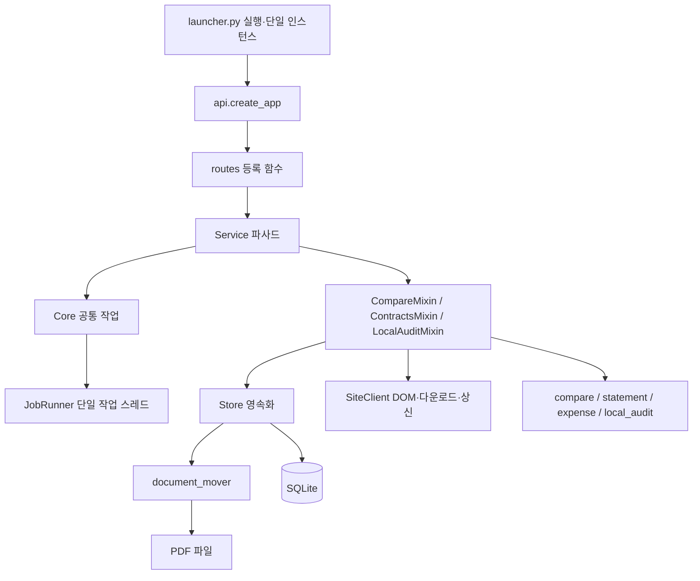

# 백엔드 상세설계서

- 기준일: 2026-10-26, 리팩토링 1~3단계 소스 기준.
- 대상: `saebom/` 런타임. HTTP 계약은 [API 명세서](04_API_명세서.md), 저장 구조는 [DB 설계서](03_DB_설계서.md), 호출 순서는 [시퀀스 다이어그램](07_시퀀스_다이어그램.md)을 따른다.
- 구현 원칙: 업무 조정은 서비스, 영속화는 Store, 사이트 DOM은 SiteClient, 판정·출력 규칙은 순수 모듈에 둔다.

## 1. 계층과 진입점

`service.py:31`의 `Service(Core, CompareMixin, ContractsMixin, LocalAuditMixin)`는 기존 import·메서드 호출 경로를 보존하는 파사드다. 믹스인은 `services/common.py`의 `ServiceHost` Protocol로 필요한 속성·메서드 계약을 명시하며 서버 라우트나 DB 연결을 직접 소유하지 않는다. `common.py`의 명시 import와 `service.py`의 호환 재노출은 테스트 대역 주입 경로도 보존한다.

## 2. 모듈별 책임·주요 함수

| 모듈 | 책임 | 주요 진입점·출력 | 실패·부수효과 |
|---|---|---|---|
| `api.py` | 실행/잠금 인증·미들웨어·예외 변환·정적 화면 등록 | `create_app(store, static, token, shutdown, activate)` → FastAPI | Service 생성·종료, 쿠키·헤더; 비밀값 응답 제외 |
| `api_models.py` | 요청 구조·크기·형식 | `Work`, `Correct`, `Settings`, `ImportContracts`, `StatementRequest`, `ExpenseRequest` 등 | 구조 오류 422; 업무 검증은 도메인/서비스 |
| `routes/compare.py` | 동기화·다운로드·비교·결과·보정·CSV | `register()`로 7개 라우트 등록 | 없는 결과 404; 작업 접수·파일 응답 |
| `routes/contracts.py` | 계약 가져오기·목록·거래명세서·지출결의서 | `register()`로 7개 라우트 등록 | `ContractNotFound`만 404, 내부 KeyError는 숨기지 않음 |
| `routes/local_audit.py` | 로컬 폴더·대조 | `register()`로 4개 라우트 등록 | 폴더 검증·작업 접수 |
| `routes/system.py` | 상태·설정·브라우저·원문·종료·활성화 | `register()`로 7개 라우트 등록 | 저장 위치 배타 처리·FileResponse |
| `services/core.py` | 공통 자원·작업 위임·다운로드·조회 파사드 | `download_one`, `get_result`, `list_results`, `document_file`, `close` | 파일·DB·브라우저·작업 상태 |
| `services/compare_service.py` | 연결 검증·동기화·비교 | `sync`, `catalog`, `validate_pairs`, `download`, `run_compare` | 목록·결과 저장, 파일별 오류·종료 확인 |
| `services/contracts_service.py` | 계약 가져오기·초안·생성·상신 조정 | `import_contracts`, `contract_catalog`, `statement_draft`, `create_statement`, `expense_draft`, `submit_expense`, `run_expense` | 가져오기/품의 상태·xlsx·사이트 기안 |
| `services/local_audit_service.py` | 폴더별 판독 캐시·대조 조정 | `_cached_invoice`, `local_audit_state`, `set_local_folder`, `run_local_audit` | 로컬 폴더/마지막 결과 meta 저장 |
| `jobs.py` | 단일 작업 실행·상태·배타 구간 | `JobRunner.submit/update/snapshot/exclusive/close` | meta.jobs 저장; 종료·동시 접수 거절 |
| `store.py` | SQLite 파사드·마이그레이션·파일 경로 | 문서·목록·결과·상태 CRUD, `set_document_root` | RLock·DB 트랜잭션·파일 이동 조정 |
| `document_mover.py` | 저장 위치 이동의 준비·복사·정리 | `prepare_root`, `kind_folder`, `copy_document`, `remove_old_copies` | 해시 확인·새 파일·이전 사본 삭제 |
| `site.py` | Playwright 지속 프로필·DOM·다운로드·상신 | `SiteClient.page/fetch_mails/fetch_contracts/submit_expense`, `request_pdf` | 네트워크·브라우저·기안, 상신 후 불확실 오류 구분 |
| `compare.py` | PDF 텍스트 추출·필드 판독·항목 판정 | `extract`, `extract_invoice`, `extract_contract`, `compare`, `norm`, `integer`, `val` | extract는 PDF 읽기, compare는 사전 입출력 |
| `statement.py` | 거래명세서 초안·검증·엑셀 생성 | `draft`, `validate`, `build`, `parse_month`, `month_range` | 템플릿 읽기·새 xlsx; 기존 파일 덮어쓰기 금지 |
| `expense.py` | 지출 초안·입력 검증·작성본 검토 | `draft`, `validate`, `parse_document`, `review` | 순수 규칙; 사이트 상신은 SiteClient |
| `local_audit.py` | 로컬 스캔·계약 후보·행별 판정 | `check_folder`, `scan_folder`, `match_contracts`, `pick_contract`, `audit_row`, `summarize` | 폴더/PDF 읽기; 네트워크는 서비스 |
| `rules.py` | 범용 금액·월·표 계산 안전 규칙 | `is_amount`, `is_month`, `spreadsheet_safe` | 순수 함수; 판정 전용 norm은 통합하지 않음 |
| `overrides.py` | 보정 허용 필드·값·병합 | `validate_overrides`, `merge_overrides` | 순수 함수, 원 사전 보존 |
| `export.py` | 결과 CSV | `result_csv` → BOM으로 시작하는 CSV 문자열 | HTTP 인코딩·파일 응답은 라우트 |
| `views.py` | 응답의 큰 페이지 전문 제거 | `strip_doc_pages`, `strip_result_pages` | 사본 반환, 저장본 불변 |
| `contract_utils.py`·`files.py` | 정렬·식별자·안전 파일명·폴더 이름 | `contract_sort_key`, `safe_name`, 폴더 상수 | 순환 import 제거·공통 명명 |
| `errors.py` | 업무 예외 구분 | `BusinessError`, `ContractNotFound`, `SubmitUncertain` | 예외 자체에는 I/O 없음 |

업무 라우트는 25개, api.py 인증 2개를 합쳐 API 27개다. `/health`와 정적 마운트는 별도로 취급한다.

## 3. 공통 자원·동시성

Core는 Store·SiteClient·JobRunner를 가진다. SiteClient의 Playwright sync API는 같은 단일 작업 스레드에서 사용한다. `Core.browser/context` 주입 지점은 테스트가 브라우저를 대역으로 바꾸도록 보존한다.

`JobRunner.submit`(`jobs.py:78`)은 RLock 안에서 closing·busy·running을 검사한다. 최근 19개 작업과 새 작업 1개만 유지하고 meta.jobs에 저장한 후 ThreadPoolExecutor(max_workers=1)에 예약한다. 함수 실행 후 done/failed로 전환한다. 최종 DB 저장이 실패해도 예외를 기록하고 메모리 상태를 종결해 다음 작업이 영구 차단되는 것을 막는다. DB에 남은 running은 재시작 시 failed로 복원한다.

`exclusive(label)`는 짧은 잠금 검사 후 busy 표시만 유지하고 잠금을 해제한다. 본문 실행 중 Store 조회를 전부 막는 잠금이 아니다. 저장 위치 변경·거래명세서 생성은 이 구간으로 새 작업 접수를 막는다. 주요 작업의 전체 제한시간·강제 취소는 없다.

## 4. 처리 흐름

### 4.1 목록·다운로드

`sync`는 종료 요청을 단계 사이에 검사하고 메일·계약 DOM을 읽어 `check_lists`로 빈 목록을 검사한 뒤 Store 스냅샷을 교체한다. `catalog`는 UI용 PDF 첨부·후보·보관 여부를 구성하고 pages를 제거한 문서 사본을 반환한다.

`validate_pairs`는 메일/계약 존재·계약 PDF·실제 메일 PDF 첨부 URL·메일 중복을 검사한다. `download`는 URL로 중복을 합쳐 개별 저장한다. 한 파일 실패로 이미 성공한 파일을 지우지 않으며 오류 목록을 작업 상태에 남긴다.

`Core.download_one`(`services/core.py:183`)은 source URL의 문서와 파일이 이미 있으면 재사용한다. kind가 비었을 때만 보완한다. 새 다운로드는 허용 URL·HTTP 상태·PDF 시그니처·50MiB 제한을 확인하고 SHA-256을 계산한다. `해시앞12자_안전파일명`에 `.part`로 기록한 뒤 교체하고, 추출값을 documents에 저장한다. 기존 파일의 외부 변경을 매 재사용 때 해시 재검사하지는 않는다.

### 4.2 비교·보정·결과 요약

`run_compare`는 저장 추출값을 사용한다. 연결을 검증하고 문서를 일괄 조회해 파일 존재를 확인한다. 계약별 그룹을 한 번 만들고 fields만 복사해 보정값을 적용한다. 원 추출 문서·유효 계산서·판정 체크·원 연결·보정·parent를 새 결과로 저장하고 작업에 result_id를 기록한다. 인터넷 다운로드는 비교 함수의 책임이 아니다.

보정은 기존 결과의 계산서 ID와 `supply/vat/total/month/biz/percent/installment/partner`만 허용한다(`overrides.py:25`). 정수에 bool을 허용하지 않으며 금액 상한·비율 0~100·문자열 200자·실제 월을 검사한다. 기존 보정에 새 값을 병합해 새 결과를 만든다.

`Store.save_result`는 data와 summary를 함께 저장한다. 기존 DB는 `results.summary`를 자동 추가하며 옛 행의 빈 summary는 `result_summaries` 첫 조회에서 채운다. 이후 목록 조회는 큰 data를 반복 파싱하지 않는다. SELECT fetchall과 **summary 누락 행의 data 파싱·요약 작성·UPDATE는 Store 잠금 안**에서 실행한다. 이미 채워진 summary의 JSON 파싱만 반환 시 잠금 밖에서 실행한다(`store.py:415`). 결과 JSON 내부 문서 사본 중복은 유지한다.

### 4.3 계약 가져오기·거래명세서

계약 가져오기는 구분→정렬→최근 개수→기존 가져오기 제외 조건으로 대상을 선정한다. 전체 목록이 빈 경우는 로그인 확인 오류, 수입/지출 필터가 빈 경우는 정상이다. PDF 저장 성공 후에만 가져온 관리번호를 기록하므로 실패 건은 새 계약 가져오기에서 다시 시도할 수 있다.

`_statement_source`는 가져온 계약·PDF 존재를 확인하며 없는 계약은 `ContractNotFound`다. 초안은 저장된 extraction.pages를 재사용한다. 생성은 수입 적격을 다시 검사하고 사람이 수정한 값에 서버 계약번호·계약기간을 병합해 템플릿을 채운다. 월 범위·금액·최대 12줄을 검증하고 새 xlsx 파일을 만든다. 템플릿·원본은 덮어쓰지 않는다. 저장 위치 변경은 기존 거래명세서 폴더를 자동 이관하지 않는다.

### 4.4 지출결의서

`submit_expense`는 지출 적격·입력을 검증하고 거래처는 서버 초안 값으로 강제한다. 실제 입력 청구 월과 이전 완료 기록으로 중복 경고를 다시 계산해 작업을 접수한다. 접수/검증 실패까지는 이전 품의 상태를 바꾸지 않는다.

`run_expense`(`services/contracts_service.py:171`)는 시작 시 상태를 없음으로 초기화하고 사이트 폼 입력·상신·작성본 검토를 한다. 비어 있지 않은 검토 목록의 모든 항목이 ok일 때만 품의완료를 저장한다. 작성본 불일치나 `SubmitUncertain`은 상태 없음과 `site_draft=true`를 저장한다. 일반 오류는 없음과 오류를 저장한다. 상신 클릭 후 단계는 종료 요청으로 중단하지 않고 자동 재상신하지 않는다.

`site_draft`는 JSON 보조 필드이며 새 DB 열이나 세 번째 계약 상태가 아니다. 사이트 저장과 로컬 DB 저장은 하나의 트랜잭션이 아니므로 로컬 저장 자체가 실패하는 극단 상황에서는 경고 기록도 보장할 수 없다.

### 4.5 로컬 대조

`check_folder`는 존재하는 로컬 절대 폴더만 허용하고 UNC를 거절한다. 파일 스캔은 PDF/PNG를 대상으로 하며 PNG·이미지 PDF는 확인 필요로 남긴다. 상호·사업자번호·청구 월 등으로 후보를 좁히고 선택 이유를 기록한다. 확정할 수 없는 후보를 임의로 일치 처리하지 않는다. 계약 목록은 실행 중 사이트에서 수집하므로 이 기능 전체가 완전 오프라인은 아니다.

캐시 판독과 다운로드한 계약 문서는 기존 Store를 재사용한다. 행별 `audit_row`는 기존 compare를 호출하고 결과 요약과 함께 `meta.local_audit`에 마지막 결과를 저장한다.

### 4.6 저장 위치 이동

`Store.set_document_root`(`store.py:330`)는 새 루트를 준비하고 각 원본·대상 해시를 검증한다. 모든 복사 성공 후 `_commit_root`에서 DB 경로·설정을 확정한 뒤 이전 사본을 지운다. 복사 실패 시 이번에 만든 새 파일을 정리한다. 이전 파일 삭제가 잠금 등으로 실패하면 새 경로를 되돌리지 않고 이전 사본이 중복으로 남을 수 있다.

## 5. 판정·오류 계약

총액 계약 `period`의 확인 필요는 실제 납품·검수 사실을 문서만으로 확정하지 않는 의도된 정책이다. `compare()`·`norm()`은 리팩토링에서 의미를 바꾸지 않는다. 계산·상태 우선순위는 [요구사항](01_요구사항_기능명세서.md)의 판정 정책을 따른다.

| 오류 | 경계 처리 |
|---|---|
| Pydantic 입력 구조 오류 | HTTP 422 |
| BusinessError·일반 ValueError | HTTP 400, 일반 ValueError는 추가 예외 로그 |
| ContractNotFound | 계약 라우트에서 HTTP 404 |
| 알 수 없는 결과·파일 | 해당 라우트 HTTP 404 |
| SubmitUncertain | 작업 실패 + site_draft 경고 영속화 시도 |
| 내부 KeyError/IndexError 등 | 404로 오분류하지 않고 서버 오류로 드러냄 |
| 작업 함수 예외 | JobRunner가 failed·메시지로 저장 |

## 6. 확장 절차·개선 과제

새 업무는 요청 모델→서비스 조정→순수 규칙→라우트 등록→화면 호출 순으로 책임을 배치한다. 사이트 DOM은 SiteClient에만 둔다. 저장 스키마 변경은 기존 DB 자동 마이그레이션·옛 행 조회를 검사한다. 각 함수에 목적·입출력·실패·부수효과 한글 명세를 함께 작성한다.

판정 변경은 fixture 조합 스냅샷을 비교하고 의도된 변경만 승인 범위에 포함한다. 기존 테스트 대역 주입 경로·Service 파사드를 유지한다. 기능 ID와 API·화면·DB·시퀀스 문서를 함께 갱신한다.

현재 한계는 전체 작업 제한시간/강제 중단 없음, 결과 JSON 내부 문서 사본 중복, documents.disk_path 절대경로 이관, kind NULL의 재사용 시 지연 보완, 전역 로그인 잠금의 시간 감쇠 없음이다. Tk 폴더 선택창은 비메인 스레드 실행 환경에서 불안정할 수 있다. 이 항목들은 이번 리팩토링에서 새 설계로 바꾸지 않았다.
