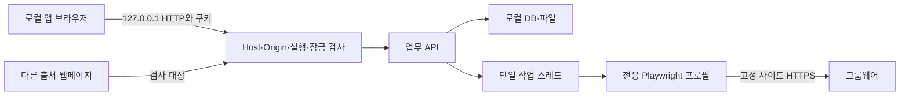

# 보안 설계서

- 기준일: 2026-10-26, `api.py`·`config.py`·`site.py`·`store.py`·`rules.py`·라우트 최종 소스 기준.
- 대상: 단일 Windows 사용자 PC의 로컬 HTTP 앱과 앱 전용 그룹웨어 브라우저.
- 이 문서는 구현된 방어와 잔여 위험을 구분한다. 보안 인증·침투시험 완료를 의미하지 않는다.

## 1. 자산·신뢰 경계

| 자산 | 저장·이동 경계 | 보호 목표 |
|---|---|---|
| 계약서·세금계산서·추출 근거 | PDF 루트·SQLite·브라우저 응답 | 임의 외부 전송/경로 접근 방지·원본 보존 |
| 실행 세션·잠금 해제 토큰 | launcher→로컬 URL→HttpOnly 쿠키 | 다른 웹페이지의 업무 API 호출 차단 |
| 시작 비밀번호 | 환경변수·프로세스 메모리·로그인 요청 | 클라이언트에 정답 노출 금지 |
| 전용 브라우저 인증·기안 | 데이터 루트/browser-profile | 사용자 Chrome과 분리, 프로필 오용 방지 |
| 비교 이력·품의 상태 | SQLite data/summary/contract_status | 원 추출·보정 분리·불확실 상신 표시 |
| 거래명세서·CSV | 로컬 파일·브라우저 다운로드 | 경로 이탈·표 수식 실행 방지 |

동일 OS 계정의 악성 프로세스·관리자·디스크 직접 접근은 현재 앱 인증 경계 밖이다. SQLite·PDF·프로필을 별도 암호화하거나 OS 사용자별 접근제어를 설정하는 기능은 없다.

## 2. 위협·방어 매트릭스

| 위협 | 구현 방어 | 근거 | 잔여 위험 |
|---|---|---|---|
| 원격 네트워크 접근 | launcher loopback 바인딩, Host가 127.0.0.1인지 검사 | `launcher.py`, `api.py:115` | 로컬 악성 프로세스는 별도 문제 |
| 다른 사이트의 상태 변경 요청·DNS rebinding | Host 검사, Origin이 있으면 정확한 `http://host:port` 일치, SameSite=Strict | `api.py` protect | Origin 없는 요청은 쿠키·토큰 검사에 의존 |
| 실행 URL 없이 API 접근 | 실행별 무작위 토큰, 최초 `/` 토큰 일치 시 쿠키 발급 후 303으로 쿼리 제거 | `api.py:86`·`protect` | 실행 URL·로컬 인스턴스 정보 유출은 로컬 계정 권한에 의존 |
| 비밀번호 우회 | 보호 API는 실행 쿠키+별도 잠금 해제 쿠키 필요 | `api.py` protect·login | 로컬 저장 파일 자체 암호화는 아님 |
| 무차별 비밀번호 시도 | 5회 실패 후 30초 잠금, 잠금 중 정답도 429 | `config.py`, `api.py:178` | 전역 메모리 상태, 재시작 초기화·실패 횟수 시간 감쇠 없음 |
| 비ASCII 토큰 입력 오류 | UTF-8 바이트 `compare_digest` | `api.py:54` `_same` | 비밀번호 강도·토큰 보관은 별도 책임 |
| XSS·외부 코드 실행·프레임 삽입 | React 텍스트 렌더, CSP, nosniff, frame-ancestors none | `api.py` protect, React 화면 | style unsafe-inline 허용; 취약 PDF/브라우저 라이브러리 위험 잔존 |
| SSRF·임의 PDF URL·리다이렉트 | 고정 사이트 HTTPS·정확 netloc·.pdf 경로, max_redirects=0 | `site.py:32`·`:62` | 허용 사이트 자체 침해는 차단하지 않음 |
| 비PDF·거대 PDF·과다 작업 | 50MiB·PDF 시그니처·100페이지·500 연결 제한 | `config.py`, `site.py:46`, `compare.extract` | 본문 전체를 읽은 뒤 크기 검사; 전체 작업 제한시간 없음 |
| 임의 파일명·경로 이탈 | safe_name, 문서 ID 조회, xlsx 파일명·resolve 상위 검사 | `files.py:22`, `routes/contracts.py:102` | 로컬 OS 파일 변조·심볼릭 링크 등 모든 공격을 포괄하지 않음 |
| CSV·xlsx 수식 삽입 | 위험 접두어 셀 이스케이프 | `rules.py:52`, `export.py`, `statement.safe_cell` | 수신 프로그램이 안전화 문자를 제거하면 별도 위험 |
| 상신 중복·성공 오인 | 전용 확인 창·검토·site_draft·자동 재상신 없음 | `contracts_service.py:171` | 중복 경고는 유일성 제약이 아니며 사이트/DB 원자성 없음 |
| 원본 이동 손실·덮어쓰기 | 복사 전후 SHA-256·동명 파일 내용 검사·DB 확정 후 이전 파일 정리 | `document_mover.py:64`, `store.py:330` | 잠긴 이전 사본 중복·디스크 고장·수동 파일 삭제 위험 |

## 3. 인증·HTTP 정책

1. 실행 토큰과 잠금 해제 토큰은 `secrets.token_urlsafe(32)`로 생성하는 서로 다른 실행별 값이다. 실행 쿠키가 먼저 있어야 비밀번호 상태 조회·로그인도 가능하다.
2. 최초 실행 URL의 유효 토큰은 `saebom_session` 쿠키로 바꾸고 `/`로 리다이렉트한다. 로그인 성공은 `saebom_unlocked` 쿠키를 발급한다. 두 쿠키는 HttpOnly·SameSite=Strict다. 로컬 HTTP에서 Secure 플래그를 사용하지 않는다.
3. `/health`는 Host·Origin 검사 후 인증 없이 앱 식별 상태를 반환한다. `/api/auth/status`, `/api/auth/login`, `/api/activate`는 잠금 해제 예외지만 실행 세션 검사는 필요하다. 다른 `/api/`는 모두 두 쿠키를 검사한다.
4. 일반 응답은 Referrer-Policy=no-referrer, X-Content-Type-Options=nosniff, CSP를 설정한다. `/api` 응답은 Cache-Control=no-store다. 미들웨어가 조기 반환하는 인증/Host/Origin 오류·health 응답에는 이후 공통 헤더 설정이 적용되지 않는다.
5. OpenAPI·Swagger·ReDoc 공개 경로는 비활성이다. 프런트의 인증 복귀는 UX이며 서버 접근 검사를 대체하지 않는다.

현재 CSP는 default/script/connect/base를 self로, font는 self/data, img는 self/data/blob, worker는 self/blob으로 제한한다. style에는 self/unsafe-inline을 허용하고 object-src none·frame-ancestors none을 사용한다. 로컬 PDF.js 자산을 함께 제공한다.

## 4. 입력·파일·출력 통제

Pydantic은 길이·목록 크기·Literal·정수 구조를 검사한다. `ExpenseRequest`의 공급가액·세액·합계는 StrictInt다. 다른 요청 모델의 일반 int와 StrictInt를 동일하다고 간주하지 않는다. 업무 계층은 금액 검산·월·날짜·적격 계약·저장 목록 소속을 다시 확인한다.

보정은 결과에 포함된 계산서 문서와 허용 필드만 변경하며 원 추출값을 보존한다. `is_amount`는 bool을 제외하는 정수·상한 검사다. `is_month`는 실제 달력 연월을 확인한다. 누락된 금액·기간을 안전 검증 통과를 위해 추정하지 않는다.

문서 원문 API는 사용자가 임의 디스크 경로를 넘기는 형태가 아니라 저장 문서 ID로 조회한다. 거래명세서 다운로드는 `/`, `\\`, `..`, xlsx 외 확장자를 거부하고 resolve한 부모가 출력 폴더인지 확인한다. 생성물은 새 이름으로 저장한다. safe_name은 Windows 금지 문자·제어문자를 치환하고 160자로 제한한다.

`spreadsheet_safe`는 선행 `=`, `+`, `-`, `@`, 탭·캐리지 리턴 등의 위험한 문자열을 표 수식으로 해석하지 않도록 처리한다. CSV와 거래명세서는 공통 함수를 사용한다. 숫자 산출과 문자열 이스케이프는 구분한다.

저장 위치와 로컬 대조 폴더는 PC 절대경로를 요구하고 UNC를 거절한다. 이는 접근 경로 제약이며 모든 외부 드라이브·악성 파일·OS 권한 위험을 차단하는 보안 샌드박스는 아니다.

## 5. 사이트 상신·개인정보·로그

SiteClient의 사이트 쓰기 메서드는 `submit_expense`다. 입력·상신 클릭 이후 오류를 `SubmitUncertain`으로 구분한다. 작성본 검토가 불일치해도 성공 상태를 남기지 않는다. `site_draft=true`는 사이트에 기안이 존재할 수 있음을 알리는 근거이며 재상신 허가/금지 판정은 사람이 확인한다.

DB·로그에는 업무 오류와 추출 문서·계약 정보가 남을 수 있다. 일반 ValueError·작업 예외는 logging으로 기록한다. 로그 전체 자동 비식별화 기능은 없으므로 외부 공유 전 사람이 업무정보 포함 여부를 확인해야 한다. 비밀번호·토큰·개인 이메일을 위키·개발문서·클라이언트 번들에 적지 않는다.

전용 브라우저 프로필에는 사이트 인증과 기안 localStorage가 남을 수 있다. 프로필은 테스트 시 반드시 격리하고 사용자 프로필을 상신 검증에 재사용하지 않는다. 사용자 데이터 백업·공유 때 PDF·SQLite뿐 아니라 프로필도 민감 자산으로 취급한다.

## 6. 잔여 위험·검증 범위

| 항목 | 현재 상태·운영 영향 |
|---|---|
| 비밀번호 기본 설정 | 환경변수 미설정/빈 값이면 코드 기본값 사용. 이 문서에는 비밀값을 싣지 않는다. |
| 로그인 잠금 | 앱 인스턴스 전역·재시작 초기화. 성공 전 실패 횟수는 시간만으로 감쇠하지 않는다. |
| 데이터 보호 | DB/PDF/프로필 암호화·다중 사용자 권한 분리·자동 보존기간/삭제 없음. |
| PDF 자원 소비 | 페이지·크기 제한은 있지만 프로세스 메모리·실행시간의 강제 상한은 없음. |
| 상신 원자성 | 사이트 기안 생성 후 로컬 DB 실패 시 site_draft 기록조차 보장되지 않음. 실제 사이트 확인 필요. |
| 중복 상신 | 같은 청구 월 경고는 있으나 사이트와 공유하는 멱등성 키·유일성 제약 없음. |
| 파일 무결성 | 다운로드 SHA-256·이동 검증은 있음. 기존 문서 재사용 때마다 해시를 재계산하지는 않음. |
| 이동·이관 | documents.disk_path 절대경로 때문에 다른 PC 이동 시 경로 복구 필요. |
| 의존성 | PDF·브라우저 라이브러리 취약점 전수 감사·침투시험은 이번 범위에서 수행하지 않음. |

자동 테스트는 비ASCII 인증·Host/Origin·잠금·입력·URL·파일·상신 실패 분기를 검사한다. 실제 결과는 [테스트 명세서](11_테스트_명세서.md)에 적는다. 실제 사이트 상신·EXE 재배포는 별도 승인/실행 이력을 따른다. 단위·격리 화면 테스트를 실제 사용자 데이터의 보안 검증 완료로 확대 해석하지 않는다.
