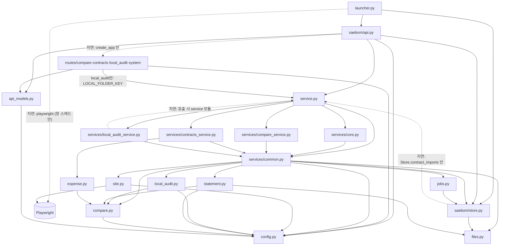
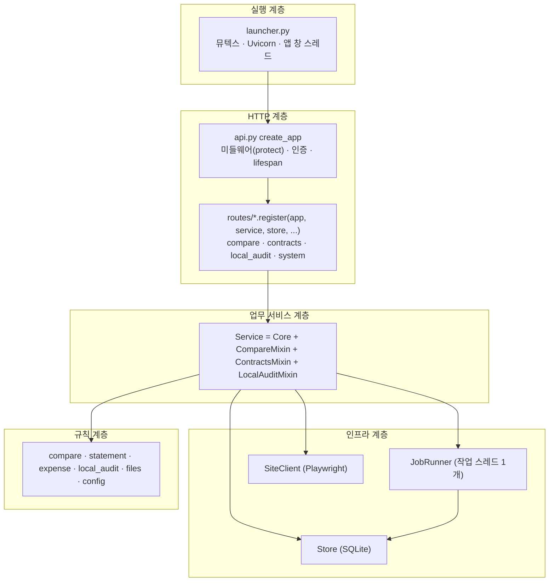
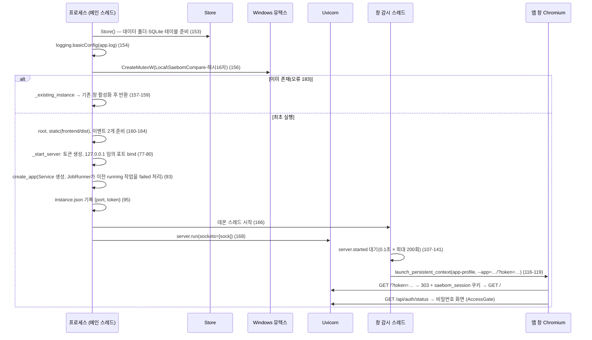
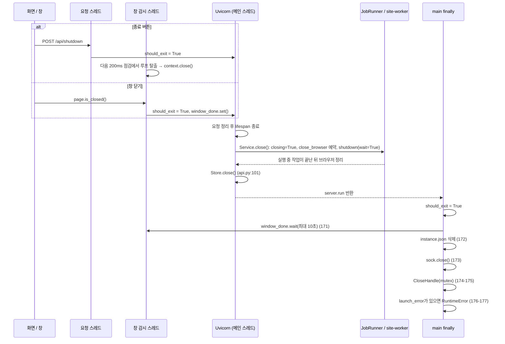

# 새봄 문서비교 시스템구성도

- 작성일: 2026-10-26
- 대상: 서버 구조를 고치거나 새 기능(작업·화면·API)을 추가하는 개발자
- 문서 기준: 소스 코드 기준 시점 2026-10-21 15:14(마지막 소스 수정). 이후 소스 변경 없음(2026-10-26 확인)
- 관련 문서: [기술설계서 3절 전체 아키텍처](../프로그램_기술설계서.md), [기술설계서 4절 실행과 종료](../프로그램_기술설계서.md), [기술설계서 13절 작업 실행과 동시성](../프로그램_기술설계서.md), [01_기능명세서](01_기능명세서.md), [11_용어집_변경이력](11_용어집_변경이력.md)

기술설계서가 이미 설명한 큰 그림(화면과 서버의 관계, 브라우저 컨텍스트 두 개, 시작·종료 개요, 작업 실행기 개요)은 반복하지 않습니다. 이 문서는 기술설계서에 없는 부분, 즉 실제 import 그래프, 잠금 획득 순서, 지연 import와 순환 의존, 믹스인이 암묵적으로 기대하는 속성, `closing` 확인이 작업마다 다른 점, 시작·종료의 세부 시퀀스를 코드에서 확인해 적습니다. 확인하지 못한 것은 "(추정)"으로 표시했습니다.

## 1. 한눈에 보는 구성

| 구분 | 위치 | 한 줄 설명 |
|---|---|---|
| 진입점 | `launcher.py` | 뮤텍스·서버·앱 창 수명 관리 |
| HTTP 경계 | `saebom/api.py`, `saebom/routes/*.py`, `saebom/api_models.py` | 인증 미들웨어, 요청 모델 검증, 라우트 등록 |
| 업무 서비스 | `saebom/service.py`, `saebom/services/*.py` | `Service` = `Core` + 3개 믹스인 |
| 작업 실행 | `saebom/jobs.py` | 단일 작업 스레드, 작업 상태 저장 |
| 사이트 접속 | `saebom/site.py` | Playwright 전용 브라우저(그룹웨어) |
| 저장소 | `saebom/store.py` | SQLite 단일 연결, 문서 경로, 저장 위치 이동 |
| 순수 규칙 | `saebom/compare.py`, `statement.py`, `expense.py`, `local_audit.py`, `files.py`, `config.py` | 네트워크·DB를 직접 쓰지 않는 규칙·상수(`statement.py`는 xlsx 파일을 읽고 씀) |
| 화면 | `frontend/src/` | React. 빌드 결과(`frontend/dist`)를 같은 서버가 정적 파일로 제공 |

## 2. 모듈 의존 그래프

아래는 `import` 문을 직접 읽어 만든 그래프입니다. 실선은 모듈 최상단 import, 점선은 함수 안에서 실행 시점에 하는 지연 import입니다. 표준 라이브러리와 외부 패키지는 핵심만 표시했습니다.



### 2.1 import 근거(핵심 줄)

| 의존 | 근거 |
|---|---|
| `launcher` → `api`, `store` | `launcher.py:23-24` |
| `api` → `api_models`, `config`, `service`, `store` | `saebom/api.py:23-26` |
| `api` ⇢ `routes` (지연) | `saebom/api.py:189` |
| `routes/local_audit` → `service` | `saebom/routes/local_audit.py:3` |
| `service` → 믹스인 5개 파일 | `saebom/service.py:2-6` |
| `services/common`이 규칙·인프라 모듈을 한곳에서 import | `saebom/services/common.py:18-24` |
| 믹스인·`Core`는 `from .common import *` | `services/core.py:2`, `compare_service.py:2`, `contracts_service.py:2`, `local_audit_service.py:2` |
| `contracts_service` → `expense` | `saebom/services/contracts_service.py:3` |
| `local_audit_service` ⇢ `service` (지연) | `saebom/services/local_audit_service.py:21` |
| `jobs` → `store`(`now`만) | `saebom/jobs.py:14` |
| `store` ⇢ `service` (지연) | `saebom/store.py:187` |
| `site` → `config`, `playwright` | `saebom/site.py:13,15` |

### 2.2 읽을 때 알아둘 점

- 순수 규칙 모듈(`compare`, `local_audit`, `statement`, `expense`)은 `service`, `store`, `jobs`, `site`를 import하지 않습니다. 의존 방향이 항상 서비스 → 규칙입니다. 그 덕분에 규칙 모듈은 단독으로 테스트할 수 있습니다(예: `local_audit.scan_folder`는 판독 함수를 인자로 받는다, `saebom/local_audit.py:78`).
- 규칙 모듈끼리의 의존은 `compare`를 향한 한 방향뿐입니다(`statement`, `expense`, `local_audit` → `compare`).
- `saebom/site.py:13`이 모듈 최상단에서 `playwright`를 import하므로, `service`를 import하는 순간 Playwright 패키지가 로드됩니다. `launcher.py:111`의 지연 import는 창 스레드 안에서 `sync_playwright`를 가져오는 용도이며 패키지 로드 시점을 늦추지는 못합니다.
- `saebom.service`는 `from .services.common import *`로 `common`의 모든 공개 이름(`extract`, `compare`, `Store`, `SiteClient` 등)을 다시 내보냅니다(`saebom/service.py:2`). 기존 import 경로와 테스트의 대체 지점(`saebom.service.extract` 등)을 유지하려는 구조입니다(`tests/test_local_audit.py:327`).

## 3. 계층 구조



| 계층 | 책임 | 하지 않는 일 |
|---|---|---|
| 실행(`launcher.py`) | 단일 실행, 포트·토큰, 앱 창, 종료 정리 | 업무 로직 |
| HTTP(`api.py`, `routes/`) | 요청 검증, 상태 코드, 파일 응답(`FileResponse`·CSV) | 직접 Playwright 호출, 작업 스레드 접근 |
| 서비스 | 작업 함수, 업무 순서, `Store`·`SiteClient`·규칙 모듈 조립 | 라우팅, HTTP 상태 코드 결정(`ValueError`·`LookupError`만 던진다) |
| 인프라 | 영속화·스레드·브라우저 | 업무 판단 |
| 규칙 | 입력 → 출력 변환, 검증 문구 | 파일 보관·네트워크(`statement.build`는 지정한 폴더에 xlsx를 씀) |

### 3.1 라우트가 서비스에 접근하는 경로

`create_app`이 각 `routes.register`에 `service`, `store`와 콜백(`ask_folder`, `strip_pages`, `shutdown`, `activate`)을 주입합니다(`saebom/api.py:192-194`). 라우트는 다음 세 가지 호출만 합니다.

| 호출 | 예 |
|---|---|
| `service.submit(종류, 함수, 인자…)`로 작업 접수 | `/api/sync`, `/api/download`, `/api/compare`, `/api/browser`, `/api/contracts/import`, `/api/local-audit/run`, `/api/contracts/{id}/expense` POST(서비스 메서드 `submit_expense` 안에서 접수) |
| `service.<동기 메서드>()` | `catalog`, `contract_catalog`, `statement_draft`, `create_statement`, `expense_draft`, `local_audit_state`, `set_local_folder` |
| `store.<메서드>()` 직접 호출 | `result_summaries`, `result`, `document`, `path`, `document_root`, `meta_get`, `set_document_root` |

라우트가 `service.site`나 `service.context`를 직접 쓰는 곳은 없습니다(`saebom/routes`와 `api.py`를 검색해 확인). 이것이 4.3절의 "Playwright는 작업 스레드에서만" 전제를 지키는 구조입니다.

## 4. 프로세스·스레드 모델

프로세스는 하나이고(PyInstaller EXE 또는 `python launcher.py`), 별도 서버 프로세스는 없습니다. 그룹웨어용 Chromium과 앱 창용 Chromium은 Playwright가 띄우는 자식 프로세스입니다.

### 4.1 스레드 목록

| 스레드 | 만드는 곳 | 하는 일 | 근거 |
|---|---|---|---|
| 메인 스레드 | 프로세스 시작 | `server.run(sockets=[sock])`으로 Uvicorn 이벤트 루프 실행. 미들웨어(`async def protect`)와 `lifespan`이 여기서 돈다 | `launcher.py:168`, `saebom/api.py:98,115` |
| 요청 처리 스레드(스레드풀) | FastAPI/Starlette | `def`로 정의한 라우트(이 앱의 모든 라우트가 `def`)가 실행된다. 풀 크기는 프레임워크 기본값(코드에서 지정하지 않음, 크기 수치는 추정) | `saebom/routes/*.py`의 `def` 핸들러 |
| 작업 스레드 `site-worker` 1개 | `JobRunner.__init__` | 백그라운드 작업(동기화·다운로드·비교·가져오기·상신·로컬 대조·브라우저 열기)을 FIFO로 하나씩 실행하고, 종료 때 `close_browser` 정리 함수도 실행 | `saebom/jobs.py:38` |
| 앱 창 감시 스레드(데몬) | `launcher.main` | 서버 준비를 기다린 뒤 앱 창용 Chromium을 열고 닫힘·활성화 이벤트를 200ms 간격으로 감시 | `launcher.py:106,166` |

요청 스레드에서 직접 실행되는 오래 걸리는 일이 둘 있습니다. 저장 위치 이동(`Store.set_document_root`, 배타 구간 안)과 거래명세서 생성(배타 구간 안)입니다. 폴더 선택 대화상자(`ask_folder`의 Tk 창)와 로컬 세금계산서 폴더 훑기(`local_audit_state` 안의 PDF 판독)도 요청 스레드에서 돕니다(`saebom/api.py:63-73`, `saebom/services/local_audit_service.py:51-60`). Tk 창을 요청 스레드에서 여는 문제는 [리팩토링 분석 리포트](../기획/리팩토링_분석_리포트.md)가 "제외한 항목"으로 적어 둔 것과 같은 지점입니다.

### 4.2 잠금 목록과 획득 순서

| 잠금 | 종류 | 소유 | 보호 대상 | 근거 |
|---|---|---|---|---|
| `Store.lock` | `RLock` | `Store` | SQLite 단일 연결(`check_same_thread=False`)의 모든 읽기·쓰기 | `saebom/store.py:53-54` |
| `JobRunner.lock` | `RLock` | `JobRunner` | `jobs` 사전, `busy`, 접수·전이 판단 | `saebom/jobs.py:39` |
| `login_lock` | `Lock` | `create_app` 클로저 | 로그인 실패 횟수·잠금 시각 | `saebom/api.py:87-88` |
| `Core._invoice_cache_lock` | `Lock` | `Core` | 로컬 대조용 세금계산서 판독 캐시 | `saebom/services/core.py:19` |

**획득 순서: `JobRunner.lock` → `Store.lock`.** `JobRunner.update`와 `submit`은 `JobRunner.lock`을 쥔 채 `persist()`를 부르고, `persist()`가 `Store.lock`을 잡는다(`saebom/jobs.py:58-60,69-72,81-88`). 반대 방향, 즉 `Store.lock`을 쥔 채 `JobRunner.lock`을 잡는 경로는 없습니다.

- `Store`는 `JobRunner`를 참조하지 않습니다(`store.py` 전체에 `runner`·`jobs` 참조 없음).
- 서비스 믹스인은 `Core.lock` 속성(`JobRunner.lock`의 별칭, `core.py:29-31`)을 쓰지 않습니다. 믹스인에서 `with self.lock`을 검색하면 결과가 없습니다.
- `JobRunner.__init__`은 `Store.lock`만 잡고 `JobRunner.lock` 없이 `meta.jobs`를 읽습니다(`jobs.py:43-44`). 이때는 아직 다른 스레드가 이 객체를 모릅니다.
- `Store` 내부 메서드끼리는 `RLock`이라 재진입합니다(`set_document_root`가 `items()`를 부르는 경우, `store.py:404-407`). 쓰기 메서드는 `with self.lock, self.db:` 순서로 잡아 잠금 → 트랜잭션 순서가 일정합니다.
- `login_lock`과 `_invoice_cache_lock`은 다른 잠금을 쥐고 잡는 일이 없는 말단 잠금입니다. `_cached_invoice`는 PDF 판독(`extract`)을 잠금 밖에서 하고 캐시 조회·저장 때만 잠깁니다(`local_audit_service.py:18-27`).

이 순서 규칙을 어기는 새 코드(예: `Store` 메서드 안에서 작업 상태를 갱신)를 추가하면 교착이 생길 수 있으니 주의합니다.

### 4.3 Playwright는 작업 스레드에서만 쓴다는 전제

`SiteClient`는 Playwright 동기 API의 스레드 제약 때문에 "모든 메서드를 단일 작업 스레드에서 호출하는 것이 전제"라고 코드에 적혀 있습니다(`saebom/site.py:67`). 확인한 사실은 다음과 같습니다.

| 항목 | 내용 |
|---|---|
| 사이트 브라우저를 부르는 서비스 메서드 | `sync`, `download_one`(다운로드·가져오기·로컬 대조에서 호출), `import_contracts`, `run_local_audit`, `run_expense`, `open_browser`. 모두 `JobRunner.submit`으로 접수된 작업 함수 안에서만 실행된다. |
| 라우트·요청 스레드 | `service.site`·`service.context`·`service.browser()`를 부르지 않는다(검색 결과 없음). |
| 종료 정리 | `Service.close()`가 `JobRunner.close(cleanup=self.close_browser)`를 호출하고, 정리 함수도 같은 작업 스레드에 예약한다(`saebom/services/core.py:199-200`, `saebom/jobs.py:148-152`). 단일 스레드 FIFO이므로 실행 중이던 작업이 끝난 뒤에 브라우저가 닫힌다. |
| 별도의 두 번째 Playwright | 앱 창 감시 스레드가 자기 `sync_playwright()` 인스턴스를 따로 만든다(`launcher.py:115`). 사이트 브라우저의 인스턴스와 스레드·프로필(`app-profile/` 대 `browser-profile/`)이 모두 다르다. |

즉 "프로세스 안에 Playwright 인스턴스가 두 개, 각자 한 스레드 전용"이 실제 구조입니다. 새 기능에서 요청 스레드가 직접 `SiteClient`를 쓰면 이 전제가 깨집니다. 테스트가 `SiteClient` 대역을 쓰는 방식은 확인하지 못했습니다(추정: 대역 주입, 4.6절 참고).

### 4.4 배타 구간(`JobRunner.exclusive`)

배타 구간은 요청 스레드에서 오래 걸리는 동기 작업을 하는 동안 새 작업 접수를 막는 표시(`busy`)입니다.

| 항목 | 내용 |
|---|---|
| 진입 검사 | `JobRunner.lock` 안에서 종료 중(`closing`), 다른 구간 진행 중(`busy`), 실행 중 작업이 하나라도 있으면 `ValueError`(`saebom/jobs.py:128-133`) |
| 진입 후 | `busy=label`을 켜고 `JobRunner.lock`을 풀고 본문을 실행한다. 본문이 도는 동안 잠금을 쥐지 않는다. |
| 종료 | `finally`에서 잠금을 잡고 `busy=None`(`jobs.py:135-139`) |
| 사용처 | 저장 위치 변경(`saebom/routes/system.py:40`), 거래명세서 생성(`saebom/services/contracts_service.py:118`) |
| 효과 | 구간 동안 `submit`과 다른 `exclusive`가 400으로 거절된다. 이미 진행 중인 구간을 기다리지 않는다. |
| 한계 | 구간은 "작업 접수"만 막는다. 조회성 요청(`/api/state` 등)은 막지 않지만, 저장 위치 이동은 이동 내내 `Store.lock`을 쥐므로 `Store`를 읽는 요청은 이동이 끝날 때까지 기다린다(`saebom/store.py:404`). 거래명세서 생성은 `Store` 잠금을 쥐지 않는다. |

### 4.5 `closing` 확인이 작업마다 다른 점

`JobRunner.close`가 `closing=True`로 바꾸면 이후 `submit`·`exclusive`는 접수를 거절합니다. 이미 실행 중인 작업이 스스로 중단하려면 작업 함수가 `closing`을 확인해야 합니다. 확인 여부는 일정하지 않습니다.

| 작업 함수 | `closing` 확인 | 근거 | 종료 요청 시 동작 |
|---|---|---|---|
| `sync` | 하지 않음 | `compare_service.py:14-22` | 끝까지 실행 |
| `download` | 파일마다 확인 | `compare_service.py:134-135` | "프로그램 종료 요청으로 중단했습니다. 저장한 파일은 유지됩니다." |
| `run_compare`(비교·보정 재비교) | 하지 않음 | `compare_service.py:154-189` | 끝까지 실행(네트워크 미사용이라 짧음) |
| `import_contracts` | 계약마다 확인 | `contracts_service.py:29-30` | "프로그램 종료 요청으로 중단했습니다. 가져온 계약은 유지됩니다." |
| `run_expense` | 하지 않음 | `contracts_service.py:161-182` | 상신·검토·저장까지 끝까지 실행 |
| `run_local_audit` | 파일마다 확인 | `local_audit_service.py:116-117` | "프로그램 종료 요청으로 중단했습니다. 이전 대조 결과는 유지됩니다." |
| `open_browser` | 하지 않음 | `core.py:146-148` | 즉시 끝남 |

결과적으로 `close()`의 `pool.shutdown(wait=True)`(`jobs.py:152`)는 제한 시간이 없습니다. 실행 중인 작업이 `sync`나 `run_expense`이면 그 작업이 끝날 때까지 서버 종료가 기다립니다. `launcher.main`의 10초 대기(`window_done.wait(timeout=10)`)는 `server.run`이 끝난 뒤에 시작하므로 이 대기를 제한하지 못합니다(`launcher.py:168-171`). 사이드바의 "프로그램 종료" 버튼은 작업 중에는 비활성이지만(`App.tsx:335`) 앱 창 닫기는 작업 중에도 가능합니다.

### 4.6 SQLite 접근

`Store`는 연결 하나를 모든 스레드가 공유합니다(`check_same_thread=False`, WAL 모드, `store.py:54-55`). 쓰기는 `with self.lock, self.db`로 잠금과 트랜잭션을 묶고, 읽기도 `with self.lock`으로 직렬화합니다. 따라서 동시 요청이 많아도 DB 접근은 한 번에 하나입니다. `/api/state`는 호출될 때마다 `catalog()`가 메일·계약·문서를 읽어 조립하므로(`compare_service.py:34-87`) 화면 폴링(작업 중 1초, 평소 8초)과 겹치면 잠금 경합이 생길 수 있습니다(영향 정도는 측정하지 않음, 추정).

## 5. 시작·종료 시퀀스

### 5.1 시작 시퀀스

`launcher.main`(`launcher.py:152-177`)의 실제 순서입니다.



시작 시퀀스에서 코드로만 알 수 있는 세부는 다음과 같습니다.

- `Store()`가 뮤텍스 검사보다 먼저 만들어집니다(`launcher.py:153-156`). 두 번째 실행도 같은 SQLite 파일을 열어 `CREATE TABLE IF NOT EXISTS`와 `PRAGMA journal_mode=WAL`을 실행한 뒤 `_existing_instance`에서 연결을 닫습니다(`launcher.py:66`). `app.log`도 두 번째 실행이 같은 파일에 기록합니다. 뮤텍스 이름은 `store.root`의 SHA-256 앞 16자로 정해지므로 `SAEBOM_DATA_DIR`을 다르게 주면 서로 다른 인스턴스로 취급됩니다(`launcher.py:42`).
- `Service`(`JobRunner`)는 `create_app` 안에서 만들어지므로 두 번째 실행은 만들지 않고, 이전 실행에서 `running`으로 남은 작업의 `failed` 전환은 최초 실행에서만 일어납니다(`saebom/jobs.py:43-49`).
- 포트는 `_start_server`에서 먼저 bind한 소켓을 `server.run(sockets=[sock])`에 넘겨 같은 포트를 씁니다. `instance.json`은 서버가 시작하기 전에 기록됩니다(`launcher.py:95,168`). 서버가 아직 준비되지 않았을 때 두 번째 실행이 읽으면 `/health` 호출이 실패하고 0.25초 간격으로 최대 40회 재시도합니다(`launcher.py:54-65`).
- 앱 창은 `SAEBOM_NO_OPEN=1`이면 열지 않고 `window_done`만 세웁니다(`launcher.py:109,138-139`). 이때 서버는 `/api/shutdown`이나 프로세스 종료까지 계속 돕니다.
- 앱 창 Chromium은 `--app=...` 옵션과 `--window-size=1440,960`, `no_viewport=True`, `ignore_default_args=["--enable-automation", "about:blank"]`로 열립니다(`launcher.py:116-119`).
- `_run_window`가 200회(약 20초) 안에 `server.started`가 되지 않으면 아무 것도 하지 않고 스레드를 끝냅니다. 이때 창이 없고 `launch_error`도 비어 있어 오류 표시 없이 서버만 남습니다(`launcher.py:107-141`, 추정: 정상 환경에서는 일어나지 않음).

### 5.2 종료 시퀀스

종료를 시작하는 경로는 세 가지이고 모두 `server.should_exit = True`로 모입니다.

| 경로 | 설정 위치 |
|---|---|
| "프로그램 종료" 버튼 → `POST /api/shutdown` | `saebom/routes/system.py:95-97` → `launcher.py:90-91`의 `shutdown` 콜백 |
| 앱 창 닫기(또는 창 감시 중 오류) | `_run_window`의 `while` 종료와 `finally`(`launcher.py:122,135-137`) |
| 외부 시그널(Ctrl+C 등) | Uvicorn 기본 시그널 처리(코드에서 따로 다루지 않음, 추정) |



종료의 세부 사항입니다.

- 정리 순서가 두 층입니다. 서버 안(`lifespan`)에서 `Service.close()` → `Store.close()`(`saebom/api.py:98-101`), 서버가 끝난 뒤(`main`의 `finally`)에서 창 스레드 대기 → `instance.json` 삭제 → 소켓 → 뮤텍스(`launcher.py:169-175`).
- `lifespan`의 `service.close()`는 동기 함수라 이벤트 루프를 막습니다. 실행 중 작업이 있으면 4.5절의 이유로 그 작업이 끝날 때까지 기다립니다.
- 창 감시 스레드가 앱 창을 닫을 때 `context.close()`를 부르고 `finally`에서 `should_exit`를 세우고 `window_done`을 세웁니다(`launcher.py:131-137`). 서버 종료 요청이 먼저 오면 창 감시 루프가 200ms 안에 이를 감지해 창을 닫습니다.
- 창을 여는 데 실패한 예외는 `launch_error`에 모았다가 서버가 끝난 뒤 `RuntimeError("앱 창을 열지 못했습니다. …")`로 던집니다. `__main__`이 이를 받아 `app.log`에 기록하고 Windows 메시지 상자를 띄웁니다(`launcher.py:176-188`).
- `main`은 정상 종료 때 `Store.close()`를 직접 부르지 않고 `lifespan`에 맡깁니다. 서버가 한 번도 시작하지 못하고 예외가 나면 `Store`가 닫히지 않은 채 프로세스가 끝납니다(영향 없음, 추정).

### 5.3 중복 실행 시퀀스

| 단계 | 동작 | 근거 |
|---|---|---|
| 1 | 같은 이름 뮤텍스가 있으면 `already=True` | `launcher.py:43` |
| 2 | `instance.json`의 포트·토큰을 읽고 `/health`가 200인지 확인(0.25초 간격, 최대 40회) | `launcher.py:54-57` |
| 3 | 세션 쿠키 `saebom_session=<토큰>`으로 `POST /api/activate` | `launcher.py:58-61` |
| 4 | 기존 실행의 `activate` 이벤트가 켜지고 창 감시 스레드가 `bring_to_front()` 실행 | `saebom/routes/system.py:109`, `launcher.py:124-126` |
| 5 | 두 번째 프로세스는 `Store`를 닫고 반환(뮤텍스 핸들은 프로세스 종료로 정리) | `launcher.py:62-63,157-159` |

40회(약 10초) 안에 기존 서버가 응답하지 않으면 조용히 반환합니다(`launcher.py:66`). 사용자에게는 아무 창도 뜨지 않는 것처럼 보입니다.

## 6. 런타임 파일·폴더 배치

```text
%LOCALAPPDATA%\SaebomCompare\          ← Store.root (환경변수 SAEBOM_DATA_DIR로 바꿀 수 있음, store.py:50)
├─ saebom.sqlite3                       SQLite 본체 (WAL 모드: -wal, -shm 보조 파일 동반)
├─ app.log                              logging.basicConfig 대상 (launcher.py:154)
├─ instance.json                        {port, token}. 서버 시작 전 기록, 종료 때 삭제 (launcher.py:95,172)
├─ app-profile\                         앱 창 Chromium 프로필 (launcher.py:117)
├─ browser-profile\                     그룹웨어 자동화 Chromium 프로필 (core.py:17)
├─ documents\                           disk_path가 없는 옛 문서의 호환 경로 (store.py:52, core.py:159)
└─ 원본PDF\                             document_root 기본값 (store.py:292). 첫 다운로드 때 만들어짐

<document_root>\                        meta.document_root 값. 기본은 위의 원본PDF
├─ 세금계산서\<해시12>_<파일명>.pdf
├─ 계약서\<해시12>_<파일명>.pdf
└─ 거래명세서\거래명세서_….xlsx          거래명세서 생성 때 처음 만들어짐. documents에 등록되지 않음 (files.py:12)

D:\ChaAI\07_auto\ (배포 EXE에서는 PyInstaller 번들 경로 _MEIPASS)
├─ frontend\dist\                       정적 화면 파일 (launcher.py:161)
├─ saebom\assets\거래명세서_템플릿.xlsx   거래명세서 양식 (statement.py:46-49)
└─ browser\                             번들 Chromium. 있으면 PLAYWRIGHT_BROWSERS_PATH로 지정 (launcher.py:113-114, site.py:96-98)
```

SQLite 테이블과 `meta` 키는 다음과 같습니다(`saebom/store.py:58-65`와 코드 검색으로 확인).

| 테이블 | 키 | 내용 | 쓰는 곳 |
|---|---|---|---|
| `items` | `(kind, id)` | 동기화 스냅샷(`mails`, `contracts`). 동기화 때 통째로 교체 | `Store.snapshot` |
| `documents` | `id`, `source`(URL, 유니크) | 저장한 PDF의 해시·경로·추출 결과·`kind` | `Store.save_document` |
| `results` | `id` | 비교 결과 JSON | `Store.save_result` |
| `contract_imports` | `id`(관리번호) | 가져온 계약. 동기화로 지워지지 않음 | `Store.save_contract_import` |
| `contract_status` | `id`(관리번호) | `품의완료/없음`과 상신 정보 | `Store.save_contract_status` |
| `meta` | `synced` | 마지막 동기화 시각 | `Store.snapshot` |
| `meta` | `jobs` | 작업 목록 JSON(최근 20개) | `JobRunner.persist` |
| `meta` | `document_root` | PDF 보관 폴더 | `Store._commit_root` |
| `meta` | `local_invoice_folder` | 로컬 대조 세금계산서 폴더 | `Service.set_local_folder` |
| `meta` | `local_audit` | 마지막 로컬 대조 결과 1건 | `Service.run_local_audit` |

기술설계서의 폴더 도식([11.2절](../프로그램_기술설계서.md))에 더해, 위 도식에는 번들 경로의 자산(`browser\`, 템플릿)과 `거래명세서\` 폴더가 만들어지는 시점을 적었습니다.

## 7. `Service` 믹스인이 암묵적으로 기대하는 속성

`Service`는 `Core`, `CompareMixin`, `ContractsMixin`, `LocalAuditMixin`을 상속합니다(`saebom/service.py:9`). 믹스인은 부모 클래스를 명시하지 않고 `self.<이름>`으로 `Core`와 서로의 속성을 씁니다. 코드를 검색해 확인한 의존 목록입니다(`self.` 호출 표 기준).

| 믹스인 | 기대하는 속성·메서드 | 제공자 |
|---|---|---|
| `CompareMixin` | `store`, `site`, `closing`, `update`, `browser`, `download_one`, `_doc_path` | `Core` |
| `ContractsMixin` | `store`, `site`, `closing`, `update`, `submit`, `exclusive`, `download_one`, `_doc_path` | `Core` |
| `ContractsMixin` 내부 | `_statement_source`, `statement_folder`, `expense_draft`, `run_expense` | 같은 믹스인 |
| `LocalAuditMixin` | `store`, `site`, `closing`, `update`, `download_one`, `_doc_path`, `_invoice_cache`, `_invoice_cache_lock` | `Core`(마지막 둘은 `Core.__init__`이 만든 속성) |
| `LocalAuditMixin` | 모듈 이름 `service_module.extract`(호출 시점에 `saebom.service` import) | `saebom/service.py`의 재노출 |
| 라우트 | `service.catalog()`(`routes/system.py`의 `/api/state`)는 `CompareMixin`에 있는데 `system` 라우트가 사용한다 | `CompareMixin` |

`Core`가 `__init__`에서 만드는 속성은 `store`, `runner`, `site`, `_invoice_cache`, `_invoice_cache_lock`이며, 나머지(`lock`, `jobs`, `closing`, `context`)는 프로퍼티, `submit`, `update`, `exclusive`, `jobs_snapshot` 등은 `JobRunner` 위임 메서드입니다(`saebom/services/core.py:14-113`). 믹스인을 새로 추가할 때 다음을 지켜야 합니다.

- 믹스인 파일 상단에서 `from .common import *`로 규칙 모듈 이름(`compare`, `statement`, `local_audit`, `KIND_FOLDERS`, `now` 등)을 가져옵니다. `common`에 `__all__`이 없어 밑줄로 시작하지 않는 이름이 모두 노출됩니다.
- `Core`의 속성 이름을 바꾸면 믹스인과 테스트 대체 지점이 조용히 깨집니다. 속성이 없을 때는 `AttributeError`가 실행 시점에 난다(타입 검사나 추상 클래스 선언이 없음).
- `Core.context`는 `SiteClient.context`의 읽기·쓰기 프로퍼티입니다(`core.py:51-58`). 테스트가 이 값을 대체하는 경로로 보이지만 어떤 테스트가 쓰는지는 확인하지 못했습니다(추정).

## 8. 지연 import와 순환 의존

| 순환·지연 | 위치 | 이유(코드 주석 기준) | 위험 |
|---|---|---|---|
| `store` ⇢ `service` | `saebom/store.py:187`, `Store.contract_imports` 안 | `service`가 `store`를 import하므로 순환을 피해 지연 import | `contract_sort_key`는 `services/common.py:46`에 있어서 `store`가 서비스 계층의 정렬 규칙에 의존한다. `Store`만 단독으로 쓰는 코드(예: 다른 스크립트)도 `contract_imports()` 호출 때 서비스 전체(Playwright 포함)를 로드한다. |
| `local_audit_service` ⇢ `service` | `saebom/services/local_audit_service.py:21` | 테스트가 `saebom.service.extract`를 대체할 수 있도록 호출 시점에 모듈 속성을 읽는다 | `core.py`의 `download_one`은 자기 모듈 전역의 `extract`를 쓰므로(`core.py:188`) `saebom.service.extract` 대체는 로컬 대조의 판독에만 영향을 준다. |
| `api` ⇢ `routes` | `saebom/api.py:189` | 확인하지 못함(코드에 이유 주석 없음). `routes/local_audit.py:3`이 `service`를 import하므로 `service` 로드 후에 라우트를 불러오려는 의도로 보인다(추정) | `routes`를 최상단 import로 바꾸면 순환은 아니지만 import 순서가 달라진다. |
| `launcher` ⇢ `playwright` | `launcher.py:111` | 창 스레드 안에서 `SAEBOM_NO_OPEN=1`이 아닐 때만 필요 | `site.py`가 이미 최상단에서 import하므로 실제 지연 효과는 없다. |

`saebom/routes/local_audit.py`가 `from ..service import LOCAL_FOLDER_KEY`로 `service` 모듈에서 상수를 가져오는 것도 같은 재노출 구조에 의존합니다(상수 정의는 `services/common.py:31`).

## 9. 기존 문서와 어긋난 점

| 번호 | 기존 문서 | 기존 서술 | 코드로 확인한 사실 |
|---|---|---|---|
| 1 | [기술설계서 3.2절](../프로그램_기술설계서.md) 표 | 그룹웨어 자동화 컨텍스트의 생성 위치가 `saebom/service.py` | `SiteClient`가 `saebom/site.py:87-103`에서 만들고, `Core.__init__`이 `SiteClient`를 소유한다(`saebom/services/core.py:17`). `service.py`는 11줄짜리 조합 파일이다. |
| 2 | [기술설계서 13절](../프로그램_기술설계서.md) | 작업은 동기화·브라우저 열기·다운로드·비교·보정 재비교, 배타 구간은 저장 위치 변경 | 계약서 가져오기·지출결의서 상신·로컬 대조도 작업이고, 거래명세서 생성도 배타 구간이다(`contracts_service.py:118`). |
| 3 | [기술설계서 4.3절](../프로그램_기술설계서.md) | "서비스가 그룹웨어 자동화 컨텍스트와 작업 실행기를 정리" | 정리는 `lifespan` → `Service.close()` 경로이며 브라우저 정리 함수가 작업 스레드에 예약되어 실행 중이던 작업 뒤에 실행된다. 작업별 `closing` 확인이 달라(4.5절) 종료가 작업 완료까지 기다릴 수 있다는 서술은 기존 문서에 없다. |

## 10. 확인하지 못한 항목

| 번호 | 내용 | 이유 |
|---|---|---|
| 1 | 요청 처리 스레드풀의 실제 크기 | 코드에서 지정하지 않고 프레임워크 기본값에 의존한다(수치는 확인하지 않음, 추정). |
| 2 | 테스트가 `SiteClient`·Playwright를 대체하는 방식 | 이 작업의 읽기 범위에 테스트 코드를 포함하지 않았다(추정: 대역 주입). |
| 3 | Ctrl+C 등 외부 시그널 종료 때 `lifespan`·`main`의 정리 흐름 | 코드에 별도 처리가 없고 Uvicorn 기본 동작에 의존한다(추정). |
| 4 | `/api/state` 폴링과 `Store.lock` 경합의 실제 체감 영향 | 측정하지 않았다(추정). |
| 5 | `api.py:189`에서 `routes`를 지연 import한 의도 | 코드에 이유가 적혀 있지 않다(추정). |
| 6 | `_run_window`가 20초 안에 서버 시작을 못 본 경우의 실제 증상 | 재현하지 않았다(추정). |
