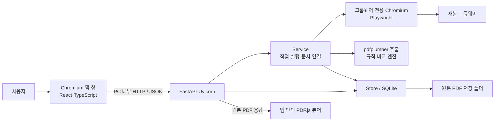
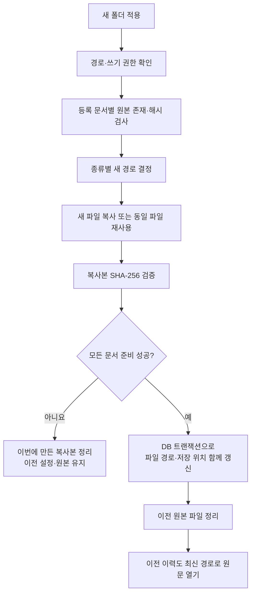

# 새봄 문서비교 프로그램 기술·동작 원리 설계서

- 작성일: 2026-10-19
- 대상 폴더: `D:\ChaAI\07_auto`
- 문서 기준: 작성일 현재의 구현 코드와 검증 기록
- 앱 표시 버전: 1.0.0
- 대상 실행 환경: Windows 데스크톱

> 이 문서는 현재 구현을 설명합니다. 초기 기획서에 있던 기본 브라우저 탭 실행과 ‘설정 변경 이후 다운로드에만 새 폴더 적용’ 방식은 변경되었습니다. 현재는 주소창 없는 앱 창을 사용하며, 저장 위치를 바꾸면 기존에 등록된 PDF도 함께 이동합니다.

## 1. 프로그램의 목적과 처리 범위

새봄 그룹웨어에 등록된 세금계산서 PDF와 계약서 PDF를 연결하여, 사업자등록번호·업체명·공급가액·부가세·합계액·계약기간·분할 지급 조건을 대조하는 로컬 업무 도구입니다.

사용자가 기업을 선택하면 앱이 추천 계약을 연결합니다. 사용자가 연결 관계를 확인하고 PDF를 저장한 다음 비교를 실행하면, 항목별 실제값·계약 기준값·차이·원문 근거가 표시됩니다. 비교 이력과 수동 보정 이력도 PC에 남습니다.

핵심 처리 방식은 **PDF의 텍스트를 읽고, 현재 문서 양식에 맞춘 정규표현식으로 값을 추출한 뒤, 명시적인 계산 규칙으로 비교하는 방식**입니다. 생성형 AI, AI API, OCR, 문서 의미 추론 모델은 사용하지 않습니다.

| 처리 영역  | 현재 구현                                   |
| ------ | --------------------------------------- |
| 목록 수집  | 그룹웨어 화면을 브라우저로 열어 메일·계약 목록 추출           |
| 문서 수집  | 사용자가 선택한 실제 PDF 첨부 링크 다운로드              |
| 데이터 판독 | 텍스트 PDF에서 지정 양식의 항목 추출                  |
| 비교     | 금액·세액·기간·사업자번호 등을 규칙으로 대조               |
| 원문 확인  | 두 PDF를 앱 안에 나란히 표시                      |
| 수정     | 계산서 추출값 수동 보정 후 새 비교 이력 생성              |
| 저장     | SQLite에 설정·목록·추출값·결과 저장, PDF는 파일로 보관    |
| 배포     | Python·Node 설치 없이 사용할 수 있는 폴더형 EXE와 ZIP |

인터넷은 목록 갱신, 사이트 접속, PDF 다운로드에 필요합니다. 파일과 목록이 저장된 후 비교·원문 조회·이력 조회·CSV 내보내기는 로컬에서 처리합니다.

## 2. 사용 기술과 역할

다음 버전은 Python 가상환경 및 프런트엔드 `package-lock.json`을 확인한 값입니다. `package.json`에는 `^`를 포함한 허용 버전 범위가 있으므로 실제 고정 버전과 구분해야 합니다.

| 계층         | 기술 / 확인 버전                   | 역할                              |
| ---------- | ---------------------------- | ------------------------------- |
| 실행 언어      | Python 3.12.1                | 서버, PDF 처리, 파일 관리, 앱 실행 제어      |
| API 서버     | FastAPI 0.115.0              | 화면의 요청을 받아 설정·작업·문서·결과 제공       |
| 서버 실행기     | Uvicorn 0.34.0               | PC 내부 HTTP 서버 실행                |
| 입력 검증      | Pydantic                     | 비교 대상과 수동 보정값 등의 형식·범위 검증       |
| 화면         | React / React DOM 19.3.1     | 목록·비교·원문·설정 화면의 상태와 렌더링         |
| 화면 언어      | TypeScript 5.9.3             | 데이터 형식 선언과 빌드 시 타입 검사           |
| 화면 빌드      | Vite 6.4.4                   | React 소스를 배포용 정적 파일로 변환         |
| 아이콘        | lucide-react 0.468.0         | 메뉴·버튼·판정 아이콘                    |
| 브라우저 제어    | Playwright 1.60.0            | 앱 창 수명 관리, 그룹웨어 탐색, 첨부 PDF 요청   |
| 앱 표시       | 번들 Chromium의 앱 모드            | 주소창·탭이 없는 전용 창 제공               |
| PDF 텍스트 추출 | pdfplumber 0.11.9            | 각 페이지의 텍스트 읽기                   |
| PDF 화면 표시  | PDF.js / pdfjs-dist 6.4.299  | PDF를 Canvas에 렌더링                |
| 데이터베이스     | Python 표준 `sqlite3` / SQLite | 설정·목록·문서 메타데이터·결과 영속 저장         |
| 금액 계산      | Python `Decimal`             | 세액 계산과 원 단위 반올림                 |
| 파일 식별      | SHA-256                      | PDF 내용 식별, 이동 전후 동일성 확인         |
| 패키징        | PyInstaller 6.18.0           | Python과 의존성을 포함한 Windows EXE 생성 |
| 자동 테스트     | pytest 8.4.2, httpx 0.28.1   | 비교 규칙·API·파일 이동 등 검증            |
| 폴더 선택      | Tkinter 파일 대화상자              | Windows에서 저장 폴더 선택              |

PDF 표시와 PDF 판독은 별도 기능입니다. PDF.js는 사용자에게 원문을 보여 주고, pdfplumber는 비교에 사용할 텍스트를 읽습니다. PDF.js 화면에 문서가 보인다고 해서 그 문서가 자동 비교 가능한 텍스트 양식이라는 뜻은 아닙니다.

## 3. 전체 아키텍처



### 3.1 화면과 서버의 관계

앱 화면은 웹 기술로 구현되지만 서버를 외부에 배포하지 않습니다. `launcher.py`가 `127.0.0.1`의 사용 가능한 포트를 선택해 서버를 띄우고, 같은 PC의 Chromium 창이 그 서버에 접속합니다.

프런트엔드는 `fetch('/api/...')`로 데이터를 요청합니다. FastAPI는 JSON 결과를 반환하거나 PDF·CSV 파일을 전달합니다. 화면 정적 파일도 같은 서버에서 제공하므로 별도의 프런트엔드 서버가 필요하지 않습니다.

### 3.2 브라우저 컨텍스트 두 개의 역할

| 구분 | 앱 화면용 | 그룹웨어 자동화용 |
|---|---|---|
| 생성 위치 | `launcher.py` | `saebom/service.py` |
| 접속 대상 | PC 내부 서버 | `https://sbgw.vercel.app/` |
| 프로필 폴더 | `app-profile/` | `browser-profile/` |
| 표시 방식 | 주소창 없는 앱 모드 | 사이트 탐색용 전용 브라우저 |
| 주된 역할 | 프로그램 UI와 창 수명 관리 | 목록 수집·로그인 세션·첨부 요청 |

앱 화면을 주소창 없이 실행하는 것과 그룹웨어에 로그인하는 것은 별개입니다. 그룹웨어에서 로그인이 필요한 경우 사용자가 전용 브라우저에서 진행합니다.

### 3.3 주요 소스 파일

| 파일                           | 책임                                   |
| ---------------------------- | ------------------------------------ |
| `launcher.py`                | 중복 실행 방지, 로컬 서버 기동, 앱 창 실행·활성화·종료    |
| `saebom/api.py`              | HTTP API, 세션·출처 검증, 파일 응답, 요청 형식 검증  |
| `saebom/service.py`          | 작업 큐, 그룹웨어 수집, 계약 추천, 다운로드, 비교 실행    |
| `saebom/compare.py`          | PDF 텍스트 추출, 항목 인식, 금액·기간 비교 규칙       |
| `saebom/store.py`            | SQLite 접근, 문서 경로 조회, 저장 위치 이동, 결과 저장 |
| `frontend/src/main.tsx`      | React UI, 선택 상태, API 호출, PDF 뷰어      |
| `frontend/src/style.css`     | 화면 스타일, 반응형 배치, 3단 너비와 스크롤           |
| `scripts/build.py`           | 프런트 빌드·PyInstaller·브라우저 번들·ZIP 생성    |
| `scripts/copy_pdf_assets.py` | PDF.js 글꼴·문자 매핑·WASM 자산 로컬 복사        |
| `tests/test_app.py`          | 비교·API·오프라인 처리·저장 위치 이동 회귀 테스트       |
| `scripts/verify_ui.py`       | 실제 브라우저의 화면·스크롤·비교·파일 이동 검증          |

## 4. EXE 실행과 종료 원리

### 4.1 시작 순서

1. `Store`를 열어 앱 데이터 폴더와 SQLite를 준비합니다.
2. 앱 데이터 폴더에 `app.log`를 기록하도록 설정합니다.
3. Windows 이름 있는 Mutex를 생성해 같은 데이터 폴더를 사용하는 중복 실행을 막습니다.
4. `127.0.0.1`에 임시 포트를 배정하고 실행별 무작위 세션 토큰을 만듭니다.
5. 포트와 토큰을 `instance.json`에 기록합니다.
6. Uvicorn 서버를 시작합니다.
7. 서버 시작을 확인한 별도 스레드가 Chromium을 `--app=...` 옵션으로 엽니다.
8. 최초 접속의 토큰이 맞으면 서버가 세션 쿠키를 설정하고 `/`로 리다이렉트합니다.
9. React 화면이 `/api/state`, `/api/results`를 읽어 목록과 이전 결과를 복원합니다.

현재는 9단계 전에 `AccessGate`가 `/api/auth/status`로 잠금 해제 여부를 확인합니다. 새 실행에서는 비밀번호 화면을 표시하며, `0000`을 입력해 `/api/auth/login` 검증을 통과한 뒤에만 `App`을 마운트하고 문서·이력을 조회합니다. 비밀번호는 화면 코드에서 비교하지 않고 서버에서 확인합니다.

### 4.2 중복 실행

동일 Mutex가 이미 있으면 두 번째 실행은 새 서버를 만들지 않습니다. `instance.json`의 포트로 기존 서버 상태를 확인하고 인증된 `/api/activate` 요청을 보냅니다. 기존 실행의 앱 스레드가 활성화 이벤트를 받아 화면을 앞으로 가져옵니다.

### 4.3 정상 종료

앱 창을 닫거나 **프로그램 종료**를 누르면 서버 종료가 시작됩니다. 앱 화면용 Chromium 컨텍스트를 닫고, 서비스가 그룹웨어 자동화 컨텍스트와 작업 실행기를 정리합니다. SQLite 연결과 서버 소켓을 닫고 `instance.json` 및 Mutex를 정리합니다.

Playwright 연결을 유지하면서 실제 페이지의 종료 상태를 관찰합니다. Windows에서 Chromium을 시작하는 중간 프로세스의 종료를 앱 창 종료로 잘못 판단하지 않도록 한 구조입니다.

## 5. 사용자 화면과 상태 관리

### 5.1 3단 비교 화면

| 단 | 표시 내용 | 사용자 동작 |
|---|---|---|
| 1단: 비교할 기업 | PDF 첨부 메일, 기업·제목·날짜·저장 상태·추천 계약 | 기업 클릭, 검색, 날짜 필터, 전체 선택·해제 |
| 2단: 문서 연결·비교 | 선택 기업의 계산서 PDF와 연결 계약 | 첨부 변경, 계약 변경, 다운로드, 비교 실행 |
| 3단: 비교 결과·원문 | 전체 판정, 항목별 값·차이·근거, 원문·보정·CSV | 결과 선택, 두 PDF 보기, 수동 보정 |

기업 목록의 한 항목은 메일 한 건입니다. 같은 기업의 여러 달 또는 여러 차수 계산서는 별도 항목으로 나타날 수 있으며, 함께 선택해 누적 비교할 수 있습니다.

클릭하면 해당 메일의 첫 PDF를 선택합니다. 추천 계약이 정확히 한 건이면 자동 연결하고, 후보가 없거나 여러 건이면 사용자가 선택하도록 둡니다. PDF 없는 메일은 비교 목록에서 제외합니다.

### 5.2 비교 버튼 활성화

- 다운로드: 한 건 이상 선택되고 모든 선택 메일에 계약이 연결되어야 합니다.
- 비교: 위 조건에 더해 연결한 계산서와 계약서 파일이 모두 실제 경로에 있어야 합니다.
- 작업 진행 중이나 저장 위치 이동 중에는 충돌하는 조작을 막습니다.

### 5.3 반응형과 스크롤

넓은 화면은 3열입니다. 기본 너비 비율은 27:32:41이며, 경계선 드래그 또는 키보드 좌우 방향키로 조절합니다. 화면 너비 900px 이하에서는 2열, 600px 이하에서는 1열로 바뀝니다.

문서 전체가 세로로 스크롤되도록 하여 목록과 마지막 비교 항목·하단까지 접근하게 합니다. PDF 모달은 각 원문 영역에 스크롤을 제공하며 작은 화면에서는 두 PDF가 위아래로 배치됩니다.

### 5.4 서버 상태 갱신

React는 최초에 상태와 이력을 읽고, 진행 중 작업이 있으면 약 1초마다, 그 외에는 약 8초마다 다시 조회합니다. WebSocket이나 서버 푸시 방식은 사용하지 않습니다. 선택 목록과 단 너비는 현재 화면의 React 상태이며, 앱 재시작 후 그대로 복원되는 영속 설정은 아닙니다.

## 6. 목록 동기화와 계약 추천

### 6.1 목록 수집

Playwright가 그룹웨어의 `#/mail` 화면을 열고 메일 행의 DOM을 읽습니다. 메일 ID, 발신자, 제목, 수신일, 첨부 이름·URL을 수집합니다. 이어서 계약 문서함의 전체 계약을 읽어 계약번호, 지출·수입 구분, 거래처, 제목, 기간, 금액 표시 문자열, PDF 첨부 링크를 저장합니다.

공식 그룹웨어 API를 호출하는 연동이 아니라 **현재 화면의 요소와 표 구조를 읽는 자동화**입니다. `data-testid`, 특정 ID, 메뉴 이름, 열 위치가 바뀌면 수집 코드를 조정해야 합니다.

메일과 계약 목록을 모두 성공적으로 가져온 뒤 하나의 SQLite 트랜잭션으로 갱신합니다. 계약 표의 열 수가 예상과 다르거나 목록이 비면 오류로 처리하여 기존 목록을 유지합니다. 현재는 누적 추가 방식보다 최신 목록 전체 스냅샷을 교체하는 방식입니다.

### 6.2 추천 기준

1. 기본 후보는 **지출 계약**입니다.
2. 업체명에서 공백, 괄호, `주식회사`, `(주)`, `㈜` 등 법인 표기를 정리합니다.
3. 정리한 계약 거래처명이 메일 발신자 문자열에 포함되는지 확인합니다.
4. 이미 다운로드된 계산서·계약서에서 사업자등록번호를 알 수 있으면 번호 일치 후보를 우선합니다.
5. 번호 일치 후보가 없으면 앞서 구한 업체명 후보를 사용합니다.

자동 추천은 확률 점수나 AI 유사도 계산이 아닙니다. 계약기간과 계약 금액을 종합한 자동 순위 결정도 구현되어 있지 않습니다. 최종 연결은 사용자가 수정할 수 있습니다.

## 7. PDF 다운로드와 파일 재사용

비교 대상 한 건은 `mail_id`, `contract_id`, `invoice_url`의 조합입니다. 서버는 메일·계약이 존재하는지, 선택 URL이 실제 메일 PDF 첨부인지, 같은 메일이 중복 선택되지 않았는지 검증합니다. 한 요청은 1~500건을 지원합니다.

다운로드 흐름은 다음과 같습니다.

1. 원본 URL로 기존 문서 레코드를 찾습니다.
2. 기록된 파일이 있으면 재다운로드 없이 재사용합니다.
3. 파일이 없으면 `https://sbgw.vercel.app` 도메인의 PDF URL인지 검사합니다.
4. 전용 브라우저 세션의 요청 객체로 PDF를 받습니다. 요청 제한시간은 30초이며 리다이렉트는 따라가지 않습니다.
5. HTTP 200, PDF 시그니처 `%PDF-`, 50MiB 이하 크기를 확인합니다.
6. 전체 내용의 SHA-256을 계산합니다.
7. 파일명을 정리하고 `해시앞12자리_원본파일명` 형태로 저장합니다. 새 파일은 먼저 `.part`에 쓴 뒤 최종 이름으로 바꿉니다.
8. 문서 종류에 따라 텍스트를 추출하고 문서 레코드를 저장합니다.

같은 계약서를 여러 계산서가 참조하면 다운로드 목록을 URL 기준으로 합칩니다. 일부 파일 다운로드가 실패해도 이미 저장한 정상 파일은 유지되며 재시도할 때 재사용합니다.

현재 캐시 재사용은 ‘URL에 대응하는 파일이 존재하는지’ 기준입니다. 사이트가 같은 URL의 내용을 바꿨는지 HTTP ETag나 수정일로 재검사하는 기능은 없습니다. 또한 50MiB 제한은 응답 본문을 받은 후 확인하므로 스트리밍 수신 용량 제한과는 다릅니다.

## 8. PDF에서 항목을 읽는 방법

### 8.1 페이지 텍스트와 추출 근거

`pdfplumber.open()`으로 PDF를 연 뒤 페이지별 `extract_text()`를 호출합니다. 추출한 텍스트를 합쳐 정규표현식으로 항목을 찾습니다. 현재 코드는 표 전용 `extract_tables()`를 이용한 범용 표 분석이 아니라 텍스트 양식 규칙을 사용합니다.

각 항목에는 다음 정보를 함께 저장합니다.

```json
{
  "value": 1000000,
  "quote": "해당 값을 읽은 원문 구간",
  "page": 1,
  "method": "PDF 텍스트·양식 규칙"
}
```

값뿐 아니라 근거 문장과 페이지를 남겨 사용자가 원문을 확인할 수 있게 합니다. 매칭된 원문이 페이지 텍스트 안에서 직접 발견되지 않으면 페이지 값은 비어 있을 수 있습니다.

### 8.2 계산서 추출 항목

사업자등록번호, 공급자 업체명, 작성일자, 공급가액, 세액, 합계액, 명시된 청구 월, 분할 차수, 계약금액 대비 청구 비율을 읽습니다.

예를 들어 `2026년 9월분`이라는 표현을 `2026-09`로 바꿉니다. 계산서 작성일을 청구 월로 대신 사용하지 않습니다. 공급가액과 세액은 현재 계산서의 헤더와 다음 줄 금액 배치에 맞는 규칙으로 추출합니다.

### 8.3 계약서 추출 항목

계약 상대방 ‘을’의 업체명, 사업자등록번호, 계약 시작·종료일, 월 금액 또는 총 금액, 부가세 포함·별도, 명시된 분할 지급 비율, 익월말 지급 표현, 설치·검수 관련 지급 문구를 읽습니다.

이전 계약서 양식에서 ‘갑’과 ‘을’의 사업자번호가 함께 나오는 경우를 위한 특정 자사 번호 처리 규칙도 있습니다. 따라서 현재 조직과 양식에 맞춘 구현이며 다른 회사 양식에 그대로 일반화할 수 없습니다.

### 8.4 판독 불가 처리

- 100페이지 초과: 자동 판독 중단, 오류 반환.
- 공백을 제거한 추출 텍스트가 30자 미만: 이미지 PDF 등 텍스트 판독 불가로 처리.
- 손상·암호화 등 열기 실패: 오류 반환.
- 형식이 맞지 않아 항목을 찾지 못함: 값을 비워 두고 비교 시 확인 필요로 처리.

PDF 열기·텍스트 추출 오류를 정상 금액이나 일치 결과로 대체하지 않습니다.

## 9. 비교 규칙과 계산 공식

### 9.1 비교 항목 데이터

항목별 결과는 항목 키·이름, 계산서 실제값, 계약 기준값, 판정, 금액 차이, 설명, 양쪽 추출 근거로 구성됩니다. 두 값이 정수이면 차이는 `계산서 실제값 - 기준값`으로 계산합니다.

### 9.2 업체 식별

사업자등록번호는 문자열을 직접 비교합니다. 업체명은 법인 표기·공백 등을 정리한 후 비교합니다. 회사명 표기가 비슷하다는 이유만으로 사업자번호 불일치를 무시하지 않습니다.

### 9.3 계산서 내부 검산

```text
계산서 합계액 = 공급가액 + 세액
계산서 예상 세액 = 공급가액 ÷ 10 → 원 단위 사사오입
```

세액 계산은 `Decimal`과 `ROUND_HALF_UP`을 사용합니다. 현재 지원 양식의 일반과세 10%를 기준으로 하며 면세·영세율·복수 세율을 일반적으로 처리하지 않습니다.

### 9.4 계약 금액 대조

부가세 별도 계약:

```text
예상 공급가액 = 계약 기준 금액
예상 부가세 = 계약 기준 금액 ÷ 10 → 원 단위 사사오입
예상 합계액 = 예상 공급가액 + 예상 부가세
```

부가세 포함 계약:

```text
예상 공급가액 = 계약 기준 금액 ÷ 1.1 → 원 단위 사사오입
예상 부가세 = 계약 기준 금액 - 예상 공급가액
예상 합계액 = 계약 기준 금액
```

예를 들어 월 1,000,000원에 부가세 별도이면 공급가액 1,000,000원·세액 100,000원·합계 1,100,000원을 기대합니다. 부가세 포함 1,100,000원 계약도 같은 계산서 금액과 대응합니다.

### 9.5 월정액과 계약기간

계산서에 명시된 청구 월의 첫날과 마지막 날을 구합니다. 다음 두 조건을 모두 만족해야 기간이 일치합니다.

```text
계약 시작일 ≤ 청구 월 첫날
청구 월 마지막 날 ≤ 계약 종료일
```

월 중간 시작·종료 계약의 일할 계산, 자동 갱신 추정, 변경 계약 병합은 수행하지 않습니다. 청구 월이 없으면 작성일로 추정하지 않고 확인 필요를 반환합니다.

월정액 계약의 지급 조건은 계약서에서 인식한 ‘발행·청구 다음 달 말일’ 규칙과 비교합니다. 실제 송금 여부나 지급 완료 상태를 확인하는 기능은 없습니다.

### 9.6 총액·분할 지급

총액 계약에서는 계산서에 적힌 청구 비율이 계약서에서 읽은 허용 비율에 있는지 검사합니다. 허용 비율이라면 다음 금액을 기준으로 부가세 포함·별도 계산을 적용합니다.

```text
차수별 계약 기준 금액 = 총 계약금액 × 청구 비율 ÷ 100
```

현재 이 단계는 `int(Decimal(...))`로 정수화하므로 원 미만은 절삭합니다. 모든 금액 계산 단계가 동일한 반올림 정책인 것은 아닙니다.

같은 계약에 연결된 선택 계산서들을 묶어 비율 합계가 100%인지, 비율이 중복되는지, 누적 공급가액이 계약 금액과 일치하는지 확인합니다. 계약서 비율 목록도 동일 비율을 중복 저장하지 않으므로 같은 비율의 여러 차수, 복잡한 기성 청구 등에는 제약이 있습니다.

분할 지급의 납품·설치·검수 완료 사실은 문서만으로 확정하지 않습니다. 금액이 맞더라도 해당 조건은 확인 필요로 남을 수 있습니다. 누적 비교의 현재 구현은 공급가액 합계와 추출한 계약 금액을 직접 비교하므로, 부가세 포함 총액 등에서는 그 결과를 별도로 검토해야 합니다.

### 9.7 전체 판정

| 판정 | 발생 기준 |
|---|---|
| 처리 실패 | PDF 손상·암호화·페이지 제한 등 처리 오류 |
| 확인 필요 | 이미지 PDF, 필수값 누락, 계약 기준 미확정, 실제 이행 확인 필요 등 |
| 불일치 | 추출 가능한 비교 항목 중 차이가 하나 이상 있음 |
| 일치 | 모든 비교 항목이 일치하고 확인 필요 항목이 없음 |

문서 오류가 없을 때의 집계 우선순위는 `불일치 → 확인 필요 → 일치`입니다. ‘일치’는 지원하는 항목과 규칙에서 차이가 없다는 뜻이며 계약 전체의 법적·업무적 적정성을 보증하는 판정은 아닙니다.

## 10. 원문 보기·수동 보정·CSV

### 10.1 원문 보기

화면은 파일 절대경로 대신 `/api/documents/{문서ID}`로 PDF를 요청합니다. 서버가 문서 ID의 최신 경로를 조회하고 파일을 반환합니다. PDF.js가 페이지를 Canvas에 그리며 이전·다음 페이지 이동을 제공합니다.

문서 Canvas 클릭 시 화면 맞춤 기준 200%로 확대하고 다시 클릭하면 100% 화면 맞춤으로 돌아갑니다. 문서별 확대 상태를 따로 관리하며 + / − 버튼은 25% 단위로 100~300%를 조절합니다. 확대 시 가로·세로 스크롤을 제공하고 클릭한 지점을 중심으로 이동합니다. ResizeObserver로 각 표시 영역 너비를 측정하며, 배율·영역 너비·화면 픽셀 비율(최대 2배)에 맞게 PDF를 다시 렌더링해 확대 시 선명도를 확보합니다. 키보드 Enter·Space로도 클릭 확대를 전환할 수 있습니다.

PDF.js 작업 스크립트와 CMap·표준 글꼴·WASM 자산은 배포본 안에 포함합니다. 원문 표시를 위해 CDN에서 스크립트나 글꼴을 받도록 설계하지 않았습니다.

### 10.2 추출값 보정

사용자는 계산서의 업체명·사업자번호·공급가액·세액·합계·청구 월·분할 비율·차수를 수정할 수 있습니다. 서버가 허용 필드와 자료형·숫자 범위·월 형식을 검증합니다.

보정은 PDF 원본을 수정하지 않습니다. 기존 추출값을 복사하고 변경 항목에 이전 값과 ‘사용자 수동 보정’ 근거를 남긴 뒤 재비교합니다. 새 결과의 `parent`에는 이전 결과 ID를 기록합니다. 기존 결과를 덮어쓰지 않습니다.

### 10.3 CSV 내보내기

저장된 결과의 기업·계약번호·전체 판정·항목별 값·차이·설명·원문 근거를 행으로 만듭니다. UTF-8 BOM을 붙이고, 수식으로 해석될 수 있는 접두 문자로 시작하는 셀은 작은따옴표를 앞에 붙여 내보냅니다.

## 11. 데이터 모델과 저장 구조

### 11.1 SQLite 테이블

| 테이블 | 주요 컬럼 | 역할 |
|---|---|---|
| `items` | `kind`, `id`, `data` | 메일·계약 목록 JSON. `(kind,id)` 복합 기본키 |
| `documents` | `id`, `source`, `name`, `hash`, `extraction`, `disk_path` | 문서 ID·원본 URL·해시·추출값·현재 파일 경로. `source`는 고유 |
| `results` | `id`, `created`, `data` | 비교 결과·문서 메타데이터·보정·연결 관계 JSON |
| `meta` | `key`, `value` | 동기화 시각, 작업 상태, PDF 저장 위치 |

JSON 문자열을 SQLite의 TEXT로 저장합니다. 관계형 컬럼과 JSON 문서를 혼합한 단순 로컬 구조이며 외부 DB나 클라우드 저장소는 사용하지 않습니다.

SQLite WAL 모드를 사용하고 `RLock`으로 공유 연결 접근을 보호합니다. 외래키로 모든 참조를 강제하는 구조는 아니며 서비스 코드가 연결 유효성을 검증합니다.

### 11.2 저장 폴더

```text
%LOCALAPPDATA%/SaebomCompare/
├─ saebom.sqlite3          설정·목록·추출값·비교 이력
├─ app.log                 실행 로그
├─ instance.json           실행 중 포트·세션 정보
├─ app-profile/            앱 화면 브라우저 프로필
├─ browser-profile/        그룹웨어 자동화 브라우저 프로필
├─ 원본PDF/                별도 설정이 없을 때의 PDF 기본 폴더
└─ documents/              과거 경로 형식과의 호환용 폴더

사용자가 선택한 PDF 저장 폴더/
├─ 세금계산서/
│  └─ 해시앞12자리_원본파일명.pdf
└─ 계약서/
   └─ 해시앞12자리_원본파일명.pdf
```

저장 위치 설정은 **원본 PDF 위치**를 바꿉니다. SQLite·이력·설정·로그·브라우저 프로필까지 새 폴더로 이동시키는 기능은 아닙니다. 개발·테스트에서는 `SAEBOM_DATA_DIR`로 앱 데이터 루트를 따로 지정할 수 있습니다.

## 12. 저장 위치 변경과 기존 문서 이동

저장 위치 변경은 `PUT /api/settings`에서 실행하며, 다른 주요 작업이 진행 중이면 거부합니다. 화면에도 처리 중 상태를 반영합니다.



### 12.1 이동 대상과 분류

DB에 등록된 문서 전체를 대상으로 합니다. 지정 폴더 안의 임의 파일을 재귀적으로 모두 옮기지 않습니다. 메일 첨부 URL·문서 이름으로 계산서를 분류하고 계약 첨부 URL과 기존 상위 폴더를 참고해 계약서를 분류합니다. 분류 정보가 부족하면 계약서 폴더로 처리하는 기본값이 있습니다.

### 12.2 오류·충돌 처리

| 상황 | 동작 |
|---|---|
| 원본 파일 없음 | 이동 중단, 기존 설정 유지, 재다운로드 안내 |
| 원본 해시가 DB와 다름 | 이동 중단, 기존 설정 유지 |
| 대상에 같은 이름·같은 내용 파일 있음 | 기존 대상 파일 재사용 |
| 대상에 같은 이름·다른 내용 파일 있음 | 덮어쓰지 않고 전체 변경 중단 |
| 복사 실패·복사본 해시 불일치 | 새로 만든 대상 파일 정리, 기존 원본·설정 유지 |
| DB 갱신 실패 | 트랜잭션 취소 후 이번 복사본 정리 시도 |
| DB 갱신 후 이전 파일 삭제 실패 | 새 위치는 유지하고 이전 복사본이 남을 수 있음 |

문서 ID는 바꾸지 않으며, `Store.path()`가 ID의 최신 경로를 우선 조회합니다. 이 때문에 비교 결과 JSON에 과거 경로가 포함되어 있어도 원문 조회는 새 경로로 이어집니다.

### 12.3 보장 범위

정상적인 예외 처리에서는 원본과 설정을 보존하도록 구현했습니다. 다만 파일시스템 복사와 SQLite 갱신이 하나의 운영체제 트랜잭션으로 묶이는 것은 아닙니다. 강제 종료·정전 등에서는 새 복사본이나 이전 복사본이 중복으로 남을 수 있습니다. 별도의 이동 복구 저널이나 자동 디렉터리 감시 기능은 없습니다.

탐색기에서 파일을 임의로 이동하면 DB 경로는 자동 변경되지 않습니다. 앞으로 위치를 바꿀 때는 앱 설정을 사용해야 합니다. 원본이 이미 없으면 먼저 해당 문서를 다시 다운로드해야 합니다.

## 13. 작업 실행과 동시성

`Service`는 작업 스레드 한 개를 가진 `ThreadPoolExecutor(max_workers=1)`를 사용합니다. 목록 동기화·브라우저 열기·문서 다운로드·비교·보정 재비교는 작업 ID를 발급한 후 백그라운드에서 실행합니다.

작업에는 종류, 상태(`running`, `done`, `failed`), 안내 메시지, 완료 수, 전체 수, 파일별 오류, 결과 ID 등을 기록합니다. 작업 목록은 약 20개로 제한하고 `meta.jobs`에 저장합니다. 비교 결과 이력 자체에는 이 20개 제한을 적용하지 않습니다.

실행 중인 작업이 있으면 다른 주요 작업 제출을 거부합니다. 저장 위치 변경은 별도 백그라운드 작업이 아니라 서비스 잠금을 잡은 설정 API 요청 안에서 처리하므로 큰 문서 묶음은 요청이 오래 걸릴 수 있습니다.

이전 실행에서 `running`으로 남은 작업은 재시작 시 실패로 전환해 재실행을 안내합니다. 중단된 작업을 마지막 파일 위치에서 자동 이어받는 구조는 아니지만, 다운로드가 끝난 파일은 재사용할 수 있습니다.

## 14. 주요 API

| 메서드 | 경로 | 역할 |
|---|---|---|
| GET | `/health` | 서버 실행 확인. 인증 없이 제공 |
| GET | `/api/auth/status` | 앱 진입 토큰 확인 후 비밀번호 잠금 해제 여부 조회 |
| POST | `/api/auth/login` | 고정 비밀번호 0000 확인 후 잠금 해제 쿠키 발급 |
| GET | `/api/state` | 메일·계약·작업·동기화·저장 경로 조회 |
| POST | `/api/sync` | 그룹웨어 목록 동기화 작업 시작 |
| POST | `/api/browser` | 그룹웨어 전용 브라우저 열기 |
| POST | `/api/download` | 선택한 PDF 다운로드 작업 시작 |
| POST | `/api/compare` | 로컬 비교 작업 시작 |
| GET | `/api/results` | 저장된 비교 결과 조회 |
| POST | `/api/results/{id}/correct` | 추출값 보정 후 새 결과 생성 |
| GET | `/api/documents/{id}` | 문서 ID의 최신 경로에서 PDF 제공 |
| GET | `/api/results/{id}/csv` | 비교 결과 CSV 다운로드 |
| PUT | `/api/settings` | PDF 저장 위치 변경·기존 PDF 이동 |
| POST | `/api/settings/pick-folder` | Windows 폴더 선택 대화상자 열기 |
| POST | `/api/activate` | 기존 앱 창 활성화 요청 |
| POST | `/api/shutdown` | 프로그램 종료 요청 |

작업 시작 응답은 완료 결과가 아니라 작업 ID입니다. 화면은 상태 조회를 반복해 완료 여부와 결과 ID를 확인합니다. 입력·업무 조건 오류는 주로 400, 인증 누락은 401, 허용하지 않은 호스트·출처는 403, 파일·결과 누락은 404, 요청 스키마 오류는 FastAPI의 422 응답으로 나타납니다.

## 15. 로컬 접근 보호

시작 비밀번호는 `0000`이며 서버의 상수 시간 비교로 확인합니다. 앱 진입 세션과 별도로 실행마다 무작위 잠금 해제 토큰을 생성하고 `saebom_unlocked`라는 HttpOnly·SameSite=Strict 쿠키로 전달합니다. 진입 세션 쿠키만 있거나 이전 실행의 잠금 해제 쿠키만 있으면 문서·결과·설정·작업 API에 접근할 수 없습니다. 상태 조회·로그인·기존 창 활성화 API만 비밀번호 검증 전에 허용합니다. 프로그램 재시작 시 토큰이 바뀌므로 비밀번호를 다시 묻고, 같은 실행의 새로고침에서는 잠금 해제를 유지합니다. 사용자별 계정·비밀번호 변경 화면은 구현하지 않은 단일 고정 비밀번호 방식입니다.

- 서버는 `127.0.0.1`에만 바인딩하고 요청 Host도 검사합니다.
- 실행마다 임의 토큰을 생성하고 인증 쿠키를 사용합니다.
- 쿠키에는 `HttpOnly`, `SameSite=Strict`를 지정합니다.
- Origin이 있으면 현재 로컬 서버의 출처와 일치해야 합니다.
- CSP로 스크립트·연결 출처 등을 제한하고 외부 프레임 삽입을 막습니다.
- PDF 다운로드는 지정 HTTPS 도메인과 PDF 경로로 제한합니다.
- 임의 절대 파일 경로를 입력받아 파일을 내려주는 API 대신 문서 ID를 사용합니다.
- API 응답에 `Cache-Control: no-store`를 지정합니다.

현재 SQLite·PDF·프로필·실행 정보 파일을 앱 자체에서 암호화하지는 않습니다. 로컬 세션 보호는 다른 사이트의 무단 접근을 줄이기 위한 것으로, 같은 Windows 사용자 권한으로 파일을 읽는 프로그램까지 차단하는 보안 경계는 아닙니다. 별도 사용자 계정 관리·역할별 권한·중앙 감사 서버는 없습니다.

## 16. 빌드·배포·개발 실행

### 16.1 배포 생성

```powershell
.\.venv\Scripts\python.exe scripts/build.py
```

빌드 스크립트는 `npm ci`로 잠금 파일 기준 의존성을 설치하고, TypeScript 검사와 Vite 빌드를 실행합니다. PDF.js 부가 자산을 복사한 뒤 PyInstaller로 Python 코드·라이브러리·프런트 정적 파일·Chromium을 묶습니다. 사용방법과 라이선스도 복사하고 ZIP을 생성합니다.

```text
dist/SaebomCompare/SaebomCompare.exe
dist/SaebomCompare-Windows.zip
```

`--onedir --windowed` 방식이므로 실행에 필요한 `_internal` 등의 파일이 EXE 옆에 있어야 합니다. 단일 EXE만 복사하는 배포 방식이 아닙니다. 설치형 MSI, 자동 업데이트, 코드 서명 절차는 현재 빌드 스크립트에 포함되어 있지 않습니다.

### 16.2 개발 실행

의존성과 Chromium을 설치한 개발 환경에서 실행합니다.

```powershell
npm.cmd ci --prefix frontend
npm.cmd run build --prefix frontend
.\.venv\Scripts\python.exe scripts/copy_pdf_assets.py
.\.venv\Scripts\python.exe launcher.py
```

이 진입점은 `frontend/dist`를 제공합니다. React 소스를 수정했으면 화면 빌드가 필요하고, 배포 사용자에게 반영하려면 EXE 배포본도 다시 만들어야 합니다.

## 17. 검증 현황과 재검증 방법

작성 시점 최신 검증 기록은 `검증결과.md`입니다. 최근 기능 수정 과정에서 pytest **17개 통과**를 확인했으며 이 문서 작성만을 위해 테스트를 다시 실행하지는 않았습니다.

| 검증 범위 | 확인 내용 |
|---|---|
| 비교 규칙 | 실제 양식 PDF의 일치·세액 차이·사업자번호 차이·기간 초과 |
| 보수적 판정 | 필수값 누락·손상 PDF·분할 지급·중복 청구 비율 |
| API | 인증·출처 검사, 비교·CSV·원문·보정 이력 |
| 오프라인 | 비교 경로의 외부 연결을 실패시키고 로컬 기능 확인 |
| 저장 위치 | 실제 이동, 실패 시 보존, 누락·이름 충돌, 동일 파일 재사용 |
| 화면 | 390~1920px 너비, 가로 넘침·하단 스크롤·3단 너비 조절 |
| 원문 | 이동 전후 계산서·계약서 PDF 양쪽 렌더링 |
| 패키지 | EXE 실행 유지·중복 실행·저장 위치 이동·정상 종료 |

재검증 명령:

```powershell
.\.venv\Scripts\python.exe -m pytest -q
.\.venv\Scripts\python.exe scripts/verify_ui.py
```

브라우저 검증 스크립트는 사용자 DB를 테스트 폴더로 백업하고 PDF도 복사한 후 실행합니다. 화면·이동 검증으로 실제 사용자 원본을 옮기지 않도록 분리했습니다. 이 검증은 현재 PC의 저장 목록·문서가 준비된 상태를 전제로 하는 통합 검사이며, 모든 환경에서 독립 실행되는 단위 테스트와는 다릅니다.

## 18. 현재 한계와 변경 시 확인할 지점

1. **현재 그룹웨어 화면 의존성**: 사이트 DOM·메뉴·표 구조가 바뀌면 `Service.sync()`를 수정해야 합니다.
2. **현재 PDF 양식 의존성**: 다른 계산서·계약 양식은 추출 정규표현식과 실제 문서 회귀 테스트를 추가해야 합니다.
3. **OCR 미지원**: 스캔·이미지 PDF와 PNG는 자동 비교 대상이 아닙니다.
4. **세무·계약 규칙 범위**: 일반과세 10%, 특정 월정액·총액·분할 표현을 지원하며 일할 계산·갱신·변경계약 합산·실제 검수·실제 지급 확인은 별도 판단이 필요합니다.
5. **분할 누적 규칙 제약**: 동일 비율 반복 차수, 부가세 포함 총액, 복잡한 기성 조건은 현재 누적 규칙을 확장해야 합니다.
6. **파일 외부 변경**: 탐색기 이동을 감시하지 않으며, 이미 저장된 URL의 원격 변경을 자동 갱신하지 않습니다.
7. **이동 중 강제 종료**: 복사본 중복이 남을 수 있고 별도 복구 저널은 없습니다.
8. **자료량 증가**: 전체 결과를 읽는 API와 화면 상태 구조이며, 대량 결과용 페이지네이션·검색 인덱스·가상 목록은 없습니다.
9. **한 PC 중심 운영**: 다중 사용자 서버, 중앙 동기화, 권한 관리, 자동 백업·자동 업데이트는 구현 범위 밖입니다.

이후 기능을 추가할 때는 ‘화면에서 값을 추출하는 규칙’, ‘추출된 값을 판정하는 규칙’, ‘저장·이동·이력의 일관성’을 분리해서 변경하고, 실제 PDF와 이전 이력을 포함한 회귀 검증으로 연결 관계를 확인해야 합니다.

## 19. 구현 근거 문서와 코드

- 실행·창 수명: [launcher.py](launcher.py)
- API·접근 보호: [saebom/api.py](saebom/api.py)
- 수집·추천·작업: [saebom/service.py](saebom/service.py)
- 추출·비교 공식: [saebom/compare.py](saebom/compare.py)
- DB·파일 이동: [saebom/store.py](saebom/store.py)
- 화면: [frontend/src/main.tsx](frontend/src/main.tsx), [frontend/src/style.css](frontend/src/style.css)
- Python 의존성: [requirements.txt](requirements.txt), [requirements-lock.txt](requirements-lock.txt)
- 화면 의존성: [frontend/package.json](frontend/package.json), [frontend/package-lock.json](frontend/package-lock.json)
- 빌드: [scripts/build.py](scripts/build.py), [scripts/copy_pdf_assets.py](scripts/copy_pdf_assets.py)
- 테스트: [tests/test_app.py](tests/test_app.py), [scripts/verify_ui.py](scripts/verify_ui.py)
- 사용·검증: [사용방법.md](사용방법.md), [검증결과.md](검증결과.md)
- 초기 기획: [기획/세금계산서_계약서_비교앱_구축계획.md](기획/세금계산서_계약서_비교앱_구축계획.md). 초기 내용과 최신 동작이 다르면 현재 코드와 본 문서의 작성 기준을 확인합니다.
